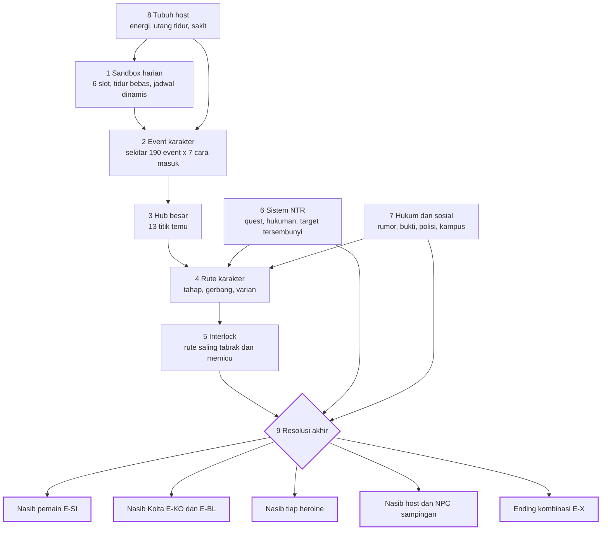
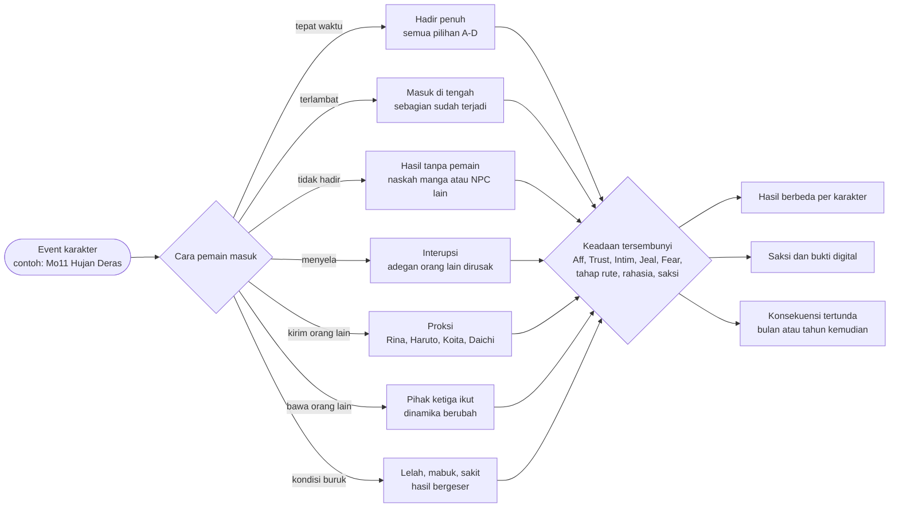
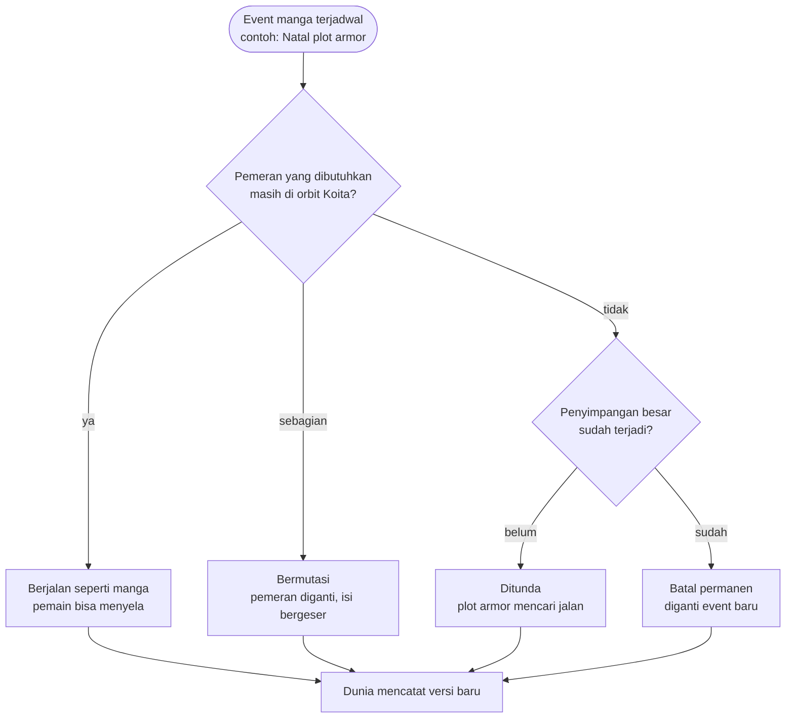
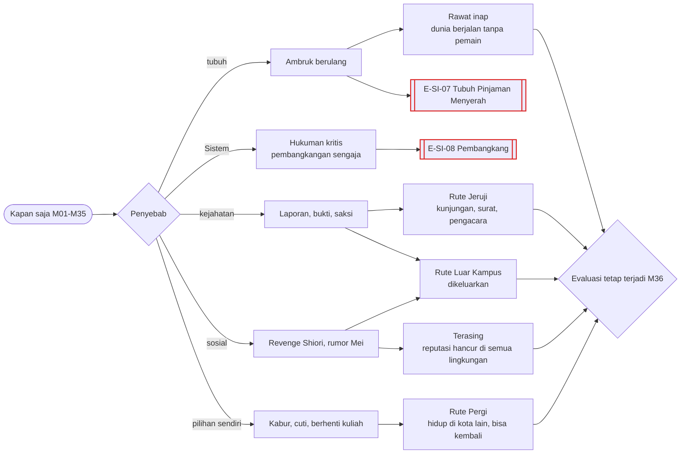

# Pohon Global — tulang punggung tiga tahun

Status: 🟡 usulan di atas canon ✅ (GDD 6B, 6H, 6I, 6N) dan keputusanmu ⭐.

## 1. Bentuk pohon
Kouseikan bukan satu batang dengan beberapa ranting. Ia **hutan berlapis**: sembilan lapisan yang saling memengaruhi. Setiap hari di sandbox bisa menggeser event; setiap event bisa menggeser rute; setiap rute bisa menabrak rute lain; dan semuanya baru "ditagih" saat evaluasi di wisuda.

Lima aturan yang membuat cabang berlipat:
1. **Tujuh cara masuk** ke setiap event (bagian 4), bukan hanya pilihan A/B/C di dalamnya.
2. **Enam rute khusus bisa aktif bersamaan** (✅ GDD 6B.5), jadi kombinasinya berlipat, bukan bertambah.
3. **Ending disusun komposit:** nasib pemain, hati pemain, Koita, tiap heroine, host, dan NPC sampingan ditentukan terpisah lalu dirangkai (lihat [13_Katalog_Ending.md](13_Katalog_Ending.md)).
4. **Dua jenis cabang** ⭐: cabang pemicu yang mengarah ke event tertentu, dan cabang akumulasi yang menggeser poin sampai melewati ambang. Arah ending ditarik oleh akumulasi dan bisa dibelokkan sampai resolusi ([Sistem_Cabang_dan_Poin.md](../Sistem_Cabang_dan_Poin.md)).
5. **Pilihan muncul sedikit demi sedikit** ⭐, dan event dinamis (`Mi-D01`, `X-D01`, dan seterusnya) muncul saat poin memenuhi syarat, bukan pada tanggal tetap.

## 2. Tulang punggung tiga tahun

```mermaid
flowchart LR
  classDef gerbang stroke:#ea580c,stroke-width:3px
  classDef titik stroke:#dc2626,stroke-width:2px,stroke-dasharray:6 3
  classDef ending stroke:#9333ea,stroke-width:2px
  classDef bahaya stroke:#dc2626,stroke-width:2px
  START(["Pilih tubuh"]) -->|laki-laki| MR["Male Route<br/>Yutaka, apartemen mewah"]
  START -->|perempuan| FR["Female Route<br/>Chiasa, rumah Amamiya"]
  MR --> PR["M01 Prolog<br/>kontrak Sistem aktif"]
  FR --> PR
  subgraph T1["Tahun 1 · Kontrak"]
    PR --> H12{{"Hub 1-2 · Hanabi dan vila M05"}}
    H12 --> H3{{"Hub 3 · Natal pertama M09"}}
    H3 --> H4{{"Hub 4 · Valentine M11"}}
    H4 --> AU1["M12 Audit 1: hanya kesan"]
  end
  subgraph T2["Tahun 2 · Retak"]
    AU1 --> GR{{"Gerbang rute M15-M21<br/>enam rute bisa aktif bersamaan"}}
    GR --> KS["M19 Koita menyadari<br/>manuver balik"]
    KS --> H8{{"Hub 8 · Pengakuan Bentrok M23"}}
    H8 --> AU2["M24 Audit 2<br/>peringatan pertama"]
  end
  subgraph T3["Tahun 3 · Tagihan"]
    AU2 --> PNR>"M24-M27 titik tanpa balik"]
    PNR --> PF["M33 Peringatan Final"]
    PF --> MTB>"M34 Malam Tanpa Balasan"]
    MTB --> H13{{"Hub 13 · Puncak M35"}}
  end
  H13 --> EV{"M36 Evaluasi<br/>saat Koita menerima ijazah"}
  EV -->|lolos| HID["Pemain hidup"]
  EV -->|gagal| MATI["Pemain mati"]
  HID --> EP[["Epilog komposit"]]
  MATI --> EP
  T1 -.->|tubuh, hukuman, kejahatan| KELUAR["Pintu keluar awal<br/>bagian 6"]
  T2 -.-> KELUAR
  T3 -.-> KELUAR
  KELUAR -.->|dunia tetap berjalan| EV
  class H12,H3,H4,GR,H8,H13 gerbang
  class PNR,MTB titik
  class EP ending
  class MATI,KELUAR bahaya
```

## 3. Sembilan lapisan

| Lapisan | Isi | Dokumen |
|---|---|---|
| 1 Sandbox | hari, malam, tidur, jadwal dinamis, kerja, kuliah, belanja | [Sistem_Waktu_Bebas_dan_Kondisi_Fisik.md](../Sistem_Waktu_Bebas_dan_Kondisi_Fisik.md) |
| 2 Event karakter | K/Y/C/Mi/N/H/Mo/S | `Karakter/<nama>/Event_<nama>.md` |
| 3 Hub | 13 hub besar | [Milestone_3_Tahun.md](../Milestone_3_Tahun.md) |
| 4 Rute | 6 rute khusus + Koita/BL + host + sampingan | file 01–08, 11 |
| 5 Interlock | tabrakan dan rantai reaksi | file 12 |
| 6 Sistem | sikap pemain pada Sistem, hukuman, evaluasi | file 10 |
| 7 Hukum dan sosial | Force, kejahatan lain, rumor | file 09 |
| 8 Tubuh | tidak tidur, sakit, cedera | dokumen sistem |
| 9 Resolusi | epilog komposit | file 13 |

## 4. Template cabang event: tujuh cara masuk
Setiap event karakter punya tujuh cara masuk. Pilihan A/B/C/D di file Event hanyalah isi dari cara pertama.

| Cara masuk | Aturan 🟡 |
|---|---|
| Tepat waktu | semua pilihan event tersedia |
| Terlambat | sebagian adegan sudah terjadi; pemain melihat akibatnya dan memilih dari sisa |
| Tidak hadir | event berjalan dengan naskah manga atau NPC lain (✅ 6E.4); pemain tahu belakangan, atau tidak pernah |
| Menyela | pemain memotong adegan orang lain (pengakuan, kencan, konfrontasi); risiko Jealousy dan Fear |
| Kirim orang lain | pemain meminta NPC lain datang (Rina ke Moeka, Haruto ke Nagisa, Koita sendiri); hasil mengikuti hubungan NPC itu |
| Bawa orang lain | pemain datang bersama pihak ketiga; bisa menenangkan, bisa memicu cemburu |
| Kondisi buruk | lelah, mabuk, sakit, atau sedang dihukum Sistem; pilihan sama, hasil bergeser |

Hitungan kasar: sekitar 190 event × 7 cara masuk × rata-rata 3–4 pilihan ≈ **5.000 hasil lokal** sebelum keadaan tersembunyi ikut dihitung.

## 5. Event manga setelah penyimpangan
Menjawab ❓ lama di Milestone §7. Dasarnya ✅ GDD 6H (event manga sebagian besar berjalan sampai penyimpangan besar) dan ✅ 6N.2 (pemain bisa mengubah hasil akhir manga sepenuhnya). Keputusanmu untuk cabang sebebas mungkin ⭐ berarti **event manga boleh batal permanen**.

**Penyimpangan besar** 🟡 = salah satu dari: heroine utama berhenti mencintai Koita; Koita memilih seseorang; ada kematian; ada kasus kriminal terbuka; rahasia besar terbongkar ke publik.

### Plot armor Koita (✅ arah, 🟡 aturan)
- Tiap minggu plot armor membuat 1–3 **kebetulan** untuk Koita dengan heroine yang paling siap (Affection pada Koita tertinggi di antara yang masih di orbitnya).
- Pemain bisa menemukan kebetulan itu lewat pola, jejak, atau Sistem. Datang lebih dulu berarti **mencuri** momen itu atau **merusaknya**.
- Plot armor tidak bisa memaksa cinta (✅). Bila sering dicuri, kebetulan berikutnya lebih kuat, tetapi tetap hanya peluang.
- Bila Koita diberi tahu ia tokoh manga dan percaya, plot armor "melawan" selama sebulan (lihat file 07 dan 10).

## 6. Pintu keluar awal: gagal bukan Game Over

| Mode lanjutan 🟡 | Yang masih bisa dilakukan |
|---|---|
| **Rute Jeruji** | menerima kunjungan; menulis surat; telepon terbatas; melihat siapa yang masih datang; pengacara dan proses hukum. Evaluasi tetap terjadi di dalam sel. |
| **Rute Luar Kampus** | tinggal di kota; tidak bisa masuk kampus secara resmi; kerja; heroine tetap bisa ditemui di luar kampus; menyusup ke kampus = risiko baru. |
| **Terasing** | semua lingkungan menjauh; hanya sedikit orang yang tetap peduli. Siapa mereka adalah petunjuk hati. |
| **Rute Pergi** | pindah kota sementara atau selamanya. Quest Sistem tetap jalan dari jauh. Kabur untuk menghindari quest dihitung **pembangkangan**. |
| **Rawat inap** | dunia berjalan; pengunjung dan pesan menjadi isi permainan; pemain bisa kabur dari RS (risiko tubuh). |

**Evaluasi terjadi di mana pun pemain berada** 🟡: di sel, di RS, atau di kota lain, saat Koita menerima ijazah.

## 7. Tidak ada target yang dipilih ⭐
Tidak ada rute atau target yang ditentukan di awal, baik oleh pemain maupun Sistem. Semua tindakan bisa mengarah ke rute mana saja, atau tidak ke rute mana pun dan berakhir tanpa siapa-siapa (E-HP-03, E-HP-05). Yang tersembunyi (✅ 6G.1) adalah apa yang dihitung Sistem dan ambangnya; Sistem baru membacakannya saat evaluasi. Rincian di [10_Sistem_dan_Evaluasi.md](10_Sistem_dan_Evaluasi.md) §5.
