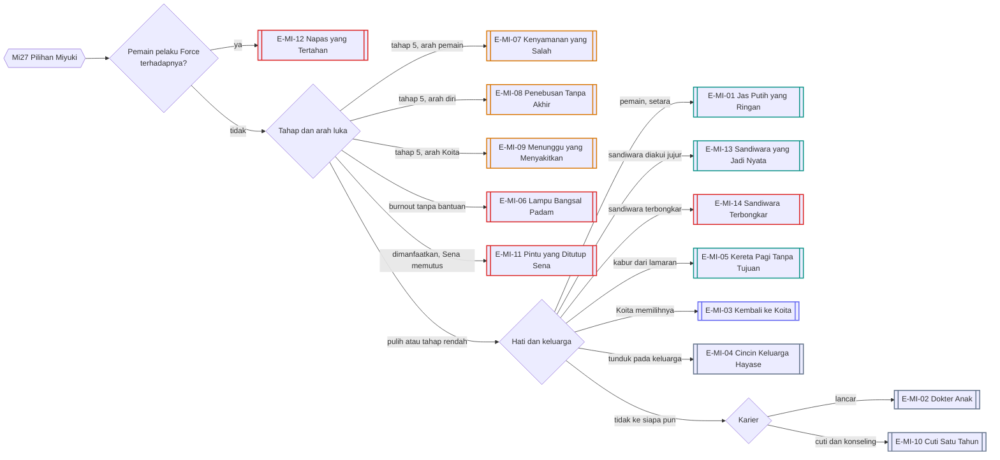

# Alur Cabang 01 — Tachibana Miyuki (Rute Masokis)

Status: 🟡 usulan. Dasar ✅ GDD 6B.2: Miyuki bisa menjadi masokis secara emosional sekaligus romantis/seksual; ia mengasosiasikan perlakuan buruk dengan perhatian dan tertarik pada dinamika dominasi–penyerahan. Teks dewasa tersirat, tanpa ilustrasi eksplisit ⭐.
Event: [Event_Miyuki.md](../../Karakter/Tachibana_Miyuki/Event_Miyuki.md). Bulan: [Milestone_3_Tahun.md](../Milestone_3_Tahun.md).

## 1. Bentuk pohon
Rute Miyuki bercabang di **arah lukanya**. Gerbang Mi16 tidak hanya bertanya "masokis atau tidak", tetapi **kepada siapa** rasa sakit itu menempel: pemain, Koita, atau dirinya sendiri. Di atas itu ada tiga tekanan yang berjalan sendiri: kelelahan klinik, omiai keluarga Hayase, dan sandiwara pasangan palsu bila pemain memulainya. Hasilnya 14 ending, ditambah varian host.

## 2. Sumbu cabang
| Sumbu | Nilai | Digerakkan oleh |
|---|---|---|
| `miyuki_stage` | 0 tenang, 1 kelelahan, 2 dimarahi = diperhatikan, 3 normalisasi, 4 gerbang masokis, 5 pola menetap | Mi03, Mi12, Mi14, Mi15, Mi16, Mi22 |
| `arah_luka` (baru) | pemain / Koita / diri sendiri / tidak ada | siapa yang menegur, mendinginkan, atau menghibur di Mi16 |
| `kelelahan` | rendah sampai burnout | klinik, orang tua, bantuan atau gangguan pemain |
| `omiai_takeru` | tidak ada / dibuka / ditekan / bertunangan / batal | Mi07, Mi18, Mi25 |
| `pasangan_palsu` (baru) | tidak / aktif / terbongkar / jadi nyata | Mi09-B, Mi18 |
| Hati | Koita / pemain / tidak ada | akumulasi, K26 |
| Dukungan | Sena sekutu atau lawan; Sato; orang tua menekan atau melunak | Mi08, Mi17, Mi23, Mi26 |
| Karier | lancar / terancam / cuti / berhenti | Mi16, Mi24 |
| `rahasia_koita_sma` (baru) | Miyuki tahu atau tidak bahwa Koita pernah menyukainya | pemain membukanya (sumber: Koita saat lelah atau mabuk, Matsuda, draf tulisan Koita) |

## 3. Diagram utama

```mermaid
flowchart LR
  classDef gerbang stroke:#ea580c,stroke-width:3px
  classDef titik stroke:#dc2626,stroke-width:2px,stroke-dasharray:6 3
  classDef romantis stroke:#0d9488,stroke-width:2px
  classDef distorsi stroke:#d97706,stroke-width:2px
  classDef buruk stroke:#dc2626,stroke-width:2px
  classDef koita stroke:#6366f1,stroke-width:2px
  S(["M01b Mi01 Bento Hanami<br/>senpai yang sempurna"])
  subgraph T1["Tahun 1 · kelelahan yang belum disadari"]
    MA["Dimanja<br/>Mi02-C, Mi11"]
    MB["Kelelahan tahap 1<br/>Mi03 perpustakaan malam"]
    MC["Omiai dibuka<br/>Mi07 Hayase Takeru"]
    MD["Jalur bantuan dikenal<br/>Mi08 Sato Kyoko"]
    MP["Pasangan palsu<br/>Mi09-B pesta RS"]
    MS["Rahasia Koita SMA<br/>dibuka pemain"]
  end
  MF["Force di vila Mi05-C<br/>file 09"]
  S --> MA
  S --> MB
  S --> MC
  MB --> MD
  MC -->|pemain berpura-pura| MP
  S -.->|bila ditemukan| MS
  S -.->|kejahatan| MF
  subgraph T2["Tahun 2 · pola terbentuk"]
    K2["Mi12 klinik dimulai<br/>tahap 2"]
    W["Mi14 dimarahi = diperhatikan"]
    N3["Mi15 minta maaf berlebihan<br/>tahap 3"]
    G{{"Mi16 Kesalahan di Bangsal<br/>GERBANG M19"}}
    GA["A dihibur<br/>tertahan di tahap 3"]
    GB["B ditegur keras<br/>arah luka: pemain"]
    GC["C didinginkan<br/>arah luka: diri sendiri"]
    GD["D dibawa ke Sena/Sato<br/>jalur pulih"]
    GX["Pemain tidak ada<br/>Koita menghibur lalu menggantung<br/>arah luka: Koita"]
    PG["Mi17 pingsan di pameran"]
    PH["Mi18 lamaran terselubung<br/>sandiwara diuji"]
    AU["Mi20 audit pribadi<br/>titik pulih terakhir T2"]
  end
  MA --> K2
  MB --> K2
  MD --> K2
  MS -->|ia menegur Koita| K2
  MS -->|ia menyalahkan diri| GC
  K2 --> W --> N3 --> G
  G --> GA
  G --> GB
  G --> GC
  G --> GD
  G --> GX
  GA --> PG
  GB --> PG
  GC --> PG
  GX --> PG
  PG -->|UGD, Sena sekutu| AU
  PG -->|dimanfaatkan, Sena curiga| AU
  GD --> AU
  MC --> PH
  MP --> PH
  PH --> AU
  subgraph T3["Tahun 3 · menetap atau pulih"]
    P5{"Mi22 pola menetap<br/>tahap 5?"}
    PN>"Satu semester tanpa intervensi<br/>pola permanen"]
    PU["Pulih sebagian<br/>Sena, Sato, keluarga"]
    PB["Dihentikan mendadak<br/>merasa dibuang"]
    CBT{"Mi24 hasil CBT"}
    LM{"Mi25 lamaran Takeru"}
    SE["Mi26 Sena memihak<br/>atau melawan"]
    R{{"Mi27 Pilihan Miyuki M35"}}
  end
  AU -->|tidak ada bantuan| P5
  AU -->|bantuan diterima| PU
  P5 -->|lanjutkan| PN
  P5 -->|hentikan| PB
  P5 -->|bawa ke Sato| PU
  PB -->|kelelahan naik| CBT
  PN --> CBT
  PU --> CBT
  CBT --> LM
  LM --> SE
  SE --> R
  class G,R gerbang
  class PN titik
  class GD,PU romantis
  class GB,GC distorsi
  class GX koita
  class MF buruk
```

## 4. Garis besar cabang per fase

### Tahun 1 — benih
- **Dimanja (Mi02-C, Mi11):** pemain membuat Miyuki merasa boleh dimanja. Ini benih sehat. Bila nanti pemain mendominasi tanpa kehangatan, benih ini berbalik menjadi "aku hanya boleh dimanja kalau dihukum dulu".
- **Kelelahan (Mi03):** tiga cara masuk penting: membawakan makanan jam 01:00 (Trust), memaksa pulang (ia patuh tapi merasa gagal), menemani diam (Intimacy). Tidak hadir berarti Sena yang menemaninya dan `sena_curiga` mulai.
- **Omiai (Mi07):** mendukung Takeru, menghalangi, atau jujur. Menghalangi tanpa memberi alternatif membuat orang tua menekan lebih keras.
- **Pasangan palsu (Mi09-B):** pemain berpura-pura jadi kekasih di pesta RS. Omiai tertunda, tetapi kebohongan ini hidup sendiri: orang tua mengundang pemain makan malam, Takeru menyelidiki, Shiori bisa mencatatnya sebagai kebohongan bila ia tahu.
- **Rahasia Koita SMA:** bila pemain menemukan dan membukanya, Miyuki memilih tiga arah: menegur Koita (pola Koita terbongkar di matanya), tidak percaya, atau menyalahkan diri ("aku tidak menyadarinya") yang langsung mengisi `arah_luka: diri`.
- **Force (Mi05-C):** keluar ke [09_Force_dan_Kriminal.md](09_Force_dan_Kriminal.md). Tidak memicu Rute Masokis secara otomatis (aturan 🟡 di Aturan_Evaluasi §3.3).

### Tahun 2 — gerbang Mi16
- Mi12 dan Mi14 membangun tahap 2: teguran supervisor terasa seperti perhatian.
- Mi15 (tahap 3): permintaan maaf berlebihan. Menegur halus menahan laju; membiarkan atau memanfaatkan mempercepatnya.
- **Mi16 Kesalahan di Bangsal** punya lima keluaran: A dihibur, B ditegur keras, C didinginkan, D dibawa ke Sena/Sato, dan **pemain tidak ada** (Koita datang lewat plot armor, menghibur, lalu menggantung lagi). Empat dari lima menentukan `arah_luka` yang berbeda.
- Mi17 Pingsan: membawa ke UGD menjadikan Sena sekutu; memanfaatkan momen membuat Sena memasang jarak.
- Mi18: lamaran terselubung keluarga Hayase. Sandiwara pasangan palsu diuji di depan dua keluarga: dipertahankan, dibongkar sendiri, atau terbongkar oleh Takeru.
- Mi20: titik pulih terakhir sebelum Tahun 3.

### Tahun 3 — menetap atau pulih
- Mi22: pola tahap 5. Melanjutkan selama satu semester tanpa intervensi mengunci pola (titik tanpa balik). Menghentikan mendadak membuat Miyuki merasa dibuang dan kelelahannya melonjak. Membawanya ke Sato membuka pulih sebagian.
- Mi23: Sena memutus hubungan bila pemain memanfaatkan Miyuki di depan umum.
- Mi24: hasil CBT dihitung dari `kelelahan` dan dukungan. Gagal membuka jalur cuti atau berhenti.
- Mi25: lamaran Takeru. Mendukung, menghalangi, atau mengajak kabur.
- Mi26: Sena memilih sisi.

## 5. Diagram resolusi ending

## 6. Varian host
| Titik | Yutaka (Y) | Chiasa (C) |
|---|---|---|
| Awal | Miyuki melihatnya sebagai adik tingkat jahil | Miyuki belum pernah mempertimbangkan perempuan; butuh waktu |
| Pasangan palsu | menghentikan omiai sementara | orang tua menganggapnya "teman dekat", omiai tetap jalan, kecuali Chiasa menyatakan terbuka. Ibu Miyuki lalu terkejut, lalu strategis |
| Dominasi | dominasi Yutaka cepat menggeser `arah_luka` ke pemain | dominasi Chiasa (✅ canon dominan) lebih halus, tetapi efeknya sama kuat |
| Ending romantis | E-MI-01, -05, -13 versi Yutaka | versi Chiasa: orang tua Tachibana bereaksi lebih keras; Sena justru lebih cepat menerima |

## 7. Malam dan tubuh
- Tahun 3 Miyuki jaga malam di RS Tachibana. Pemain yang datang jam 03:00 bisa menemukannya menangis di tangga darurat (tahap 4) atau bertemu Hayase yang juga jaga. Ini adegan persaingan tanpa pesta.
- Ayah Moeka (Kohinata Shuji) cuci darah di RS Tachibana 🟡. Miyuki tahu kondisinya memburuk sebelum Moeka tahu. Ia bisa membocorkannya kepada pemain (melanggar etika, ia merasa bersalah) atau diam. Ini sambungan langsung ke [04_Moeka_DeathFlag.md](04_Moeka_DeathFlag.md).
- Bila **pemain Ambruk** di dekat Miyuki: pada tahap 0–3 merawat pemain membuatnya "dibutuhkan dengan sehat" (dorongan pulih). Pada tahap 4–5 ia menambahkan pemain ke daftar beban dan kelelahannya naik.
- Pemain yang Sangat Lelah kehilangan petunjuk halus Miyuki (tangan gemetar, senyum yang terlalu rapi).

## 8. Ending
| Kode | Nama | Jenis | Host | Syarat inti | Isi |
|---|---|---|---|---|---|
| E-MI-01 | Jas Putih yang Ringan | Romantis | Y/C | tahap ≤ 3 atau pulih; Affection dan Trust tinggi ke pemain; tanpa Force; Sena tidak memusuhi | hubungan setara; ia belajar meminta tolong dan tetap menuju pediatri |
| E-MI-02 | Dokter Anak | Neutral | Y/C | tahap ≤ 2; karier lancar; hati tidak ke siapa pun | lulus, fokus pediatri, hangat pada semua tetapi sendiri |
| E-MI-03 | Kembali ke Koita | Koita | Y/C | Koita memilih Miyuki di K26; tahap ≤ 3 | jalur manga; deviasi rendah untuk Miyuki |
| E-MI-04 | Cincin Keluarga Hayase | Neutral | Y/C | Mi25-A atau pemain absen; omiai ditekan | bertunangan demi keluarga; senyum yang rapi; ikatan sosial, bukan pasangan romantis baru |
| E-MI-05 | Kereta Pagi Tanpa Tujuan | Romantis | Y/C | Mi25-C kabur bersama pemain | orang tua memutus hubungan; karier tertunda; cinta yang mahal |
| E-MI-06 | Lampu Bangsal Padam | Bad | Y/C | kelelahan ekstrem; tanpa bantuan; CBT gagal | burnout; berhenti dari kedokteran |
| E-MI-07 | Kenyamanan yang Salah | Distorted | Y/C | tahap 5 permanen; `arah_luka` pemain | hubungan "nyaman" yang tidak sehat; ia hanya merasa dicintai saat diperlakukan keras |
| E-MI-08 | Penebusan Tanpa Akhir | Distorted | Y/C | tahap 5; `arah_luka` diri | lulus dan bekerja, tetapi menghukum diri lewat jam kerja tanpa batas |
| E-MI-09 | Menunggu yang Menyakitkan | Distorted | Y/C | tahap 5; `arah_luka` Koita; Koita tetap menggantung | ia bertahan di sisi Koita justru karena sakitnya |
| E-MI-10 | Cuti Satu Tahun | Neutral | Y/C | pulih sebagian lewat Sato; CBT tertunda | cuti kuliah; masa depan terbuka; pesan pendek untuk pemain di musim semi |
| E-MI-11 | Pintu yang Ditutup Sena | Bad | Y/C | pemain memanfaatkan di depan umum; Sena memutus | Miyuki terisolasi; Sena menjadi penghalang pemain di semua lingkungan medis |
| E-MI-12 | Napas yang Tertahan | Broken | Y/C | pemain pelaku Force terhadapnya | trauma terpisah dari Rute Masokis; jalur Sena, Sato, dan hukum; tanpa romansa dengan pelaku |
| E-MI-13 | Sandiwara yang Jadi Nyata | Romantis | Y/C | pasangan palsu dipertahankan sampai Mi18, lalu diakui jujur | dua keluarga marah lalu menerima; awal yang bohong menjadi hubungan yang jujur |
| E-MI-14 | Sandiwara Terbongkar | Bad | Y/C | pasangan palsu terbongkar oleh Takeru atau orang tua | malu di depan keluarga; Miyuki menjauh dari pemain dan menerima omiai |

## 9. Interlock
- **Moeka:** Miyuki bisa menjadi penolong Moeka (mengenali tanda bahaya sebagai calon dokter) bila kelelahannya sendiri rendah. Bila burnout, ia tidak melihat apa-apa.
- **Nagisa:** kelompok belajar SMA; Nagisa cemburu pada kedewasaan Miyuki. Pada Rute Yandere tahap 4+, Miyuki bisa menjadi sasaran sabotase.
- **Koita:** rahasia SMA Koita adalah granat. Membukanya bisa menghancurkan Koita di mata Miyuki (deviasi naik) atau justru menyalakan kembali cintanya (E-MI-03 menguat).
- **Shiori:** pasangan palsu adalah kebohongan; bila Shiori tahu dan peduli pada Miyuki, kebohongan ini bisa memicu S13.

## 10. Poin dan ambang
Skala dan aturan umum: [Sistem_Cabang_dan_Poin.md](../Sistem_Cabang_dan_Poin.md) §2–§3. Semua tersembunyi dari pemain.

| Poin | Awal | Naik karena | Turun karena | Ambang dan akibat |
|---|---|---|---|---|
| `kelelahan` | 35 | klinik +3/minggu (Tahun 2+); Mi13 +8; pemain meminta tolong padanya +5; jaga malam beruntun +10; Mi16 +15 | dibawakan makanan atau disuruh tidur saat Trust Sedang −8; dimasakkan −5; sesi Sato −15; libur penuh −20 | 45: narasi menyebut kantung mata, pilihan "Paksa dia tidur" muncul · 60: Mi-D02, mudah sakit · 75: Mi17 pasti terjadi, CBT terancam · 90: Mi-D10, E-MI-06 menguat tajam |
| `dimanja` | 10 | dimasakkan; tasnya dibawakan; dibiarkan bersandar; pastry-nya dipuji dengan spesifik | hanya ditegur; diabaikan | 30: pilihan "Biarkan dia bermanja" · 50: Mi-D01 · 70: E-MI-01 menguat. Selama `dimanja` ≥ luka tertinggi, arah luka tidak bisa menetap |
| `luka[pemain]` | 0 | ditegur keras; diejek; didominasi tanpa kehangatan; dimanfaatkan setelah Mi14 | dihibur; minta maaf yang diikuti perubahan; Mi-D06 ditolak dengan lembut | 40: Mi-D06 · 50 saat Mi16: arah luka ke pemain · 70: tahap 4 · 85 selama satu semester: tahap 5 permanen |
| `luka[koita]` | 10 | Koita menghibur lalu menggantung; plot armor memberi momen lalu Koita mundur | Koita berhenti menggantung; Miyuki menegur Koita | 50 saat Mi16: arah luka ke Koita · 70: E-MI-09 menguat |
| `luka[diri]` | 15 | kesalahan tanpa ada yang menghibur; didinginkan; rahasia SMA Koita membuatnya menyalahkan diri | Mi-D05 ditemani; Mi-D09 didukung; Sato | 50 saat Mi16: arah luka ke diri sendiri · 70: E-MI-08 menguat |
| `cinta_koita` | 75 | momen plot armor; Koita jujur padanya | Koita menggantung; kehadiran pemain yang hangat; rahasia SMA bila ia kesal | < 50: harapan goyah · < 30: E-MI-03 tertutup |
| `omiai_takeru` | 0 | tekanan orang tua tiap bulan; pemain absen di Mi09 atau Mi18 | alternatif dari pemain; pasangan palsu (Y); Mi-D12 | 40: Takeru datang ke RS tiap akhir pekan, Mi-D07 · 70: lamaran Mi25 terjadi · 90: pertunangan nyaris pasti kecuali Mi25-B/C |
| `sena_curiga` | 10 | Miyuki memburuk setelah bersama pemain; pemain memanfaatkan | pemain membawa Miyuki ke Sena atau Sato; jujur pada Sena | 40: Sena mengawasi · 60: Sena menegur pemain · 80: Mi23 memutus bila pemain memanfaatkan |
| `karier` | 70 | dibantu belajar; istirahat cukup; Mi-D09 didukung | kelelahan tinggi; Mi16; Mi-D10 disembunyikan | < 40: CBT kemungkinan gagal · < 25: risiko berhenti kuliah |

Turunan: `arah_luka` = luka tertinggi. Ditetapkan di Mi16 dan masih bisa bergeser sampai pola menetap.

## 11. Event dinamis
Muncul saat syaratnya terpenuhi, bukan pada tanggal tetap. Tiap event tetap punya tujuh cara masuk ([00_Pohon_Global.md](00_Pohon_Global.md) §4).

| ID | Nama | Syarat | Isi dan cabang | Efek |
|---|---|---|---|---|
| Mi-D01 | Permintaan Kecil | `dimanja` ≥ 50; Trust Sedang | jam 23:00 Miyuki minta dibelikan puding konbini, "sekali ini saja". Belikan dan temani / belikan lalu pergi / tolak / tertawakan | `dimanja` +10 / +5 / −5 / −10; Intim |
| Mi-D02 | Tertidur di Bahu | kelelahan ≥ 60; pemain duduk di dekatnya | ia tertidur di bahu pemain di perpustakaan atau kereta. Biarkan sampai bangun (dua jam lewat) / bangunkan / foto / pindahkan ke ruang jaga | Intim +, kelelahan −5; foto bisa sampai ke Mei |
| Mi-D03 | Pastry dengan Nama | Aff ≥ 55; pemain pernah memuji pastry-nya | pastry bertuliskan nama pemain. Makan di depan Koita / sembunyikan / bagikan ke semua | Koita mencatat; Nagisa cemburu bila melihat |
| Mi-D04 | Telepon Ibu yang Terdengar | pemain bersamanya Sabtu malam; `omiai_takeru` ≥ 40 | Sayuri menelepon soal Hayase. Pura-pura tidak dengar / tanya setelahnya / minta bicara dengan ibunya | `omiai_takeru` ±; Trust; bicara dengan ibunya membuka hubungan pemain dengan keluarga Tachibana |
| Mi-D05 | Tangga Darurat Jam Tiga | Tahun 3; jaga malam; `luka[diri]` ≥ 50; pemain di RS saat Dini Hari | ia duduk sendirian di tangga darurat. Duduk di sebelahnya / panggil Sena / pergi diam-diam | `luka[diri]` −15 / Sena menjadi sekutu / tidak ada |
| Mi-D06 | Teguran yang Ia Minta | tahap ≥ 3; `luka[pemain]` ≥ 40 | "Bilang aku bodoh. Aku pantas." Tolak dengan lembut / turuti / alihkan / bawa ke Sato | persimpangan utama; lihat Sistem_Cabang_dan_Poin §5.3 |
| Mi-D07 | Hayase di Kafe | `omiai_takeru` ≥ 40; pemain di Kafe Komorebi hari Sabtu | Takeru mengajak bicara. Hadapi / bersekutu / pancing ia jujur / rekam diam-diam | Takeru bisa mengaku ia tidak mencintai Miyuki; rekaman menjadi bukti sekaligus risiko |
| Mi-D08 | Rahasia di Konbini | Koita lelah atau mabuk; `koita_sadar` ≥ 25 | jam 03:00 Koita mengaku pernah menyukai Miyuki di SMA. Simpan / ceritakan ke Miyuki / pakai untuk menekan Koita / dorong Koita mengaku sendiri | bendera `rahasia_koita_sma`; bila Koita mengaku sendiri, `cinta_koita` bisa +20 atau Miyuki justru kesal, tergantung tahapnya |
| Mi-D09 | Pasien Kecil | rotasi pediatri Tahun 3; Aff Sedang | pasien anak yang ia sayangi memburuk. Datang ke RS / telepon / tidak bisa datang | didukung: `luka[diri]` −, karier +; ia merasa dibutuhkan dengan cara yang sehat |
| Mi-D10 | Resep yang Salah Tulis | kelelahan ≥ 85 | hampir salah menulis resep; Sena menangkapnya. Paksa ia cuti / bantu menyembunyikan / laporkan ke pembimbing | menyembunyikan lalu ketahuan: E-MI-06 menguat; cuti: E-MI-10 menguat |
| Mi-D11 | Malam Sebelum CBT | minggu M30 | temani belajar semalaman (tubuh pemain) / bawakan makanan lalu pulang / tidak datang | hasil Mi24 bergeser |
| Mi-D12 | Ia Memilih Dirinya | `dimanja` ≥ 70; semua luka < 30; Trust ≥ 70 | untuk pertama kali ia berkata "tidak" pada ibunya. Dukung / goda / bilang itu berkat pemain | `omiai_takeru` −30; E-MI-01 dan E-MI-02 menguat |
| Mi-D13 | Pertanyaan yang Belum Pernah Ia Tanyakan | Chiasa host; Intim ≥ 55 | Miyuki bertanya pada dirinya sendiri apakah ia tertarik pada perempuan. Beri waktu / desak / bercanda | Aff, Intim; desakan menurunkan Trust |
| Mi-D14 | Jaga untuk Pemain | pemain Ambruk atau sakit; tahap ≤ 3 | Miyuki merawat pemain semalaman. Terima / tolak / minta ia pulang tidur | tahap ≤ 3: ia merasa dibutuhkan dengan sehat; tahap 4+: kelelahan naik |

## 12. Belok ke ending lain
Setiap panah adalah belok yang masih bisa terjadi sampai resolusi M35. Pola menetap satu semester (titik tanpa balik) menutup ending pulih (E-MI-01, -02, -10, -13); ending lain tetap bersaing.

```mermaid
flowchart LR
  classDef romantis stroke:#0d9488,stroke-width:2px
  classDef netral stroke:#64748b,stroke-width:2px
  classDef distorsi stroke:#d97706,stroke-width:2px
  classDef buruk stroke:#dc2626,stroke-width:2px
  classDef koita stroke:#6366f1,stroke-width:2px
  E07[["E-MI-07 Kenyamanan yang Salah"]] -->|Mi-D06 ditolak lembut berulang| E01[["E-MI-01 Jas Putih yang Ringan"]]
  E07 -->|Sato sebelum pola menetap| E10[["E-MI-10 Cuti Satu Tahun"]]
  E01 -->|dominasi tanpa kehangatan| E07
  E01 -->|dimanfaatkan di depan umum| E11[["E-MI-11 Pintu yang Ditutup Sena"]]
  E08[["E-MI-08 Penebusan Tanpa Akhir"]] -->|kelelahan 90| E06[["E-MI-06 Lampu Bangsal Padam"]]
  E08 -->|Mi-D09 didukung| E02[["E-MI-02 Dokter Anak"]]
  E09[["E-MI-09 Menunggu yang Menyakitkan"]] -->|Koita berhenti menggantung| E03[["E-MI-03 Kembali ke Koita"]]
  E09 -->|rahasia SMA membuatnya menyalahkan diri| E08
  E03 -->|cinta Koita di bawah 30| E02
  E04[["E-MI-04 Cincin Keluarga Hayase"]] -->|Mi25-C kabur| E05[["E-MI-05 Kereta Pagi Tanpa Tujuan"]]
  E04 -->|Mi-D12 ia menolak ibunya| E02
  E13[["E-MI-13 Sandiwara yang Jadi Nyata"]] -->|Takeru membongkar lebih dulu| E14[["E-MI-14 Sandiwara Terbongkar"]]
  E14 -->|malu lalu menerima omiai| E04
  E06 -->|Mi-D10 dipaksa cuti| E10
  E10 -->|pemain menunggu dan jujur| E01
  E02 -.->|lintas rute: pemain dan Sena menjaganya| NP1[["E-NPC-01 Dua Jas Putih"]]
  class E01,E05,E13,NP1 romantis
  class E02,E04,E10 netral
  class E07,E08,E09 distorsi
  class E06,E11,E14 buruk
  class E03 koita
```

