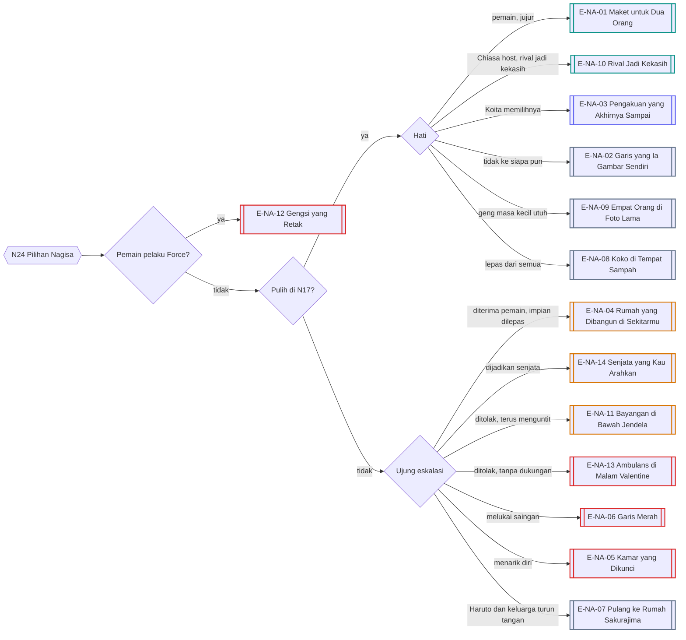
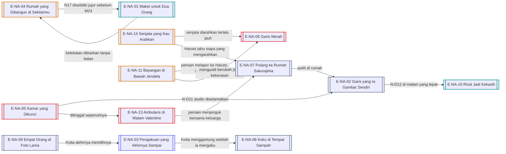

# Alur Cabang 02 — Sakurajima Nagisa (Rute Yandere)

Status: 🟡 usulan. Dasar ✅ GDD 6B.2: pusat obsesi Nagisa di rute ini adalah **pemain**, bukan Koita; cinta, cemburu, dan takut kehilangan berkembang menjadi obsesi dan perilaku posesif.
Event: [Event_Nagisa.md](../../Karakter/Sakurajima_Nagisa/Event_Nagisa.md).

## 1. Bentuk pohon
Rute Nagisa adalah **tangga eskalasi** dengan banyak pintu samping. Setiap anak tangga (sabotase, pengawasan, ultimatum, pemerasan emosional, kekerasan) punya pintu keluar: Haruto, orang tua, pemain sendiri, atau kehancuran. Cabang terbesar ditentukan oleh **siapa yang ia anggap saingan** dan **apakah pemain memanfaatkan obsesinya** sebagai senjata terhadap heroine Koita. 14 ending.

## 2. Sumbu cabang
| Sumbu | Nilai | Digerakkan oleh |
|---|---|---|
| `nagisa_stage` | 0 gengsi, 1 terima kasih, 2 kelekatan, 3 posesif, 4 ultimatum, 5 eskalasi | N03, N06, N14, N15, N18 |
| `harapan_koita` | tegak / goyah / padam | N04, N07, N16, K-event |
| `aff_pemain`, `jeal_nagisa` | rendah sampai sangat tinggi | akumulasi |
| `sasaran_cemburu` (baru) | Chiasa / Moeka / Miyuki / Shiori / Harumi / Yuuto / Koita | siapa yang terlihat dekat dengan pemain |
| `kebohongan_ke_nagisa` (baru) | tidak / tersimpan / terbongkar | N14-C, kencan rahasia |
| `senjata` (baru) | apakah pemain mengarahkan cemburu Nagisa ke heroine Koita | N15-C, N18-B |
| `koko_status` | di kamarnya / dititipkan / di meja pemain / dibuang | N05, N07, N23 |
| Haruto | tidak tahu / curiga / sekutu / lawan | N10, N21 |
| Arsitektur | lancar / terbengkalai / pindah kampus | studio, tenggat |

## 3. Diagram utama

```mermaid
flowchart LR
  classDef gerbang stroke:#ea580c,stroke-width:3px
  classDef titik stroke:#dc2626,stroke-width:2px,stroke-dasharray:6 3
  classDef romantis stroke:#0d9488,stroke-width:2px
  classDef distorsi stroke:#d97706,stroke-width:2px
  classDef buruk stroke:#dc2626,stroke-width:2px
  classDef koita stroke:#6366f1,stroke-width:2px
  S(["M01a N01 Tabrakan di koridor<br/>tantangan game"])
  subgraph T1["Tahun 1 · gengsi dan maket"]
    A1["N03-A begadang membantu maket<br/>tahap 1"]
    A2["N04-B didorong mengaku<br/>Koita menggantung"]
    A3["N04-C pengakuan disela"]
    A4["N06-B/C cemburu pada Yuuto<br/>tahap 2"]
    A5["N08-C coklat dialihkan ke pemain"]
  end
  S --> A1
  S --> A2
  S --> A3
  A1 --> A4
  A3 --> A4
  S --> A5
  HK{"Harapan pada Koita"}
  A2 -->|goyah lebih cepat| HK
  A4 --> HK
  A5 --> HK
  subgraph T2["Tahun 2 · posesif"]
    N11["N11 ditinggal saat Kansai<br/>cemburu naik"]
    G{{"N14 Cek Pesan<br/>GERBANG M18"}}
    GA["A ditunjukkan<br/>isi ponsel menentukan sasaran"]
    GB["B ditolak<br/>ia menyelidiki sendiri"]
    GC["C ditipu<br/>kebohongan tersimpan"]
    GH["Pemain menghindar berminggu-minggu<br/>pengawasan diam-diam"]
    U{{"N15 Ultimatum Natal<br/>tahap 4"}}
    UA["A memilih Nagisa<br/>yandere tenang"]
    UB["B menolak<br/>ancaman menyakiti diri"]
    UC["C memanipulasi<br/>obsesi jadi senjata"]
    N17>"N17 gantungan kunci hilang<br/>titik pulih terakhir M24"]
  end
  HK -->|goyah dan Aff pemain tinggi| N11
  HK -->|tegak| K3["Jalur Koita<br/>N16 mengaku ke Koita"]
  N11 --> G
  G --> GA
  G --> GB
  G --> GC
  G --> GH
  GA --> U
  GB --> U
  GC --> U
  GH --> U
  U --> UA
  U --> UB
  U --> UC
  UA --> N17
  UB --> N17
  UC --> N17
  subgraph T3["Tahun 3 · eskalasi atau pulih"]
    P["Pulih: N17 diselidiki jujur<br/>Haruto dan keluarga"]
    X5["N18 sabotase saingan<br/>tahap 5"]
    HR{"N21 Haruto datang"}
    KO["N23 Koko di meja pemain<br/>ia masuk tanpa izin"]
    KL["N22 Natal Sakurajima<br/>jalur keluarga"]
    R{{"N24 Pilihan Nagisa M35"}}
  end
  N17 -->|diselidiki jujur| P
  N17 -->|jebakan atau tuduh balik| X5
  X5 --> HR
  HR -->|jujur| KL
  HR -->|bohong| KO
  HR -->|konfrontasi| KO
  P --> KL
  KL --> R
  KO --> R
  K3 --> R
  class G,U,R gerbang
  class N17 titik
  class P,KL romantis
  class UC,KO distorsi
  class UB,X5 buruk
  class K3 koita
```

## 4. Garis besar cabang per fase

### Tahun 1 — gengsi dan maket
- **N01–N02:** terus menang membuatnya kesal tapi hormat. Sengaja mengalah lalu ketahuan ("kau mengalah?") melukai gengsinya. Mengajak satu tim menumbuhkan rasa kawan.
- **N03-A:** begadang membantu maket adalah benih tahap 1. Harganya tubuh pemain (lihat contoh B di dokumen sistem).
- **N04:** tiga arah besar. Menghibur mendekatkan. Mendorongnya mengaku membuat ia benar-benar mengaku pada Koita, dan Koita menggantungnya ("kita kan teman masa kecil"), sehingga `harapan_koita` goyah sejak Tahun 1. Menyela membuatnya marah tetapi lega.
- **N06:** cemburu pada Yuuto dibaca Nagisa sebagai tanda pemain peduli (tahap 2).
- **N08-C:** coklat yang gosong dialihkan ke pemain; ia pura-pura tidak peduli.

### Tahun 2 — posesif
- **N14 Cek Pesan** punya empat keluaran:
  - A ditunjukkan: kalau ponsel bersih, Trust naik tetapi pengecekan menjadi kebiasaan. Kalau ada rahasia, `sasaran_cemburu` langsung terkunci pada orang itu.
  - B ditolak: ia menyelidiki sendiri (media sosial, jadwal, teman).
  - C ditipu: kebohongan tersimpan. Bila terbongkar nanti, tahap melompat satu.
  - Pemain menghindar berminggu-minggu: Nagisa beralih ke pengawasan diam-diam.
- **N15 Ultimatum:** A memilihnya (yandere "tenang": stabil tetapi terus memantau; satu perselingkuhan memicu ledakan), B menolak (ancaman menyakiti diri, tanpa metode), C memanipulasi (obsesinya dijadikan senjata untuk merusak hubungan Koita dengan heroine lain; deviasi naik, Nagisa makin rusak).
- **N17:** titik pulih terakhir. Menyelidiki dengan jujur membuka jalur pulih. Jebakan atau tuduh balik mendorong ke tahap 5. Setelah M24 tanpa pulih, hanya ending Distorted atau Bad.

### Tahun 3 — eskalasi atau pulih
- **N18:** sabotase saingan. Menghentikan membuat obsesinya berbalik ke dirinya sendiri; membiarkan membuat saingan dirugikan secara sosial atau akademik; pemain mengambil kesalahan dan menjadi "korban" pengganti.
- **N19:** tanzaku palsu atas nama pemain; pengawasan.
- **N21 Haruto:** jujur menjadikannya sekutu dan membuka jalur keluarga; bohong atau konfrontasi membuatnya lawan, dan Nagisa menyusup ke tempat pemain (N23).
- **N22:** Natal di rumah Sakurajima; orang tua bisa menarik Nagisa pulang.
- **N23:** Koko di meja pemain. Ini juga pelanggaran (masuk tanpa izin), jadi pemain bisa melapor, mengembalikan, menyimpan, atau membawa ke Haruto.

## 5. Diagram resolusi ending

## 6. Varian host
| Titik | Yutaka (Y) | Chiasa (C) |
|---|---|---|
| Awal | "Yuu-kun", tempat curhat soal Koita; zona teman | "Nacchan-oneechan", saingan lama dan gengsi tinggi |
| Kecurigaan identitas | Yutaka asli jago game; pemain tidak (Y05). Pada tahap 3+ ia justru terobsesi pada "Yutaka yang baru" | Chiasa asli dominan dan tengil; pemain yang lembut membuatnya bingung |
| Sasaran cemburu khas | Chiasa (yang disukai Yutaka asli), Moeka (satu panitia) | heroine yang dekat dengan Chiasa; Koita bila Koita Success |
| Romansa | E-NA-01 versi Yutaka | E-NA-01 versi Chiasa dan E-NA-10 (rival menjadi kekasih) |
| Pengawasan | menunggu di lobi apartemen D3 | rumah Amamiya dan Sakurajima sama-sama di D2, jadi ia bisa melihat jendela kamar Chiasa |

## 7. Malam dan tubuh
- Tahap 3+: pesan beruntun di Larut dan Dini Hari. Mode Siaga membuat pemain tidak bisa tidur (utang tidur naik); mode Senyap membuat Nagisa naik tingkat ("kenapa tidak membalas?"). Nagisa adalah rute yang secara harfiah menguras tubuh pemain.
- Tahap 4+: ia berdiri di luar tempat tinggal pemain jam 02:00. Bila pemain terjaga dan membuka tirai, adegan terjadi. Bila tidur, pagi harinya ada 37 pesan dan satu kantong konbini di depan pintu.
- Bila pemain sakit: pada tahap 0–2 ia membawa bubur gosong dan mengomel. Pada tahap 3+ merawat berubah menjadi mengatur ("kau tidak boleh keluar sampai sembuh").
- Studio arsitektur 24 jam saat tenggat: tempat paling sering untuk adegan berdua di malam hari.

## 8. Ending
| Kode | Nama | Jenis | Host | Syarat inti | Isi |
|---|---|---|---|---|---|
| E-NA-01 | Maket untuk Dua Orang | Romantis | Y/C | pulih di N17 atau tidak pernah melewati tahap 3; tanpa kebohongan terbongkar; tanpa Force | hubungan jujur; ia belajar meminta maaf; arsitektur tetap jalan |
| E-NA-02 | Garis yang Ia Gambar Sendiri | Neutral | Y/C | pulih; hati tidak ke siapa pun | fokus arsitektur; gengsinya kembali sehat |
| E-NA-03 | Pengakuan yang Akhirnya Sampai | Koita | Y/C | `harapan_koita` tegak; Koita memilih Nagisa di K26 | jalur manga; deviasi rendah untuk Nagisa |
| E-NA-04 | Rumah yang Dibangun di Sekitarmu | Distorted | Y/C | tahap 5; pemain menerimanya | hidup berputar pada pemain; impian arsitektur dilepas |
| E-NA-05 | Kamar yang Dikunci | Bad | Y/C | tahap 4–5; ditinggal; tanpa keluarga | mengasingkan diri; tugas akhir terbengkalai |
| E-NA-06 | Garis Merah | Bad | Y/C | tahap 5; N18-B dibiarkan; `sasaran_cemburu` terus didekati pemain | ia melukai saingan secara fisik; ditangkap; Haruto hancur. Tanpa detail kekerasan |
| E-NA-07 | Pulang ke Rumah Sakurajima | Neutral | Y/C | Haruto sekutu (N21-A) atau N22 dihadiri | keluarga menariknya pulang; terapi; cuti atau pindah kampus |
| E-NA-08 | Koko di Tempat Sampah | Neutral | Y/C | pulih, tetapi kecewa pada Koita dan pemain | melepas masa kecil; memutus keduanya; studi arsitektur di luar negeri |
| E-NA-09 | Empat Orang di Foto Lama | Neutral | Y/C | tahap ≤ 2; tidak ada pengkhianatan besar di geng masa kecil | Koita, Yutaka, Nagisa, Chiasa kembali berfoto berempat |
| E-NA-10 | Rival Jadi Kekasih | Romantis | C | Chiasa host; pulih; gengsi kedua pihak runtuh | dari saingan sejak kecil menjadi pasangan |
| E-NA-11 | Bayangan di Bawah Jendela | Distorted | Y/C | pemain menolak; Nagisa terus menguntit; pemain melapor ke Hanabusa | perintah menjauh; kuliah dan nama baiknya hancur |
| E-NA-12 | Gengsi yang Retak | Broken | Y/C | pemain pelaku Force terhadapnya | trauma; Haruto menjadi lawan serius pelaku; tanpa romansa dengan pelaku |
| E-NA-13 | Ambulans di Malam Valentine | Bad | Y/C | N15-B ditolak; tanpa Haruto, keluarga, atau pemain di sisinya | ia melukai diri dan dirawat (tanpa metode); pemulihan panjang; epilog berbeda bila pemain menjenguk |
| E-NA-14 | Senjata yang Kau Arahkan | Distorted | Y/C | `senjata` aktif sampai M35 | ia melakukan hal kejam demi pemain; saat sadar dimanfaatkan, ia runtuh atau berbalik pada pemain (risiko E-SI-16) |

## 9. Interlock
- **Siapa pun yang dekat dengan pemain** bisa menjadi `sasaran_cemburu`. Moeka yang sedang di Rute Death-Flag adalah sasaran paling berbahaya: sabotase Nagisa menambah stres Moeka.
- **Chiasa:** di Male Route, Chiasa NPC sering menjadi sasaran karena Yutaka asli menyukainya. Di Female Route, rival lama.
- **Rute BL:** bila Yutaka mengejar Koita, Nagisa (yang curhat pada Yutaka) paling terkejut. `sasaran_cemburu` bisa menjadi Koita sendiri.
- **Shiori:** bila Nagisa menyabot Shiori, Shiori menganggapnya serangan dan bisa membalas dengan cara dingin, atau menelusuri siapa yang mengarahkan Nagisa (pemain).

## 10. Poin dan ambang
Skala dan aturan umum: [Sistem_Cabang_dan_Poin.md](../Sistem_Cabang_dan_Poin.md) §2–§3.

| Poin | Awal | Naik karena | Turun karena | Ambang dan akibat |
|---|---|---|---|---|
| `kelekatan` | 20 | N03-A; N12; dihibur setelah Koita menggantung; dibalas cepat di malam hari | studio berhasil; teman baru; pemain memberi ruang yang sehat | 50: tahap 2 · 70: N14 bisa terpicu lebih awal · 85: tekanan tahap 4, N-D06 |
| `jeal[x]` (per orang) | 10–30 | x terlihat dekat dengan pemain (×2 bila intim, ×1,5 di malam hari); rumor | pemain menenangkan dengan jujur; x menjauh | 40: sindiran pada x · 60: N-D05, sabotase kecil · 80 (tahap 4+): N18 sabotase serius terhadap x |
| `harapan_koita` | 70 | momen plot armor; Koita menghubunginya | Koita menggantung; N04-B ditolak halus | < 45: goyah (syarat gerbang) · < 25: padam |
| `gengsi` | 70 | menang dengan jujur; dihormati | dikasihani; mengalah lalu ketahuan; dipermalukan | < 40 bersamaan dengan kelekatan ≥ 70: eskalasi lebih cepat · tinggi: pengakuan tertunda |
| `luka_bohong` | 0 | kebohongan pada Nagisa terbongkar (N14-C, N-D05, N-D06) | mengaku jujur sebelum ketahuan | 30: batas atas Trust turun · 60: tahap melompat satu |
| `haruto_curiga` | 10 | nilai Nagisa turun; ia pulang larut; Haruto melihat pemain bersama orang lain | pemain jujur pada Haruto | 50: N-D07, Haruto menelepon · 75: N21 lebih awal · 90: Haruto bertindak sendiri |
| `studio` | 60 | dibantu; maket dipuji; tenggat berhasil | tahap 3+ mengabaikan studio | < 35: E-NA-05 menguat · ≥ 80: E-NA-02 dan E-NA-08 menguat, N-D11 |

Turunan: `sasaran_cemburu` = `jeal[x]` tertinggi. Bisa berpindah dari satu orang ke orang lain dalam semalam.

## 11. Event dinamis
| ID | Nama | Syarat | Isi dan cabang | Efek |
|---|---|---|---|---|
| N-D01 | Rematch Jam Dua | Larut atau Dini Hari; Aff Sedang | ajakan main online. Main sampai pagi / tidur / biarkan ia menang | Intim + dan utang tidur; menang tipis yang jujur menaikkan gengsi; ketahuan mengalah menurunkannya |
| N-D02 | Bekal yang Tidak Diakui | Aff ≥ 55; gengsi ≥ 50 | bekal yang "kebetulan kelebihan". Puji di depan orang / puji diam-diam / kembalikan | di depan orang: gengsi −, Aff +; diam-diam: Aff ++ |
| N-D03 | Ayunan Malam | hari itu `harapan_koita` turun | ia duduk di ayunan taman masa kecil. Duduk di ayunan sebelah / panggil Koita / beri ruang | kelekatan +; bila Koita yang datang, hasilnya tergantung Koita |
| N-D04 | Tawaran Kedua Yuuto | tenggat studio; pemain absen | Yuuto membantu maket. Datang membantu / biarkan / alihkan Yuuto | studio +; kelekatan ke pemain turun bila pemain absen |
| N-D05 | Tangkapan Layar | `jeal[x]` ≥ 60; pemain mengunggah foto bersama x | Nagisa mengirim tangkapan layar dengan satu tanda tanya. Jelaskan jujur / bohong / abaikan / blokir | jujur: Trust +; bohong: `luka_bohong` bila ketahuan; blokir: eskalasi |
| N-D06 | Kunci Cadangan | tahap ≥ 3; kelekatan ≥ 75 | ia meminta kunci cadangan "untuk jaga-jaga". Beri / tolak / beri kunci palsu | memberi: N23 dan kunjungan malam datang lebih awal; kunci palsu ketahuan: `luka_bohong` +30 |
| N-D07 | Haruto di Depan Rumah | `haruto_curiga` ≥ 50; pemain di D2 malam hari | Haruto pulang lembur. Jujur / bohong / ajak minum | Haruto bercerita masa kecil Nagisa; ia menjadi sekutu atau lawan |
| N-D08 | Rekaman Pertandingan | N02-B pernah terjadi; gengsi ≥ 60 | Nagisa menonton ulang dan sadar pemain mengalah. Akui / sangkal / tantang ulang dengan serius | Trust dan gengsi bergeser |
| N-D09 | Koko Robek | Koko di tempat pemain, atau tahap ≥ 4 | boneka Koko robek. Jahit sendiri / minta Moeka menjahit / beli yang baru | kelekatan bergeser besar; Moeka yang menjahit bisa meredakan cemburu Nagisa padanya |
| N-D10 | Pesan Ketiga Puluh Tujuh | tahap ≥ 3; pemain tidur dengan mode Senyap | pagi hari ada 37 pesan. Telepon langsung / balas singkat / jelaskan mode senyap / marah | tahap naik atau turun; contoh tubuh dan ponsel yang menjadi cabang |
| N-D11 | Ruang di Gambar Kerja | `studio` ≥ 70; Aff ≥ 55; tahap ≤ 2 | ia merancang rumah dengan satu ruangan untuk pemain. Tanya maksudnya / pura-pura tidak paham / tambahkan sesuatu ke gambarnya | pengakuan lewat arsitektur; E-NA-01 menguat |
| N-D12 | Nacchan-oneechan | Chiasa host; momen emosional | Chiasa memakai panggilan masa kecil. Pakai dengan sungguh-sungguh / bercanda / tidak | E-NA-10 menguat, atau gengsi tersinggung |
| N-D13 | Jendela Seberang | Chiasa host; tahap ≥ 3 | Nagisa memandangi jendela kamar Chiasa dari rumahnya. Lambaikan tangan / tutup tirai / keluar menemuinya | kelekatan bergeser; pengawasan menjadi terbuka |

## 12. Belok ke ending lain
Setelah N17 tanpa pulih, ending pulih (E-NA-01, -02, -03, -09, -10) tertutup. Enam ending lain tetap bersaing, dan E-NA-07 tetap terbuka lewat keluarga.

