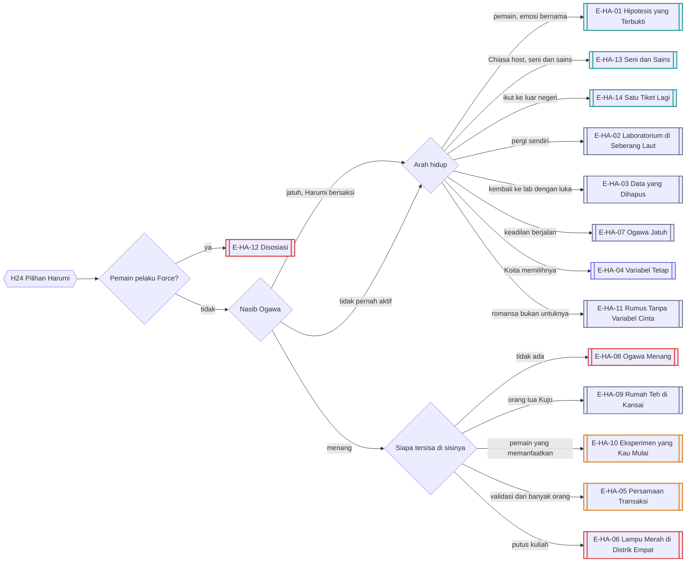
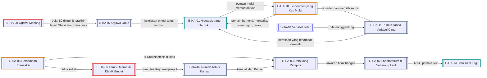

# Alur Cabang 03 — Kujo Harumi (Rute Hypersexual / Exploitation)

Status: 🟡 usulan. Dasar ✅ GDD 6B.2: Harumi bisa menjadi terobsesi pada seks dan validasi seksual, termasuk perilaku promiscuous, memakai seks untuk perhatian/uang/kekuasaan, dan kemungkinan masuk dunia prostitusi. Semua tahap adalah kemungkinan naratif, bukan hasil otomatis. Teks dewasa tersirat, tanpa ilustrasi eksplisit ⭐. Harumi punya agensi di setiap pilihan.
Event: [Event_Harumi.md](../../Karakter/Kujo_Harumi/Event_Harumi.md).

## 1. Bentuk pohon
Rute Harumi bercabang pada **dari siapa ia mencari validasi** dan **siapa yang memegang uang dan lab-nya**. Ogawa adalah antagonis yang bergerak sendiri: bila pemain tidak melakukan apa-apa, Ogawa menang. Pemain bisa menjadi pelindung, penonton, saksi, atau justru pengeksploitasi kedua. Cabang besar ketiga adalah studi luar negeri: jalan keluar, pelarian, atau tiket yang hangus karena skandal. 14 ending.

## 2. Sumbu cabang
| Sumbu | Nilai | Digerakkan oleh |
|---|---|---|
| `harumi_stage` | 0 dunia yang dihitung, 1 kekosongan emosi, 2 salah baca validasi, 3 eksperimen, 4 transaksional awal, 5 gerbang, 6 terjerat | H09, H11, H12, H13, H14 |
| `kejelasan_emosi` (baru) | seberapa mampu ia menamai perasaannya | H08-A, H09-A, H20 |
| `validasi_dari` (baru) | pemain / Ogawa / banyak orang / tidak ada | H12, H13, H14 |
| `ogawa_status` | tidak ada / membimbing / mengeksploitasi / dilaporkan / jatuh / menang | H06, H13, H18 |
| `dana_lab` | aman / dibekukan / diselamatkan / dibayar Ogawa | H13 |
| `peran_pemain` (baru) | pelindung / penonton / saksi / pengeksploitasi | akumulasi |
| `bukti_ogawa` (baru) | tidak ada / sebagian / cukup | malam di lab, H14-B, H15-B |
| `studi_luar_negeri` | tidak / ditawarkan / diterima / ditolak / hangus | H11, H21 |
| Penjaga | Mizuhara, Ogiwara, orang tua Kujo | H10, H17, H18 |

## 3. Diagram utama

```mermaid
flowchart LR
  classDef gerbang stroke:#ea580c,stroke-width:3px
  classDef titik stroke:#dc2626,stroke-width:2px,stroke-dasharray:6 3
  classDef romantis stroke:#0d9488,stroke-width:2px
  classDef distorsi stroke:#d97706,stroke-width:2px
  classDef buruk stroke:#dc2626,stroke-width:2px
  S(["M01b H01 Perpustakaan Sains"])
  subgraph T1["Tahun 1 · dunia yang dihitung"]
    O6{"H06 Ogawa muncul"}
    O6A["didukung<br/>Ogawa dipercaya"]
    O6B["dicurigai<br/>pemain mulai mengamati"]
    O6C["diperingatkan<br/>Harumi minta data"]
    H7["H07 Natal di lab<br/>pemain tidak datang: Ogawa datang"]
    H8["H08 omikuji ditafsirkan<br/>kejelasan emosi naik"]
  end
  S --> O6
  O6 --> O6A
  O6 --> O6B
  O6 --> O6C
  O6A --> H7
  S --> H8
  subgraph T2["Tahun 2 · eksperimen yang berubah arah"]
    H9{"H09 Hipotesis cinta"}
    H9A["dibantu menamai<br/>pelindung"]
    H9B["ditertawakan atau dijauhi<br/>tahap 1"]
    H11["H11 beasiswa luar negeri dibuka<br/>tahap 2"]
    H12{"H12 eksperimen sosial"}
    H12B["pemain ikut sebagai mitra<br/>validasi dari pemain"]
    H12C["pemain memanfaatkan<br/>tahap 4 transaksional"]
    G{{"H13 Dana Lab Dibekukan<br/>GERBANG M20"}}
    GA["A dana dicari<br/>orang tua, Mizuhara, uang pemain"]
    GB["B Ogawa dilaporkan<br/>butuh bukti"]
    GC["C diam atau tidak ada<br/>Ogawa memegang lab"]
    GD["D dimanfaatkan pemain<br/>pengeksploitasi kedua"]
    H14["H14 undangan diskusi Natal<br/>tahap 6 bila dibiarkan"]
    H15["H15 uang tak jelas<br/>Ogiwara curiga"]
  end
  H8 --> H9
  O6B --> H9
  O6C --> H9
  H7 --> H9
  H9 --> H9A
  H9 --> H9B
  H9A --> H11
  H9B --> H11
  H11 --> H12
  H12 -->|dihentikan| G
  H12 --> H12B
  H12 --> H12C
  H12B --> G
  H12C --> G
  G --> GA
  G --> GB
  G --> GC
  G --> GD
  GB --> H14
  GC --> H14
  GD --> H14
  H14 --> H15
  subgraph T3["Tahun 3 · konsekuensi"]
    P17>"H17 teguran Ogiwara<br/>titik tanpa balik tanpa penjaga"]
    M18{"H18 rapat tertutup Mizuhara"}
    M18A["bersaksi<br/>Ogawa diproses"]
    M18B["ditutupi<br/>Ogawa aman"]
    H21{"H21 pengumuman studi luar negeri"}
    R{{"H24 Pilihan Harumi M35"}}
  end
  GA -->|dana aman| H21
  H15 --> P17
  P17 --> M18
  M18 --> M18A
  M18 --> M18B
  M18A --> H21
  M18B --> H21
  H21 --> R
  class G,R gerbang
  class P17 titik
  class H9A,GA,M18A romantis
  class H12B,H12C,GD distorsi
  class GC,M18B buruk
```

## 4. Garis besar cabang per fase

### Tahun 1 — dunia yang dihitung
- H01–H05 membangun cara pemain mendekat: diskusi akademik, teh, masakan eksperimental, teh malam di vila.
- **H06 Ogawa:** mendukung membuat Harumi percaya pada Ogawa. Mencurigai membuat pemain mulai mengamati lab. Memperingatkan tidak cukup: Harumi meminta **data**, jadi pemain harus membawa bukti.
- **H07 Natal di lab:** bila pemain tidak datang, Ogawa "kebetulan" ada di lab. Pengaruh Ogawa naik.
- **H08:** menafsirkan omikuji "perhatikan hatimu" menaikkan `kejelasan_emosi`, perisai utama rute ini.

### Tahun 2 — eksperimen yang berubah arah
- **H09 Hipotesis cinta:** membantu menamai perasaan menjadikan pemain pelindung. Menertawakan atau menjauh membuatnya menyimpulkan perasaan adalah gangguan (tahap 1).
- **H10 Kansai:** orang tua Kujo adalah akademisi yang mengukur segalanya. Ikut ke sana membuka sekutu potensial.
- **H11:** beasiswa luar negeri. "Dipilih" dibaca sebagai "berharga" (tahap 2).
- **H12 Eksperimen sosial:** menghentikan bila Trust cukup; ikut sebagai mitra (keintiman tersirat sebagai "data", validasi dari pemain); atau memanfaatkan (tahap 4 transaksional).
- **H13 Dana Lab Dibekukan** punya empat keluaran plus absen:
  - A mencari dana: orang tua Kujo, banding lewat Mizuhara, atau **uang pemain** (✅ #52 boleh memberi uang ke NPC dekat). Menutup jalan Ogawa untuk sementara.
  - B melaporkan Ogawa: butuh `bukti_ogawa`. Tanpa bukti, Harumi menyangkal dan Ogawa membalas.
  - C diam atau tidak hadir: Ogawa memegang lab dan Harumi.
  - D memanfaatkan: pemain menjadi pengeksploitasi kedua.
- **H14–H15:** undangan diskusi Natal dan uang yang tidak jelas. Menyelidiki (H15-B) bisa mengungkap transaksi; mengabaikan membuat Ogiwara yang curiga lebih dulu.

### Tahun 3 — konsekuensi
- **H17 Teguran Ogiwara:** tanpa Mizuhara atau Ogiwara sebagai penjaga, ini titik tanpa balik.
- **H18 Rapat tertutup:** bersaksi memproses Ogawa lewat jalur akademik dan hukum (✅ butuh laporan korban dan bukti). Menutupi membuat Ogawa aman.
- **H21:** studi luar negeri: dukung pergi, minta tinggal, atau ikut. Skandal dapat menghanguskan tawarannya.

## 5. Diagram resolusi ending

## 6. Varian host
| Titik | Yutaka (Y) | Chiasa (C) |
|---|---|---|
| Pendekatan | diskusi akademik, ekonomi vs sains | kolaborasi seni–sains (ilustrasi ilmiah, poster riset) |
| Akses malam | **tidak bisa masuk Asrama Putri**; harus menunggu di luar | bisa masuk Asrama Putri sebagai tamu sampai jam malam; Ogiwara lebih lunak |
| Konfrontasi Ogawa | Ogawa memandang Yutaka sebagai saingan dan membalas lewat rumor | Ogawa meremehkan Chiasa, lalu mencoba menjadikannya sasaran juga (risiko baru) |
| Ending romantis | E-HA-01 dan -14 versi Yutaka | E-HA-01, -13, -14 versi Chiasa |

## 7. Malam dan tubuh
- Mizuhara pulang 19:00; Ogawa di lab sampai 22:00 ke atas. **Jam 19:00–01:00 adalah jendela bahaya** dan jendela bukti: log pintu lab, pesan, saksi petugas kebersihan.
- Mengintai lab di malam hari menaikkan `bukti_ogawa`, tetapi bila Ogawa memergoki, konfrontasi bisa berakhir dengan cedera atau rumor bahwa pemainlah yang menguntit Harumi.
- Tahap 4+: Harumi pulang pagi. Pemain yang begadang di dekat asrama melihatnya turun dari taksi jam 05:10.
- Pesan Harumi jam 02:00 berisi "data" tentang perasaannya. Membalas dengan jujur saat itu menaikkan `kejelasan_emosi`. Membalas saat Sangat Lelah berisiko salah nada.

## 8. Ending
| Kode | Nama | Jenis | Host | Syarat inti | Isi |
|---|---|---|---|---|---|
| E-HA-01 | Hipotesis yang Terbukti | Romantis | Y/C | `kejelasan_emosi` tinggi; pemain pelindung; tanpa Force | belajar mengenali emosi bersama; teh pagi untuk dua orang |
| E-HA-02 | Laboratorium di Seberang Laut | Neutral | Y/C | studi luar negeri diterima; pulih sebagian | pergi sendiri; surat panjang tiap musim |
| E-HA-03 | Data yang Dihapus | Neutral | Y/C | lepas dari Ogawa; tetap di Kouseikan | kembali ke akademik dengan luka yang tidak dibicarakan |
| E-HA-04 | Variabel Tetap | Koita | Y/C | Koita memilih Harumi di K26; tahap ≤ 2 | jalur manga; deviasi rendah untuk Harumi |
| E-HA-05 | Persamaan Transaksi | Distorted | Y/C | `validasi_dari` banyak orang; tahap 6 | hidup transaksional; ia merasa akhirnya "mengerti" |
| E-HA-06 | Lampu Merah di Distrik Empat | Bad | Y/C | putus kuliah; Ogawa menang atau pergi; tanpa penjaga | masuk dunia kerja seks; epilog menyisakan pintu keluar bila seseorang masih mencarinya |
| E-HA-07 | Ogawa Jatuh | Neutral | Y/C | H18-A bersaksi; `bukti_ogawa` cukup | Ogawa diproses akademik dan hukum; Harumi menjalani pemulihan |
| E-HA-08 | Ogawa Menang | Bad | Y/C | bukti kurang atau ditutupi; pemain penonton | Ogawa lolos; Harumi yang disalahkan; kariernya runtuh |
| E-HA-09 | Rumah Teh di Kansai | Neutral | Y/C | orang tua Kujo menjadi sekutu (H10, H22) | dibawa pulang; cuti; mulai lagi dari teh |
| E-HA-10 | Eksperimen yang Kau Mulai | Distorted | Y/C | H12-C atau H13-D; pemain pengeksploitasi | bergantung pada validasi pemain; pemain tahu ia yang memulai |
| E-HA-11 | Rumus Tanpa Variabel Cinta | Neutral | Y/C | `kejelasan_emosi` tinggi; hati tidak ke siapa pun | memutuskan romansa bukan untuknya; damai di riset |
| E-HA-12 | Disosiasi | Broken | Y/C | pemain pelaku Force terhadapnya | penelitian terhenti; Mizuhara dan Ogiwara mendorongnya melapor; tanpa romansa dengan pelaku |
| E-HA-13 | Seni dan Sains | Romantis | C | Chiasa host; kolaborasi berjalan sejak Tahun 1 | pasangan yang saling menerjemahkan dunia masing-masing |
| E-HA-14 | Satu Tiket Lagi | Romantis | Y/C | H21-C pemain ikut ke luar negeri | pemain meninggalkan Jepang; quest Sistem tetap berjalan dari jauh; evaluasi tetap di hari wisuda |

## 9. Interlock
- **Shiori:** bila Shiori menargetkan pihak yang menyakiti orang yang ia hormati, Ogawa bisa menjadi sasaran Rute Revenge (file 05), dan Shiori mengumpulkan bukti lebih cepat daripada pemain.
- **Moeka dan Kuga:** Kuga dan Ogawa mewakili dua bentuk eksploitasi yang berbeda. Pemain yang melawan salah satunya mendapat reputasi di lingkungan kampus, dan Mei bisa memberitakannya.
- **Miyuki:** sebagai calon dokter, Miyuki bisa melihat tanda fisik kelelahan Harumi dan menegurnya, bila Miyuki sendiri tidak sedang burnout.
- **Koita:** bila Harumi terjerat, Koita yang menyadari terlambat bisa runtuh rasa bersalahnya (E-KO-09 atau E-KO-07 menguat).

## 10. Poin dan ambang
Skala dan aturan umum: [Sistem_Cabang_dan_Poin.md](../Sistem_Cabang_dan_Poin.md) §2–§3.

| Poin | Awal | Naik karena | Turun karena | Ambang dan akibat |
|---|---|---|---|---|
| `kejelasan_emosi` | 20 | H08-A; H09-A; pesan "data"-nya dibalas jujur; H-D01 | ditertawakan; perasaannya dibingkai sebagai transaksi | 40: ia bisa berkata "aku tidak suka ini" · 60: E-HA-01 menguat · 75: ia menolak Ogawa sendiri (H-D08) |
| `validasi[x]` (pemain, Ogawa, banyak orang) | 0 | x memberi pengakuan yang terikat pada tubuh atau perhatiannya | pujian akademik yang sehat; x menjauh | 60: tahap 3–4 dengan warna sumbernya · 80: risiko tahap 6 |
| `cengkeraman_ogawa` | 0 | lab bergantung pada Ogawa; dana di tangannya; Harumi terisolasi | Mizuhara terlibat; bukti terkumpul; pemain hadir di malam lab | 40: "bimbingan" pribadi · 60: H13 cenderung C atau D · 80: H14 tahap 6 |
| `bukti_ogawa` | 0 | mengintai lab malam; H14-B; H15-B; bantuan Hanabusa atau Shiori | bukti dihapus; pemain ketahuan mengintai | 50: Mizuhara mau mendengar · 80: H18-A menjatuhkan Ogawa |
| `ogiwara_curiga` | 10 | Harumi pulang pagi; uang tidak jelas; tamu malam | pemain jujur pada Ogiwara | 50: Ogiwara bertanya pada pemain · 70: H17 lebih awal |
| `luar_negeri` | 40 | H11-A didukung; nilai bagus | skandal; tahap 5+ | ≥ 70: E-HA-02 dan E-HA-14 menguat · skandal: tawaran hangus |
| `orang_tua_kujo` | 30 | H10-A; H-D07; H22-B | Harumi menyembunyikan semuanya | 60: E-HA-09 terbuka sebagai jalan keluar |

Turunan: `validasi_dari` = `validasi[x]` tertinggi.

## 11. Event dinamis
| ID | Nama | Syarat | Isi dan cabang | Efek |
|---|---|---|---|---|
| H-D01 | Teh Jam Satu | Larut; dapur asrama (Chiasa bisa masuk, Yutaka hanya di luar jendela); kejelasan ≥ 30 | minum dan diam / tanya perasaannya / bercerita tentang dirimu | kejelasan + |
| H-D02 | Lembar Pengamatan | jalur H12 | ia menunjukkan tabel pengamatan reaksi pemain. Koreksi datanya dengan jujur / tertawa / pakai datanya | kejelasan ±; `validasi[pemain]` |
| H-D03 | Pintu Lab Jam Sebelas | `cengkeraman_ogawa` ≥ 40; pemain lewat lab saat Larut | ada suara dari dalam. Ketuk / catat jam keluar / pergi / panggil satpam | bukti +; risiko konfrontasi |
| H-D04 | Tawaran Ogawa | Ogawa mengenal pemain | Ogawa mengajak pemain "bekerja sama". Tolak / pura-pura menerima / laporkan | pura-pura menerima membuka jalur penyusup (E-NPC-26 atau E-NPC-27) |
| H-D05 | Masakan Kedua | H03-C pernah terjadi | masakannya membaik. Puji dengan spesifik / jujur / ajak memasak lagi | ia menghubungkan "senang" dengan "memasak bersama"; kejelasan + |
| H-D06 | Taksi Jam Lima | tahap ≥ 4; pemain begadang di dekat asrama | ia turun dari taksi. Sapa / ikuti / pura-pura tidak lihat / foto | bukti, atau bahan pemerasan; Trust |
| H-D07 | Surat dari Kansai | setelah H10-A | ibunya menulis dengan bahasa data. Bantu Harumi membalas / bacakan / abaikan | `orang_tua_kujo` + |
| H-D08 | Hipotesis Ditolak | kejelasan ≥ 60; `validasi[ogawa]` ≥ 40 | ia menyimpulkan Ogawa tidak peduli padanya. Dukung keputusannya / ragukan / ajak ke Mizuhara | `cengkeraman_ogawa` −30; belok besar |
| H-D09 | Celah di Jadwal | ia menghilang dua malam seminggu | tanya / ikuti / tanya Ogiwara | H15 terbuka lebih awal |
| H-D10 | Permintaan Komentar | rumor tentang Harumi; Mei menghubungi pemain | bantah / diam / beri informasi | reputasi Harumi; Mei mendapat bahan |
| H-D11 | Pelajaran yang Ia Minta | kejelasan ≥ 50; Intim ≥ 50 | ia meminta pemain mengajarinya apa itu cinta (teks tersirat, berpusat pada persetujuan). Jelaskan dengan kata / ajak kencan biasa / manfaatkan permintaan itu / tolak dengan lembut | memanfaatkan: `validasi[pemain]` naik ke arah Distorted; kencan biasa: E-HA-01 menguat |
| H-D12 | Poster Riset | Chiasa host; kolaborasi berjalan | Chiasa mengilustrasikan poster riset Harumi. Tampilkan nama berdua / anonim / batal | E-HA-13 menguat |

## 12. Belok ke ending lain
Setelah H17 tanpa penjaga, ending yang menuntut kejelasan emosi tinggi melemah, tetapi E-HA-07 dan E-HA-09 tetap bisa dicapai lewat bukti atau keluarga.

