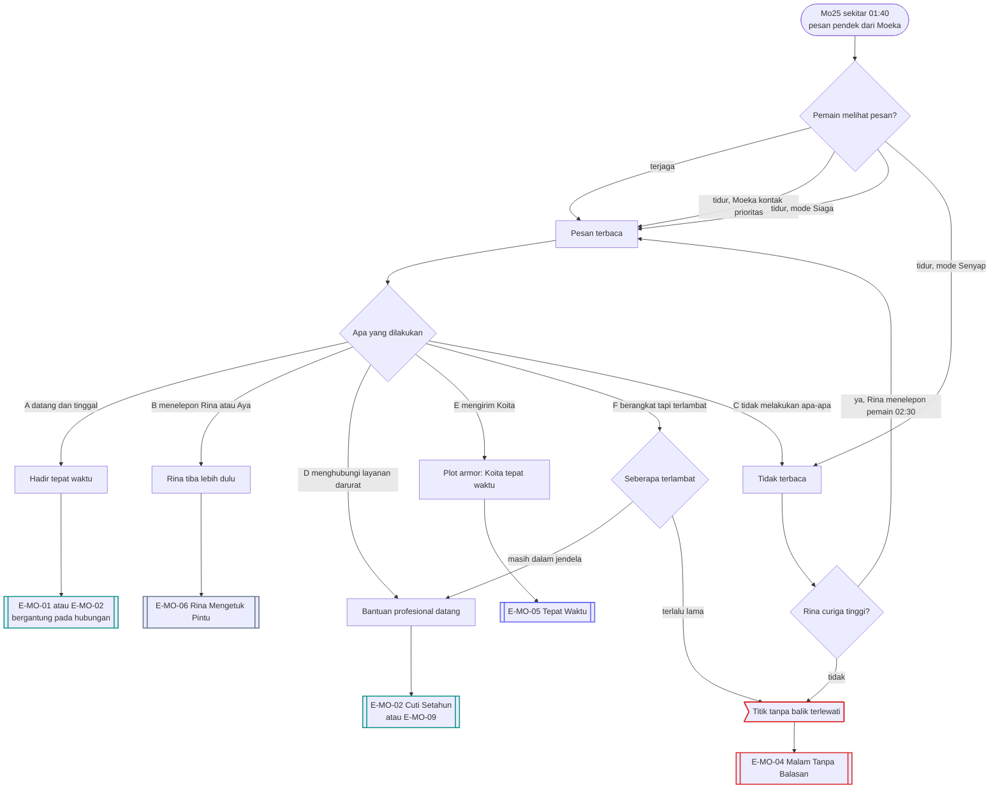
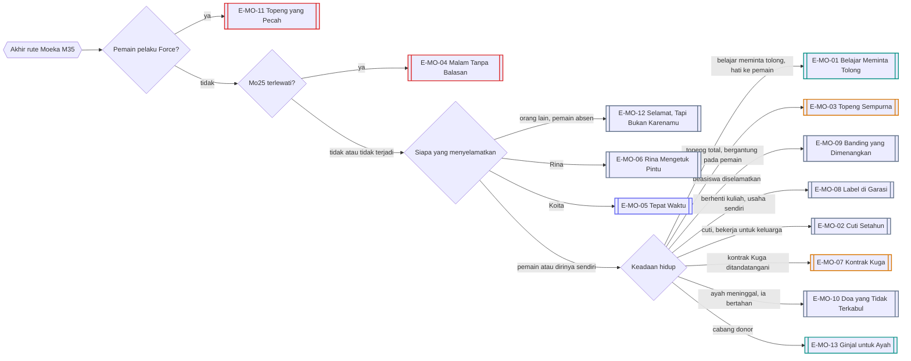
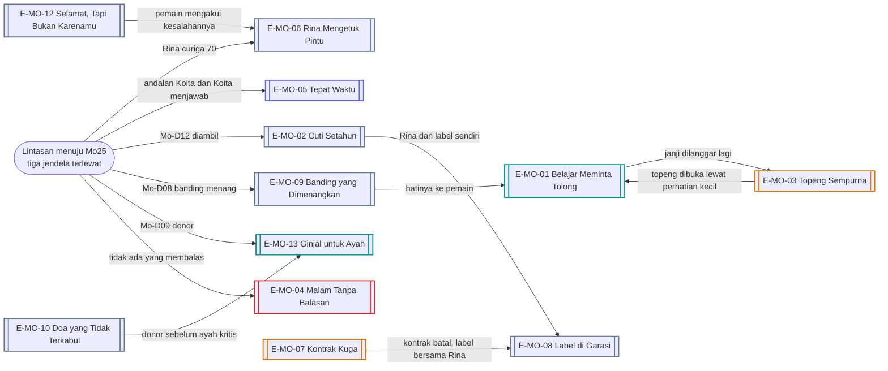

# Alur Cabang 04 — Kohinata Moeka (Rute Death-Flag)

Status: 🟡 usulan. Dasar ✅ GDD 6B.2: risiko bunuh diri muncul dari akumulasi stres; keluarga Moeka sedang tidak baik-baik saja; rute diperlakukan sebagai tragedi psikologis serius, tidak grafis, berfokus pada kondisi, tanda bahaya, dampak, dan intervensi. Kematian bisa dicegah sampai Malam Tanpa Balasan (🟡 keputusan di file karakter). Game hardcore ⭐, jadi hasil terburuk boleh terjadi.
**Batas penulisan:** tanpa metode, tanpa detail cara, tanpa lokasi yang mengisyaratkan cara. Yang ditulis adalah tekanan, tanda, pilihan orang di sekitarnya, dan duka.
Event: [Event_Moeka.md](../../Karakter/Kohinata_Moeka/Event_Moeka.md). Keluarga: ayah Kohinata Shuji (gagal ginjal kronis, cuci darah rutin), ibu Aya, adik Ren (16), Sora (12), Hinata (8).

## 1. Bentuk pohon
Rute Moeka adalah **tangga stres dengan lima jendela intervensi** dan satu malam penentu. Stres datang dari lima sumber yang bergerak sendiri: uang, beasiswa, ayah, rumor, dan Kuga. Jendela yang terlewat menumpuk diam-diam. Malam Tanpa Balasan hanya terjadi bila minimal tiga jendela terlewat **dan** tiga pemicu bertemu. Di malam itu ada enam cara masuk, termasuk **terlambat** dan **mengirim orang lain**. 13 ending.

## 2. Sumbu cabang
| Sumbu | Nilai | Digerakkan oleh |
|---|---|---|
| `moeka_stage` | 0 topeng efektif, 1 beban menumpuk, 2 topeng tebal, 3 menarik diri, 4 tanda bahaya, 5 malam penentu | Mo11, Mo14, Mo17, Mo19, Mo25 |
| `stres` (5 sumber) | uang, beasiswa, ayah, rumor, Kuga | Mo05, Mo12, Mo13, Mo15, Mo16, Mo23 |
| `jendela_terlewat` | 0–5 | Mo11, Mo15, Mo19, Mo22, Mo26 |
| `beasiswa_status` | aman / peringatan / terancam / dicabut / diselamatkan | Mo12, Mo15, Mo16 |
| `ayah_status` (baru) | stabil / memburuk / kritis / meninggal / cabang donor | kalender dunia, Mo05, Mo22 |
| `andalan_moeka` (baru) | pemain / Rina / Koita / tidak ada | siapa yang paling sering menepati janji padanya |
| `janji_tertepati` | rasio janji pemain yang ditepati | Mo03 dan semua janji kecil |
| `kuga_kontrak` | tidak / ditawarkan / ditandatangani / dinegosiasi / ditolak | Mo06, Mo23 |
| Penyadar | Rina (cepat), Ren (cepat tapi gengsi), Aya (lambat), Fujisawa, Sato Kyoko | Mo18, Mo22 |

## 3. Diagram utama

```mermaid
flowchart LR
  classDef gerbang stroke:#ea580c,stroke-width:3px
  classDef titik stroke:#dc2626,stroke-width:2px,stroke-dasharray:6 3
  classDef romantis stroke:#0d9488,stroke-width:2px
  classDef buruk stroke:#dc2626,stroke-width:2px
  classDef jendela stroke:#0d9488,stroke-width:3px
  S(["M01b Mo01 wakil yang selalu terlambat"])
  subgraph T1["Tahun 1 · topeng yang efektif"]
    J1["Mo03 janji terlupa<br/>janji pertama diuji"]
    P4["Mo04 pingsan lupa makan"]
    F5["Mo05 kabar dari rumah<br/>masalah keluarga terbuka"]
    K6{"Mo06 tawaran foto Kuga"}
    A10["Mo10 coklat untuk tiga adik"]
  end
  S --> J1
  S --> P4
  P4 --> F5
  S --> K6
  F5 --> A10
  subgraph T2["Tahun 2 · stres yang menumpuk"]
    W1{{"Jendela 1 · Mo11 M15<br/>ponsel mati saat hujan"}}
    I12["Mo12 IPK turun"]
    R13["Mo13 foto beredar<br/>rumor Mei"]
    T14["Mo14 topeng tebal<br/>tahap 2"]
    W2{{"Jendela 2 · Mo15 M20<br/>surat peringatan beasiswa"}}
    I16["Mo16 nilai kedua rendah"]
    M17["Mo17 menghilang dari grup<br/>tahap 3"]
  end
  J1 --> W1
  A10 --> W1
  K6 --> W1
  W1 --> I12 --> R13 --> T14 --> W2
  W2 --> I16 --> M17
  subgraph T3["Tahun 3 · tanda dan titik"]
    RN["Mo18 Rina bicara"]
    W3{{"Jendela 3 · Mo19 M27<br/>barang kesayangan dibagikan"}}
    W4{{"Jendela 4 · Mo22 M30<br/>Ren menelepon"}}
    KU["Mo23 kontrak Kuga"]
    W5{{"Jendela 5 · Mo26 M33<br/>Natal sunyi"}}
    CK{"Minimal 3 jendela terlewat<br/>dan 3 pemicu bertemu?"}
    MTB>"Mo25 Malam Tanpa Balasan M34"]
    AMAN["Malam itu lewat<br/>tanpa krisis"]
  end
  M17 --> RN --> W3 --> W4 --> KU --> W5 --> CK
  CK -->|ya| MTB
  CK -->|tidak| AMAN
  W1 -.->|dibantu| JB["Jendela diambil<br/>stres turun"]
  W2 -.->|dibantu| JB
  W3 -.->|dibantu| JB
  W4 -.->|dibantu| JB
  W5 -.->|dibantu| JB
  JB -.-> CK
  class W1,W2,W3,W4,W5 jendela
  class MTB titik
  class JB,AMAN romantis
  class CK gerbang
```

## 4. Malam Tanpa Balasan: enam cara masuk
Tiga pemicu: surat pencabutan beasiswa, kondisi ayah memburuk, dan **orang yang ia andalkan tidak membalas** (`andalan_moeka`). Ia mengirim pesan, bukan menelepon, karena tidak mau merepotkan.

## 5. Garis besar cabang per fase

### Tahun 1 — topeng yang efektif
- **Mo03 janji terlupa:** maklum atau membantu mengatur jadwal menurunkan stres. Marah menambah rasa bersalah yang ia sembunyikan.
- **Mo04 pingsan karena lupa makan:** merawat sendiri, memanggil Miyuki, atau abaikan. Ini tanda tubuh pertama.
- **Mo05:** kabar dari rumah. Mendengarkan atau bertanya langsung membuka rahasia: ayah sakit ginjal, kehilangan pekerjaan, ibu bekerja ganda, uang adik menumpuk.
- **Mo06 Kuga:** mendukung, menghalangi, atau menemani. Menemani membuat pemain melihat sendiri betapa ambigunya tawaran Kuga.
- **Mo10:** coklat untuk tiga adik. Pemain mengenal Ren, Sora, dan Hinata. Kelak Ren yang menelepon pemain di jendela 4.

### Tahun 2 — stres yang menumpuk
- **Jendela 1 (Mo11):** ponsel mati saat hujan deras. Mencari menaikkan `andalan_moeka` ke pemain. Menunggu atau abaikan = jendela terlewat.
- **Mo12–Mo13:** IPK turun dan foto yang disebar Mei. Membantu membantah rumor mengurangi satu sumber stres.
- **Mo14:** topeng tebal. Ia terlihat paling ceria justru saat paling buruk. Pemain yang Lelah melewatkan tanda ini (lihat dokumen sistem §4.2).
- **Jendela 2 (Mo15):** surat peringatan beasiswa. Membantu mencari bantuan (Fujisawa, Sato, banding, kerja sampingan) mengambil jendela ini.
- **Mo16–Mo17:** nilai kedua rendah dan menghilang dari grup chat di Valentine (tahap 3).

### Tahun 3 — tanda dan titik
- **Mo18:** Rina menegur pemain. Mendengarkan menjadikan Rina sekutu, dan Rina mulai menelepon pemain bila ia merasa ada yang salah.
- **Jendela 3 (Mo19):** ia membagikan barang kesayangan. Menerima tanpa bertanya = terlewat. Bertanya dan tinggal = diambil.
- **Jendela 4 (Mo22):** Ren menelepon karena khawatir. Datang ke rumah Kohinata mengambil jendela. Mengirim uang saja hanya mengurangi stres uang, tidak mengambil jendela.
- **Mo23 Kuga:** menolak atau renegosiasi kontrak menurunkan stres; membiarkan menaikkannya.
- **Jendela 5 (Mo26):** Natal sunyi.
- **Mo25:** lihat bagian 4.

### Cabang donor ⭐ (dipakai)
Event pemicunya Mo-D09 (bagian 12). Ayah membutuhkan transplantasi. Moeka diam-diam memeriksa kecocokan sebagai donor. Pemain bisa mendukung, menentang, atau memberi tahu Aya. Bila ia mendonorkan ginjal, stres keluarga turun tajam tetapi ia cuti satu semester dan beasiswanya berada di ujung tanduk. Membuka E-MO-13.

## 6. Diagram resolusi ending

## 7. Varian host
| Titik | Yutaka (Y) | Chiasa (C) |
|---|---|---|
| Kedekatan awal | satu panitia festival (Moeka koordinator, Yutaka bagian dana) | satu fakultas, senpai–kouhai |
| Uang | Yutaka punya uang besar; memberi uang menolong, tetapi uang dari laki-laki memicu gosip dan melukai gengsinya | Chiasa punya royalti; bantuan lebih mudah diterima, misalnya lewat proyek bersama |
| Melihat tanda | jarang di studio Moeka; bergantung pada Rina | satu gedung; melihat Moeka tertidur di studio jam 04:00 |
| Romansa | E-MO-01 versi Yutaka | E-MO-01 versi Chiasa; Moeka menggoda Chiasa sejak awal, jadi keseriusan harus dibuktikan |

## 8. Malam dan tubuh
- Moeka adalah rute malam paling berat. Konbini jam 03:00 adalah tempat pertemuan paling sering di tahap 2+. Panggilan yang dibatalkan sebelum tersambung (muncul sebagai "panggilan tak terjawab, 4 detik") adalah tanda.
- **Mode ponsel** menentukan Mo25 (bagian 4). Menandai Moeka sebagai kontak prioritas adalah persiapan yang sah dan murah.
- **Kelelahan pemain menyembunyikan tandanya.** Saat Sangat Lelah, narasi tidak lagi menyebut jari yang meremas lengan baju atau tawa yang terlalu keras (Mo21).
- Bila pemain sakit, Moeka datang menjenguk lalu tertidur di kursi. Itu tanda ia sendiri tidak tidur berhari-hari.
- **Setelah Moeka meninggal:** Sistem terdiam beberapa hari (✅ keputusan di file Sistem). Semua heroine mendapat varian epilog duka. Lihat E-X-04 di [12_Interlock_Antar_Rute.md](12_Interlock_Antar_Rute.md).

## 9. Ending
| Kode | Nama | Jenis | Host | Syarat inti | Isi |
|---|---|---|---|---|---|
| E-MO-01 | Belajar Meminta Tolong | Romantis | Y/C | minimal 3 jendela diambil; `andalan_moeka` pemain; janji ditepati; tanpa Force | ia belajar meminta tolong; keluarga mulai stabil |
| E-MO-02 | Cuti Setahun | Neutral | Y/C | selamat; beasiswa dicabut | cuti kuliah; bekerja membantu keluarga; kembali setahun kemudian |
| E-MO-03 | Topeng Sempurna | Distorted | Y/C | selamat; topeng tidak pernah dibuka; pemain satu-satunya andalan | tampak baik-baik saja; topengnya total; hidupnya bergantung pada pemain |
| E-MO-04 | Malam Tanpa Balasan | Bad | Y/C | Mo25 terlewati | Moeka meninggal. Yang ditampilkan: kabar, duka, pemakaman, Rina, Aya, adik-adik, penyesalan pemain. Tanpa metode. Sistem diam |
| E-MO-05 | Tepat Waktu | Koita | Y/C | Mo25-E pemain mengirim Koita, atau `andalan_moeka` Koita dan Koita menjawab | plot armor menyelamatkannya; hatinya kembali ke Koita |
| E-MO-06 | Rina Mengetuk Pintu | Neutral | Y/C | Mo25-B, atau Rina sekutu sejak Mo18 | Rina tiba lebih dulu; dirawat; persahabatan pemain dan Rina menentukan epilog |
| E-MO-07 | Kontrak Kuga | Distorted | Y/C | Mo23 kontrak dibiarkan; selamat | meninggalkan kampus untuk kontrak modeling yang eksploitatif; topeng menjadi pekerjaan |
| E-MO-08 | Label di Garasi | Neutral | Y/C | berhenti kuliah; stres keluarga turun; Rina sekutu | merintis label fesyen kecil bersama Rina; adik-adik membantu |
| E-MO-09 | Banding yang Dimenangkan | Neutral | Y/C | beasiswa diselamatkan lewat Fujisawa, Sato, atau banding | lulus; keluarga bertahan; tanpa romansa |
| E-MO-10 | Doa yang Tidak Terkabul | Neutral | Y/C | `ayah_status` meninggal; minimal 3 jendela diambil | ayahnya meninggal; Moeka bertahan karena tidak sendirian |
| E-MO-11 | Topeng yang Pecah | Broken | Y/C | pemain pelaku Force terhadapnya | risiko krisis melonjak; jendela intervensi tetap ada; tidak ada ending tenang |
| E-MO-12 | Selamat, Tapi Bukan Karenamu | Neutral | Y/C | pemain melewatkan banyak jendela; orang lain menyelamatkannya | ia hidup dan memutus hubungan dengan pemain |
| E-MO-13 | Ginjal untuk Ayah | Romantis | Y/C | cabang donor diambil; pemain mendampingi | ayah pulih; Moeka cuti; pengorbanan yang tidak ia sesali |

## 10. Interlock
- **Nagisa:** sabotase Nagisa (bila Moeka menjadi `sasaran_cemburu`) menambah stres rumor dan sosial.
- **Miyuki:** Miyuki bisa tahu kondisi ayah Moeka dari RS Tachibana sebelum keluarga diberi tahu.
- **Shiori:** Moeka menafsirkan jarak Shiori sebagai penolakan. Shiori yang dibuat peduli pada Moeka bisa menjadi penolong yang sangat efektif (dan sangat marah pada siapa pun yang menyakitinya).
- **Koita:** bila `andalan_moeka` adalah Koita, pola menggantung Koita sendiri bisa menjadi pemicu ketiga. Pemain yang membongkar pola Koita lebih awal mengubah malam itu.
- **Kematian Moeka** mengubah semua rute lain (E-X-04).

## 11. Poin dan ambang
Skala dan aturan umum: [Sistem_Cabang_dan_Poin.md](../Sistem_Cabang_dan_Poin.md) §2–§3.

| Poin | Awal | Naik karena | Turun karena | Ambang dan akibat |
|---|---|---|---|---|
| `stres[uang]` | 40 | tagihan cuci darah; uang saku dikirim ke rumah; Mo12 | bantuan uang (dari Yutaka sekaligus melukai gengsi); kerja tambahan yang layak | ikut `stres_total` |
| `stres[beasiswa]` | 20 | Mo12, Mo15, Mo16 | Mo-D08 banding; belajar bersama | ikut `stres_total` |
| `stres[ayah]` | 40 | kabar memburuk; Mo22 | Mo-D09 donor; kunjungan RS ditemani | ikut `stres_total` |
| `stres[rumor]` | 0 | Mo13; sabotase Nagisa; unggahan Mei | rumor dibantah; Mei dibayar diam | ikut `stres_total` |
| `stres[kuga]` | 0 | Mo06; Mo-D05; Mo23 | kontrak ditolak; Kuga jatuh | ikut `stres_total` |
| `stres_total` | gabungan | — | — | 40: topeng menebal (tahap 1–2) · 60: menarik diri (tahap 3), Mo-D01 · 75: tanda bahaya (tahap 4), Mo-D11 dan Mo-D12 terbuka · 85 dengan tiga pemicu: Mo25 |
| `topeng` | 50 | dipuji hanya karena ceria; pesta besar untuknya; dibutuhkan sebagai si penghibur | ada yang melihat ("kamu capek?"); perhatian kecil (Mo-D06); Mo-D12 | ≥ 70: tanda hanya terlihat oleh Rina dan pemain dengan Intim ≥ 55 |
| `andalan[x]` (pemain, Rina, Koita) | pemain 10, Rina 50, Koita 40 | x menepati janji; hadir di jendela; menjawab di malam hari | janji dilanggar; diabaikan | tertinggi = orang yang ia kirimi pesan di Mo25 |
| `rina_curiga` | 20 | Moeka menarik diri; Rina melihat janji pemain dilanggar | — | 50: Mo-D07, Mo18 lebih awal · 70: Rina menelepon pemain jam 02:30 di malam Mo25 |
| `ren_khawatir` | 10 | kakaknya tidak pulang; telepon tidak dijawab | pemain mengenal adik-adik (Mo10) | 50: Mo22 lebih awal |
| `kuga_tekanan` | 0 | Mo06-A; pemotretan malam | pemain menemani; kontrak ditolak | 40: Mo-D05 · 70: Mo23 lebih berat |

Turunan: `andalan_moeka` = `andalan[x]` tertinggi. Pemain bisa menyalip Rina atau Koita hanya lewat janji yang ditepati dan kehadiran yang konsisten.

## 12. Event dinamis
| ID | Nama | Syarat | Isi dan cabang | Efek |
|---|---|---|---|---|
| Mo-D01 | Onigiri Jam Tiga | konbini saat Dini Hari; `stres_total` ≥ 60 | duduk makan bersama / tanya langsung / bercanda / antar pulang | `andalan[pemain]` +; topeng − |
| Mo-D02 | Panggilan Empat Detik | tahap ≥ 2; Larut | panggilan tak terjawab, durasi 4 detik. Telepon balik sekarang / kirim pesan / besok saja | jendela kecil; `andalan` ± |
| Mo-D03 | Kostum untuk Hinata | adik bungsunya ikut pentas sekolah | Moeka menjahit kostum dan mengajak pemain. Datang ke pentas / bantu menjahit malam itu / tidak bisa | `stres_total` turun karena bahagia; keluarga mengenal pemain |
| Mo-D04 | Struk di Lantai | pemain di kos Moeka | tagihan cuci darah tergeletak. Tanya / pura-pura tidak lihat / diam-diam membayar sebagian | pemain tahu soal ayah; pilihan "Tanya soal cuci darah ayah" terbuka |
| Mo-D05 | Lokasi dari Kuga | `kuga_tekanan` ≥ 40 | Kuga mengirim lokasi pemotretan malam; Moeka bertanya "temani?". Temani / larang / laporkan / minta Rina menemani | jalur Kuga; bukti untuk E-NPC-26 |
| Mo-D06 | Ulang Tahun yang Ia Lupakan | hari ulang tahunnya; `stres_total` ≥ 50 | kejutan kecil / pesta besar / kue di depan pintu | kecil: topeng −; pesta besar: topeng + |
| Mo-D07 | Rina Bertanya | `rina_curiga` ≥ 50 | "Kamu tahu sesuatu?" Jujur / sangkal / ajak bekerja sama | Rina menjadi sekutu; kesempatan kedua di Mo25 |
| Mo-D08 | Formulir Banding | beasiswa diperingatkan; kenal Fujisawa | bantu menulis surat banding malam itu / suruh ia menulis sendiri / bayar orang lain | E-MO-09 menguat; membayar orang lain = kebohongan baru |
| Mo-D09 | Cocok sebagai Donor ⭐ | ayah memburuk | Moeka diam-diam tes kecocokan. Dukung / tentang / beri tahu Aya / temani ke RS (Miyuki melihat) | cabang donor; `stres[ayah]` −40 bila jadi; beasiswa terancam |
| Mo-D10 | Tawa di Grup Jam Dua | `topeng` ≥ 70 | ia mengirim banyak pesan ceria di grup tengah malam. Balas candaan / japri "kamu oke?" / abaikan | japri: `andalan[pemain]` +, topeng − |
| Mo-D11 | Barang yang Dikembalikan | tahap 4 | ia mengembalikan barang pinjaman lama. Tanya kenapa / terima / ceritakan pada Rina | tanda bahaya; menerima tanpa bertanya = jendela kecil terlewat |
| Mo-D12 | Pertanyaan Langsung | tahap ≥ 3; pemain mengenali tanda (Intim ≥ 55 atau Rina memberi tahu) | pilihan bertanya langsung dan tenang muncul. Tanya langsung lalu tetap tinggal / tanya sambil bercanda / tidak berani | tanya langsung: ia menangis dan bercerita; jendela diambil; jalan ke Sato Kyoko dan bantuan profesional terbuka |
| Mo-D13 | Sketsa Label Pertama | `stres_total` < 40; Aff ≥ 55 | ia menunjukkan rancangan label sendiri. Dukung / ajak Rina / kritik | E-MO-08 menguat |

## 13. Belok ke ending lain
Sebelum Mo25, lintasan yang paling gelap pun masih bisa dibelokkan ke enam arah. Setelah Mo25 terlewati, kematian Moeka final, tetapi epilognya tetap berbeda menurut siapa tahu apa.

