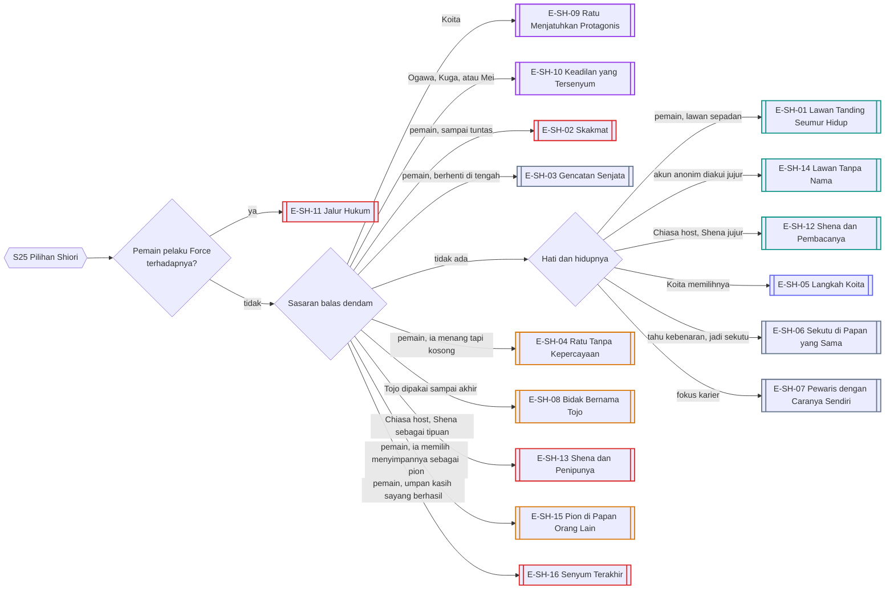
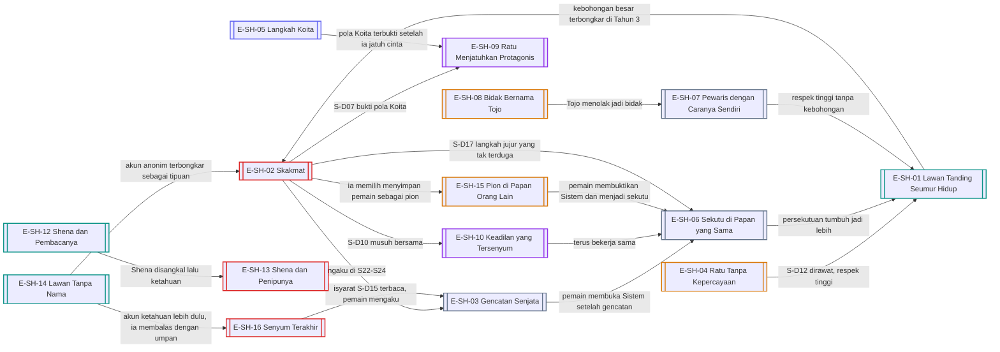
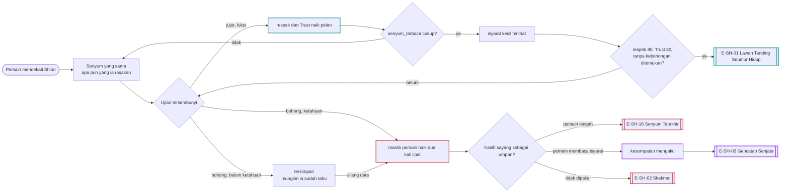

# Alur Cabang 05 — Saionji Shiori (Rute Revenge)

Status: 🟡 usulan. Dasar ✅ GDD 6B.2: Shiori berusaha menghancurkan kehidupan pemain **atau orang-orang yang menjadi sasaran kemarahannya**, dengan kemampuannya sendiri, tanpa kekuatan keluarga Saionji. ✅ Master Canon: ia bisa salah, tertipu, cemburu, dan terluka; menang catur tidak otomatis memicu romansa.
Event: [Event_Shiori.md](../../Karakter/Saionji_Shiori/Event_Shiori.md).

## 1. Bentuk pohon
⭐ Ini **rute paling sulit ditaklukkan** di seluruh game, dan rute yang paling mudah berujung pada masalah bagi pemain (bagian 13). Shiori bukan gadis dingin: ia ramah, sopan, suka menggoda, dan senyumnya tidak bisa dibaca (✅ kepribadian terinspirasi Sakayanagi Arisu). Rute Shiori bercabang pada **apa yang ia temukan** dan **ke mana amarahnya diarahkan**. Sasarannya tidak harus pemain. Bila pemain membongkar pola Koita, sasarannya bisa Koita. Bila pemain menunjukkan Ogawa, Kuga, atau Mei, sasarannya bisa mereka. Dua cabang khusus menambah lapisan: **akun shogi anonim** (pemain berteman dengannya tanpa ia tahu) dan **pengakuan Sistem** (pemain memberitahunya kebenaran, dan ia mengujinya). 16 ending.

## 2. Sumbu cabang
| Sumbu | Nilai | Digerakkan oleh |
|---|---|---|
| `shiori_stage` | 0 lawan yang layak, 1 rival, 2 penemuan, 3 senyum yang sama, 4 pengumpulan bukti, 5 penghancuran | S13, S14, S16, S18, S22 |
| `daftar_kebohongan` (baru) | kebohongan pemain yang ia ketahui | S04-C, S11-C, pasangan palsu Miyuki, rahasia Shena, senjata Nagisa, Force |
| `sasaran_balas` (baru) | pemain / Koita / Ogawa / Kuga / Mei / Nagisa / Tojo / tidak ada | S13 dan bukti yang ia pegang |
| `bukti_terkumpul` | sedikit / cukup / menghancurkan | S18 |
| `cinta_koita_shiori` | belum / tumbuh (M11) / retak / tidak pernah | S03, S08 |
| `akun_anonim` (baru) | tidak ada / aktif / terungkap jujur / terungkap sebagai tipuan | shogi online 22:00–01:00 |
| `tahu_sistem` (baru) | tidak / diberi tahu / percaya / menganggap gila | pengakuan pemain (file 10) |
| Kuroiwa | netral / curiga / memperingatkan pemain / menghadang | S10, malam di D3 |
| Tojo | tidak aktif / dilindungi / dimanfaatkan / bidak Shiori | S05, S21 |
| `senyum_terbaca` (baru) | seberapa jauh pemain bisa membaca senyumnya | pengamatan lama, respek, Intimacy; turun saat pemain Lelah |
| `ujian_lulus` (baru) | ujian tersembunyi yang ia pasang dan hasilnya | S-D04, S-D13, S-D14 |

## 3. Diagram utama

```mermaid
flowchart LR
  classDef gerbang stroke:#ea580c,stroke-width:3px
  classDef titik stroke:#dc2626,stroke-width:2px,stroke-dasharray:6 3
  classDef romantis stroke:#0d9488,stroke-width:2px
  classDef distorsi stroke:#d97706,stroke-width:2px
  classDef buruk stroke:#dc2626,stroke-width:2px
  classDef koita stroke:#6366f1,stroke-width:2px
  classDef khusus stroke:#9333ea,stroke-width:2px
  S(["M01b S01 papan shogi di taman"])
  subgraph T1["Tahun 1 · lawan yang layak"]
    U3{"S03 payung hujan"}
    U3A["momen Koita dicegat<br/>cinta Koita tidak tumbuh"]
    U3B["dibiarkan<br/>benih cinta Koita"]
    L1["S04-C menyontek<br/>kebohongan pertama"]
    AN["Akun shogi anonim<br/>teman tanpa nama"]
    S7["S07 Natal keluarga Saionji"]
    S8["S08 festival setahun<br/>cinta Koita tumbuh"]
    S9{"S09 tawaran persahabatan"}
  end
  S --> U3
  U3 --> U3A
  U3 --> U3B
  U3B --> S8
  S --> L1
  S -.->|malam, online| AN
  S --> S7
  S7 --> S9
  U3A --> S9
  S8 --> S9
  subgraph T2["Tahun 2 · kepercayaan yang diuji"]
    L2["S11-C menyontek ujian<br/>atau kebohongan lain"]
    G{{"S13 Penemuan<br/>GERBANG M20"}}
    GA["A mengaku<br/>kepercayaan sebagian pulih"]
    GB["B menyangkal<br/>ia tetap tersenyum"]
    GC["C lari"]
    SB{"Ke mana amarahnya"}
    SP["sasaran: pemain"]
    SK["sasaran: Koita<br/>pola menggantung terbukti"]
    SV["sasaran: Ogawa, Kuga, Mei"]
    S14["S14 Natal: senyum yang sama<br/>tahap 3"]
  end
  S9 --> L2
  L1 --> G
  L2 --> G
  AN -.->|identitas terkuak| G
  G --> GA
  G --> GB
  G --> GC
  GB --> SB
  GC --> SB
  GA -->|kebohongan besar| SB
  SB --> SP
  SB --> SK
  SB --> SV
  SP --> S14
  subgraph T3["Tahun 3 · skakmat"]
    P18>"S18 pengumpulan bukti<br/>titik tanpa balik M27"]
    S20["S20 permainan terakhir<br/>pesan tersirat di papan"]
    S21["S21 Tojo diumumkan<br/>dijadikan bidak"]
    S22["S22 penghancuran dimulai<br/>tahap 5"]
    S24{{"S24 Natal: Skakmat"}}
    R{{"S25 Pilihan Shiori M35"}}
  end
  S14 --> P18
  P18 --> S20 --> S21 --> S22 --> S24 --> R
  SK --> R
  SV --> R
  GA -->|kebohongan kecil| R
  class G,S24,R gerbang
  class P18 titik
  class GA,AN romantis
  class SK,SV khusus
  class SP,S22 buruk
  class S8 koita
```

## 4. Garis besar cabang per fase

### Tahun 1 — lawan yang layak
- **S01–S02:** menantang membuka rivalitas. Sengaja kalah membuatnya jengkel; ia membenci dikasihani.
- **S03 Payung hujan:** ini momen manga ketika Shiori mulai tertarik pada Koita. Mencegatnya bisa membuat `cinta_koita_shiori` **tidak pernah tumbuh**, penyimpangan yang dihitung Sistem walau Shiori belum mencintai Koita di awal (✅).
- **S04-C / S11-C:** menyontek adalah kebohongan yang ia catat.
- **Akun anonim:** Shiori main shogi online jam 22:00–01:00. Pemain bisa menjadi lawan tetapnya tanpa nama. Ini cabang paling romantis sekaligus paling berbahaya: bila identitas terkuak sebagai tipuan, itu masuk `daftar_kebohongan`. Bila pemain mengaku sendiri di waktu yang tepat, Trust melonjak.
- **S07:** Natal keluarga Saionji; orang tuanya hangat (✅). Mereka mengingat pemain.
- **S09:** tawaran persahabatan. Menerima lalu berbohong adalah resep pasti menuju S13.

### Tahun 2 — kepercayaan yang diuji
- **S13 Penemuan:** ia menemukan kebohongan pemain atau pengkhianatan terhadap orang yang ia pedulikan. Mengaku menahan rute bila kebohongannya kecil. Menyangkal atau lari membuka Rute Revenge.
- **Ke mana amarahnya:** Shiori memilih sasaran dari bukti yang ia pegang.
  - **Pemain:** jalur standar.
  - **Koita:** bila pemain membuktikan pola menggantung Koita (pesan, kesaksian heroine), Shiori yang mulai mencintai Koita merasa ditipu dan menargetkannya. Deviasi naik tajam; Koita menuju "Hancur".
  - **Ogawa, Kuga, Mei:** bila pemain membuka kejahatan mereka, Shiori menjadi pedang yang sangat tajam.
- **S14–S16:** ia tidak marah dan tidak menjauh. Ia tersenyum persis seperti biasa, mungkin sedikit lebih hangat. Senyum yang tidak berubah itulah tahap 3.

### Tahun 3 — skakmat
- **S18:** pengumpulan bukti. Menghapus bukti adalah kejahatan baru (masuk rumah Saionji, mengakses akun) dan Kuroiwa menghadang. Memperbaiki keadaan dengan orang yang disakiti adalah satu-satunya jalan sebelum titik tanpa balik.
- **S20:** permainan shogi terakhir. Langkah-langkahnya berisi pesan. Pemain yang membaca pesan itu (butuh Intimacy tinggi) mendapat satu kesempatan terakhir.
- **S21:** Tojo diumumkan sebagai calon tunangan; Shiori memakainya sebagai bidak.
- **S22–S24:** penghancuran lewat informasi, reputasi, akademik, keuangan, dan sosial. Kejam secara psikologis, tanpa kekerasan fisik. Kuroiwa mencoba memperingatkan pemain tanpa membocorkan rencana.

## 5. Diagram resolusi ending

## 6. Varian host
| Titik | Yutaka (Y) | Chiasa (C) |
|---|---|---|
| Kedekatan awal | satu fakultas dan angkatan (Ekonomi); keluarga Kisaragi sempat menyinggung Saionji (Y09) | belum pernah bicara; Shiori pembaca novel yang diilustrasikan "Shena" |
| Jembatan khusus | rivalitas akademik | **rahasia Shena**: mengaku jujur (C11-A) adalah jembatan; berpura-pura bukan Shena lalu ketahuan adalah perangkap |
| Akun anonim | sama | sama, ditambah risiko Shiori mengenali gaya bahasa Chiasa |
| Ending khas | E-SH-01, -14 | E-SH-12, -13 |

## 7. Malam dan tubuh
- Shogi online 22:00–01:00 adalah satu-satunya jendela Shiori di malam hari. Begadang demi akun anonim berarti utang tidur, dan pemain yang Lelah lebih mudah salah ketik yang membocorkan identitas.
- Tahap 4: Shiori menyusun bukti di malam hari. Jalan malam di taman rumah Saionji dengan Kuroiwa beberapa langkah di belakang.
- Menyusup ke D3 malam hari untuk menghapus bukti: Kuroiwa menghadang. Tertangkap berarti catatan polisi (Hanabusa) dan bukti baru untuk Shiori.

## 8. Ending
| Kode | Nama | Jenis | Host | Syarat inti | Isi |
|---|---|---|---|---|---|
| E-SH-01 | Lawan Tanding Seumur Hidup | Romantis | Y/C | `respek` ≥ 80; Trust ≥ 80; tidak ada kebohongan yang ia temukan sendiri; lulus semua ujiannya; tanpa Force | lawan tanding sekaligus pasangan; ambang romansa tertinggi di seluruh game |
| E-SH-02 | Skakmat | Bad | Y/C | tahap 5; sasaran pemain; tanpa pengakuan | pemain dikeluarkan dan dijauhi semua lingkungan; semua target quest menjauh |
| E-SH-03 | Gencatan Senjata | Neutral | Y/C | pemain mengaku di S22 atau S24 | penghancuran berhenti; mereka tidak lagi bicara |
| E-SH-04 | Ratu Tanpa Kepercayaan | Distorted | Y/C | tahap 5 tuntas; tidak ada yang ia percaya lagi | Shiori menang tetapi kehilangan kemampuan percaya |
| E-SH-05 | Langkah Koita | Koita | Y/C | cinta Koita tumbuh di S08; Koita memilihnya di K26 | jalur manga; deviasi rendah untuk Shiori |
| E-SH-06 | Sekutu di Papan yang Sama | Neutral | Y/C | pemain memberitahunya soal Sistem; `tahu_sistem` percaya | Shiori menjadi ahli strategi pemain melawan naskah; persahabatan, bukan cinta |
| E-SH-07 | Pewaris dengan Caranya Sendiri | Neutral | Y/C | tanpa rute aktif; S17 didukung | fokus karier; membatalkan pertunangan Tojo dengan strateginya sendiri |
| E-SH-08 | Bidak Bernama Tojo | Distorted | Y/C | S21 Tojo dipakai sampai M35 | pertunangan tanpa cinta sebagai hukuman bagi dirinya sendiri; ia tetap tersenyum di setiap foto; ikatan sosial, bukan pasangan romantis baru |
| E-SH-09 | Ratu Menjatuhkan Protagonis | Khusus | Y/C | `sasaran_balas` Koita | Koita dijatuhkan di depan semua orang; deviasi sangat tinggi; E-KO-09 terkunci |
| E-SH-10 | Keadilan yang Tersenyum | Khusus | Y/C | `sasaran_balas` Ogawa, Kuga, atau Mei; pemain memberi bukti | pelaku dijatuhkan; Shiori dan pemain menjadi sekutu yang saling waspada |
| E-SH-11 | Jalur Hukum | Broken | Y/C | pemain pelaku Force terhadapnya | Rute Revenge teraktivasi paling cepat lewat hukum dan sosial; pemain dikeluarkan dan dipenjara; tanpa romansa |
| E-SH-12 | Shena dan Pembacanya | Romantis | C | Chiasa mengaku sebagai Shena sebelum Shiori menemukannya sendiri; `respek` ≥ 70; tanpa kebohongan lain yang ia temukan | pembaca dan ilustratornya |
| E-SH-13 | Shena dan Penipunya | Bad | C | Chiasa berbohong soal Shena lalu ketahuan | revenge menyasar karier Shena dan rahasia Chiasa |
| E-SH-14 | Lawan Tanpa Nama | Romantis | Y/C | akun anonim aktif lama; pemain mengaku sendiri sebelum ketahuan; `respek` ≥ 70; tanpa kebohongan lain yang ia temukan | lawan online yang ia tunggu tiap malam ternyata duduk di kelasnya |
| E-SH-15 | Pion di Papan Orang Lain | Distorted | Y/C | Shiori memegang semua rahasia pemain tetapi memilih tidak menghancurkannya | pemain tetap kuliah dan tampak bebas, tetapi setiap langkahnya kini atas izin Shiori; ia tersenyum setiap kali mereka berpapasan |
| E-SH-16 | Senyum Terakhir | Bad | Y/C | S-D15 umpan berhasil; pemain membuka rahasia terakhirnya padanya | pemain mengira sudah memenangkan hatinya; di M35 Shiori menunjukkan papannya, dan semuanya runtuh dalam satu hari |

## 9. Interlock
- **Rute lain sebagai bukti:** pasangan palsu Miyuki, senjata Nagisa, eksploitasi Harumi oleh pemain, dan janji yang dilanggar pada Moeka semuanya bisa masuk `daftar_kebohongan` bila Shiori peduli pada korbannya.
- **Domino Shiori (E-X-03):** penghancuran tahap 5 membuka semua rahasia pemain ke semua heroine sekaligus.
- **Koita:** Shiori adalah satu-satunya heroine yang bisa menjatuhkan Koita secara sistematis.
- **Harumi dan Moeka:** Shiori bisa menjadi pelindung paling efektif melawan Ogawa dan Kuga bila pemain mengarahkannya.

## 10. Poin dan ambang
Skala dan aturan umum: [Sistem_Cabang_dan_Poin.md](../Sistem_Cabang_dan_Poin.md) §2–§3.

| Poin | Awal | Naik karena | Turun karena | Ambang dan akibat |
|---|---|---|---|---|
| `marah[x]` (pemain, Koita, Ogawa, Kuga, Mei, Nagisa, Tojo) | 0 | kebohongan atau luka terhadap orang yang ia pedulikan terbongkar; bukti tentang x | pengakuan; perbaikan pada korban | 40: ia mulai mengamati x · 60 saat S13 atau sesudahnya: x menjadi sasaran · 80: tahap 5 terhadap x |
| `respek` | 20 | tanding jujur; debat; kemenangan adil atas dirinya | sengaja kalah; menyontek; sanjungan | 60: pesan di S20 bisa dibaca · 80: S-D03; syarat E-SH-01 |
| `daftar_kebohongan` | 0 | setiap kebohongan yang ia ketahui; yang ia temukan sendiri dihitung dua kali | pengakuan sebelum ketahuan menghapus satu entri | 1 entri: S-D04 · 2 entri: S13 hampir pasti |
| `senyum_terbaca` | 0 | pengamatan berulang; respek; Intimacy; S-D16 dibaca dengan benar | pemain Lelah atau Sangat Lelah; jarang bertemu | 40, 55, 70, 85: isyarat kecil terbuka bertahap (bagian 13) |
| `ujian_lulus` | 0 | lulus S-D04, S-D13, S-D14 dengan jujur | gagal satu ujian; ia mencatatnya tanpa berkata apa-apa | semua ujian yang pernah muncul harus lulus untuk E-SH-01 |
| `cinta_koita_shiori` | 0 | S03 dibiarkan; S08; kebaikan Koita | S03 dicegat; pola Koita terbukti | 40: tumbuh · 70: E-SH-05 menguat |
| `bukti_terkumpul` | 0 | tahap 4; saksi; jejak digital | bukti dihapus (kejahatan baru) | 50: S22 bisa dimulai · 80: E-SH-02 atau E-SH-09 |
| `kuroiwa_percaya` | 20 | pemain sopan dan jujur; tidak menyusup | menyusup ke D3; menyakiti Shiori | 50: S-D02 · 70: Kuroiwa memperingatkan pemain lebih dini |
| `akun_anonim` | 0 | shogi online larut; obrolan jujur | log off tiba-tiba; bohong di chat | 60: E-SH-14 menguat. `risiko_identitas` naik setiap kali pemain mengetik saat Sangat Lelah |

Turunan: `sasaran_balas` = `marah[x]` tertinggi saat S13 dan sesudahnya. Sasaran bisa berpindah, termasuk dari pemain ke Koita.

## 11. Event dinamis
| ID | Nama | Syarat | Isi dan cabang | Efek |
|---|---|---|---|---|
| S-D01 | Langkah Jam Dua Belas | pemain tahu jam online Shiori | main serius / ajak bicara di chat / log off tiba-tiba | `akun_anonim` +; log off tiba-tiba membuatnya curiga |
| S-D02 | Kuroiwa di Parkiran | `kuroiwa_percaya` ≥ 50, atau `marah[pemain]` ≥ 40 | Kuroiwa mendekati pemain. Jujur / menghindar dengan sopan / tanya soal Shiori | Kuroiwa menjadi saluran peringatan |
| S-D03 | Kekalahan yang Ia Rayakan | `respek` ≥ 60 | Shiori kalah secara adil dan justru senang. Rayakan bersama / sombong / minta tanding ulang | E-SH-01 menguat |
| S-D04 | Pertanyaan Jebakan | `daftar_kebohongan` ≥ 1 | pertanyaan yang dirancang untuk menangkap kebohongan. Jujur sekarang / bohong lebih rapi / alihkan | jujur sekarang lebih murah; bohong yang ketahuan belakangan dihitung dua kali |
| S-D05 | Buku Bertanda Tangan | Chiasa host | Shiori membawa buku berilustrasi Shena ke kelas. Akui / pura-pura tidak tahu / tawarkan tanda tangan | jembatan atau perangkap Shena |
| S-D06 | Gala dan Tojo | Tojo aktif | ia meminta pemain menjadi pasangan pengalih di gala. Terima / tolak / datang bersama orang lain | orang tua Saionji bertemu pemain; jalur Tojo |
| S-D07 | Kartu yang Ia Tunjukkan | `marah[koita]` ≥ 40 | Shiori menunjukkan bukti pola Koita yang ia temukan. "Kau sudah tahu?" Akui / sangkal / tambahkan bukti | menambahkan bukti mengalihkan sasaran ke Koita (E-SH-09) |
| S-D08 | Teh dengan Ibu Saionji | setelah S07-A | ibunya bertanya soal kesepian Shiori. Jujur / menyanjung / membocorkan | kehangatan keluarga; Shiori tahu apa yang dikatakan |
| S-D09 | Papan yang Ditinggalkan | tahap 3 | papan shogi setengah jalan di ruang klub; langkah terakhirnya menunjuk kebohongan pemain. Lanjutkan dengan satu langkah / bereskan / tinggalkan | langkah balasan bisa menjadi pengakuan; S20 datang lebih awal |
| S-D10 | Musuh Bersama | pemain memberi bukti tentang Ogawa atau Kuga | Shiori menawarkan persekutuan. Bergabung / biarkan ia sendiri / minta ia berhenti | E-SH-10 menguat; Harumi dan Moeka terbantu |
| S-D11 | Prediksi yang Benar | pemain sudah menceritakan Sistem | prediksi pemain terbukti. Lanjut terbuka / minta ia menyimpan rahasia / manfaatkan dia | E-SH-06 menguat |
| S-D12 | Ratu yang Jatuh Sakit | tahap 4; ia begadang menyusun bukti | Kuroiwa mengizinkan pemain menjenguk bila percaya. Rawat / cari bukti di kamarnya / tinggalkan buah | merawat: `marah[pemain]` turun banyak; mencari bukti: kejahatan baru dan `marah[pemain]` +40 |
| S-D13 | Rahasia Palsu | Trust Sedang | Shiori menitipkan "rahasia" kecil pada pemain, sebenarnya umpan. Simpan / ceritakan ke orang lain / jual ke Mei | bila rahasia itu muncul di mana pun, ia tahu sumbernya; ujian gagal dan `marah[pemain]` naik |
| S-D14 | Kesempatan Kecil untuk Berkhianat | Trust Sedang; pemain sedang butuh sesuatu | ia mengatur situasi di mana pemain bisa untung dengan mengorbankan orang kecil. Ambil / tolak / ambil lalu mengaku | menolak: `respek` +10; mengambil: ujian gagal, dan pemain tidak sadar sedang diuji |
| S-D15 | Senyum Paling Manis | `marah[pemain]` ≥ 60; pemain belum mengaku | Shiori tampak jatuh cinta: lebih hangat, mengajak kencan, bersandar di bahu. Nikmati / amati isyaratnya / mengaku semuanya sekarang | menikmati dan membuka rahasia: E-SH-16. Membaca isyarat (butuh `senyum_terbaca` ≥ 70) membuka kesempatan mengaku |
| S-D16 | Langkah yang Terlalu Cepat | `senyum_terbaca` ≥ 40; sedang bertanding | langkah shogi-nya lebih cepat dari biasanya. Tanya "ada apa?" / pura-pura tidak sadar / balas dengan langkah lambat | bertanya tepat waktu: `senyum_terbaca` +10, dan ia sedikit terkejut |
| S-D17 | Papan yang Dibalik | `bukti_terkumpul` ≥ 50, atau pemain hampir menang | sambil tersenyum, Shiori menunjukkan bahwa ia sudah tahu sejak lama. Menyerah / balas dengan langkah jujur yang tak terduga / tertawa bersamanya | menyerah: E-SH-03 atau E-SH-15; langkah jujur yang tak terduga: `respek` +15, satu-satunya pintu kembali setelah S18 |

## 12. Belok ke ending lain
Setelah S18, ending romantis hampir tertutup. Pengakuan sesudah titik itu hanya membeli gencatan senjata, tetapi sasaran balas dendam masih bisa dipindahkan.

## 13. Kenapa Shiori paling sulit ⭐
Keputusanmu: rute Shiori paling sulit ditaklukkan, karena paling mudah berujung pada ending di mana pemain kena masalah. Shiori dibuat dari kepribadian Sakayanagi Arisu: ia tidak dingin, ia tersenyum. Masalahnya, senyum itu tidak bisa dibaca. Lima mekanik membuatnya begitu:

| Mekanik | Cara kerja |
|---|---|
| **Senyum yang tidak bisa dibaca** | Untuk heroine lain, narasi memberi tanda perilaku (✅ 6C.4). Untuk Shiori, narasi menulis senyum yang sama saat ia senang, tertarik, bosan, atau marah. Isyarat aslinya kecil dan baru terlihat saat `senyum_terbaca` cukup tinggi (tabel di bawah). Pemain yang Lelah kehilangan isyarat ini lebih dulu. |
| **Ia menemukan lebih banyak** | Kebohongan yang pada heroine lain baru ketahuan lewat saksi, pada Shiori bisa ketahuan lewat silang data: jadwal, ucapan pemain kepada orang lain, unggahan, perubahan kecil. Peluang tiap kebohongan terbongkar paling tinggi di antara semua heroine. |
| **Kebohongan dihitung dua kali** | Kebohongan yang ia temukan sendiri menambah `marah[pemain]` dua kali lipat dibanding kebohongan yang diakui. |
| **Ia menguji tanpa bilang** | Pertanyaan jebakan (S-D04), rahasia palsu (S-D13), kesempatan kecil untuk berkhianat (S-D14). Pemain tidak pernah diberi tahu sedang diuji. |
| **Kasih sayang bisa jadi umpan** | Bila `marah[pemain]` sudah tinggi, Shiori bisa tampak jatuh cinta (S-D15). Senyumnya sama dengan senyum yang tulus. Pemain yang lengah membuka rahasia terakhirnya, lalu skakmat (E-SH-16). |

**Isyarat yang terbuka bertahap**
| `senyum_terbaca` | Yang mulai terlihat |
|---|---|
| < 40 | hanya senyum; narasi tidak memberi petunjuk apa pun |
| 40 | kecepatan langkah shogi-nya: makin cepat, makin ia sedang tidak senang (S-D16) |
| 55 | cara ia memanggil pemain: kembali ke "Anda" setelah lama memakai nama berarti jarak |
| 70 | tehnya dibiarkan dingin; Kuroiwa berdiri lebih dekat dari biasanya |
| 85 | narasi mulai menulis apa yang ada di balik senyumnya |

**Kenapa gampang berujung masalah**
- Ambang E-SH-01 paling tinggi di game: `respek` ≥ 80, Trust ≥ 80, tidak ada kebohongan yang ia temukan sendiri, dan lulus semua ujiannya.
- Bila apa pun salah, tarikan terkuatnya condong ke ending yang merugikan pemain: E-SH-02, -03, -04, -15, -16, ditambah E-X-03 dan E-X-12 di file 12.
- Jalan kembali paling sempit. Pengakuan sebelum S18 masih bisa memulihkan. Sesudahnya pengakuan hanya membeli gencatan senjata (E-SH-03), kecuali pemain menawarkan sesuatu yang lebih ia hargai: musuh bersama (S-D10), kebenaran yang bisa dibuktikan (S-D11), atau langkah jujur yang tak terduga (S-D17).

