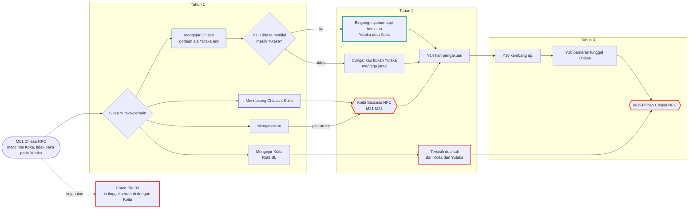
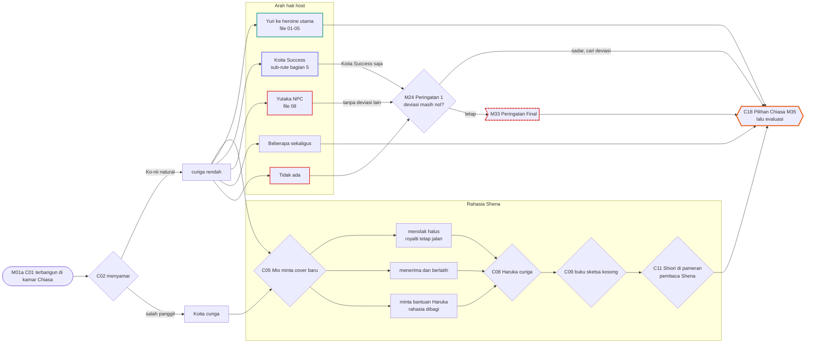
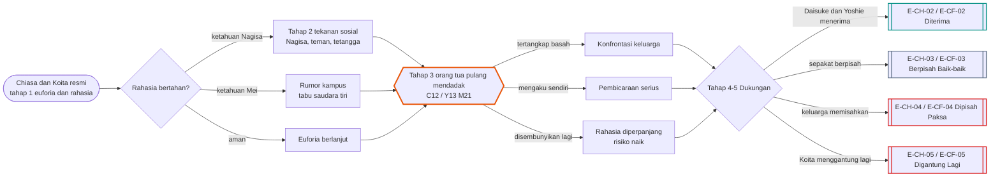
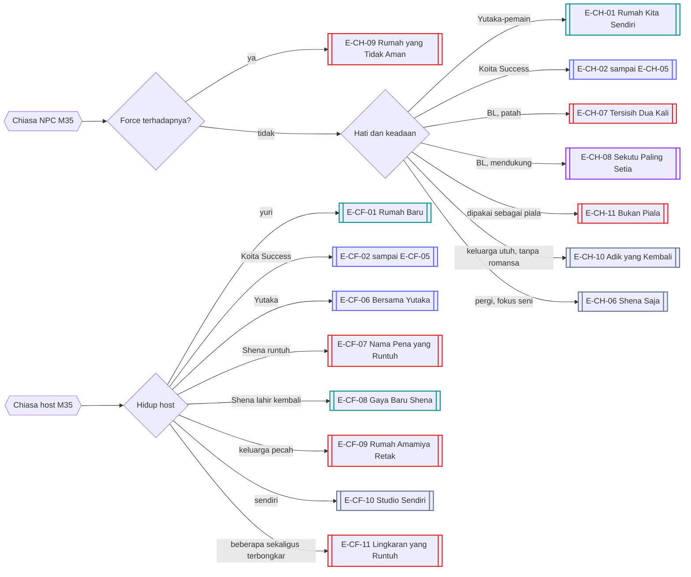
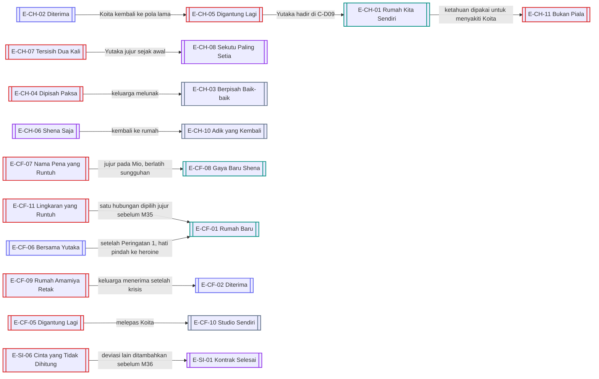
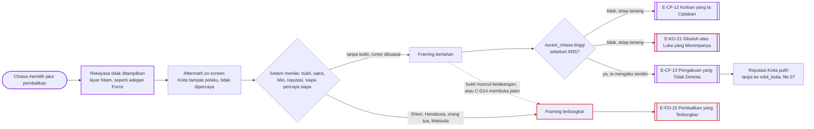

# Alur Cabang 06 — Amamiya Chiasa (NPC di Male Route, host di Female Route)

Status: 🟡 usulan. Dasar ✅ GDD 6B.3 dan 6B.5: rute khusus Chiasa (Koita Success / Step-Sibling Taboo) terpicu justru saat Chiasa **berhasil** menjalin hubungan dengan Koita; tabunya saudara tiri tanpa hubungan darah; tidak otomatis kerusakan psikologis; memakai fondasi yang sama dengan mekanik khusus. ✅ Chiasa bukan salah satu dari lima heroine utama.
Keputusanmu ⭐: Chiasa kebanyakan yuri; lurus hanya ke Koita dan Yutaka; **Chiasa × Yutaka saja tetap mati di evaluasi**; Koita Success saja tidak cukup untuk lolos.
Event: [Event_Chiasa.md](../../Karakter/Amamiya_Chiasa/Event_Chiasa.md) (host) dan [Event_Yutaka.md](../../Karakter/Kisaragi_Yutaka/Event_Yutaka.md) (Chiasa sebagai NPC).

## 1. Bentuk pohon
Chiasa punya **dua pohon**. Di Male Route ia NPC yang mencintai Koita dan tidak peka pada Yutaka. Di Female Route ia tubuh pemain, dengan tiga beban sekaligus: menyamar sebagai Chiasa, menjaga rahasia Shena padahal tidak bisa menggambar, dan mencari deviasi yang dihitung Sistem. Kedua pohon berbagi satu sub-rute: **Koita Success**, dengan mekanik **Rahasia** (berapa lama hubungan tersembunyi) dan **Dukungan** (siapa memihak). 11 ending NPC dan 13 ending host, termasuk jalur manipulasi pembalikan di §14.

## 2. Sumbu cabang
| Sumbu | Nilai | Berlaku |
|---|---|---|
| `chiasa_koita_success` | belum / rahasia / ketahuan / terbuka / berakhir | kedua route |
| `rahasia_ks` | aman / ketahuan Nagisa / ketahuan Mei / ketahuan orang tua | kedua route |
| `dukungan_ks` | siapa memihak: Daisuke, Yoshie, Yutaka, Nagisa, Haruka | kedua route |
| `sikap_yutaka` (Y) | mengejar Chiasa / mendukung Chiasa × Koita / mengejar Koita / abai | Male Route |
| `chiasa_curiga_yutaka` (Y) | apakah "Yutaka" masih Yutaka | Male Route |
| `chiasa_rahasia_shena` (C) | aman / dibagi Haruka / ketahuan Mio / terbongkar publik | Female Route |
| `kemampuan_gambar` (C) | nol / belajar / layak / gaya baru | Female Route |
| `arah_hati_host` (C) | heroine (yuri) / Koita / Yutaka / beberapa / tidak ada | Female Route |
| `deviasi_total` (C) | nol / rendah / cukup | Female Route, peringatan M24 dan M33 |

## 3. Pohon Male Route: Chiasa sebagai NPC

## 4. Pohon Female Route: Chiasa sebagai host

## 5. Sub-rute Koita Success (dipakai kedua route)

Peran pemain di sub-rute ini:
- **Male Route:** Yutaka bisa mendukung (deviasi Rendah karena Chiasa heroine tambahan; tidak cukup sendiri ⭐), menyabot (merebut Chiasa = deviasi Sedang), atau menjadi saksi yang membocorkan.
- **Female Route:** pemain sendiri yang menjalani tabu ini. Koita Success **plus** deviasi heroine utama = aman. Koita Success saja = Peringatan 1 di M24.

## 6. Garis besar cabang

### Male Route
- Yutaka asli diam-diam menyukai Chiasa (✅). Mengejar Chiasa dengan cara Yutaka asli (jahil, blak-blakan) membuat Chiasa tidak curiga. Mengejar dengan cara pemain sendiri membuatnya bertanya, "kau masih Yutaka?" (Y11).
- **Bingung (BG):** Chiasa nyaman dengan Yutaka tetapi merasa bersalah pada cintanya untuk Koita.
- **Curiga (CU):** Chiasa menjaga jarak; bisa membicarakan "Yutaka yang berubah" dengan Koita dan Nagisa (kecurigaan identitas menyebar).
- **Tersisih dua kali:** bila Yutaka mengejar Koita, Chiasa kehilangan Koita dan kehilangan Yutaka yang dulu menyukainya. Ia bisa marah, patah, atau menjadi sekutu paling setia.
- **Force:** ia tinggal serumah dengan Koita, jadi sulit menjauh dan mudah diamati (Aturan_Evaluasi §3.4).

### Female Route
- **Menyamar:** memanggil "Ko-nii" dengan natural menjaga curiga rendah. Kebiasaan yang berubah dicatat Koita, Haruka, dan Mio.
- **Rahasia Shena:** kemampuan menggambar tidak diwarisi (✅). Royalti ¥50.000 tetap masuk (✅), tetapi tawaran proyek baru dari Mio menguji rahasia. Belajar sungguh-sungguh bisa melahirkan "gaya baru Shena". Menyewa orang lain adalah kebohongan baru yang bisa ditemukan Shiori.
- **Arah hati:** yuri ke heroine utama (jalur deviasi paling aman), Koita Success, Yutaka (berbahaya tanpa deviasi lain), beberapa sekaligus, atau tidak ada.
- **Peringatan:** M24 bila deviasi masih nol ("Ini bukan penyimpangan. Ini pelarian."), lalu M33 sebagai peringatan final.

## 7. Diagram resolusi ending

## 8. Malam dan tubuh
- Tubuh Chiasa nokturnal (tidur sekitar 01:00–08:00). Di Female Route, dapur rumah Amamiya jam 02:00 adalah tempat paling sering bertemu Koita yang sedang menulis. Banyak benih Koita Success tumbuh di sini.
- Orang tua Amamiya bisa pulang tengah malam tanpa kabar (✅ kepulangan mendadak). Bila hubungan rahasia sedang berlangsung di rumah, ini cara tercepat ketahuan.
- Belajar menggambar untuk menyelamatkan rahasia Shena butuh begadang berminggu-minggu. Tangan gemetar karena kurang tidur membuat latihan sia-sia.
- Di Male Route, Chiasa NPC menggambar di ruang tamu jam 02:00 dan kadang menangis diam-diam setelah Koita menggantungnya. Yutaka yang mampir malam (biasanya mengabari dulu ✅) bisa menemukannya.

## 9. Ending
| Kode | Nama | Jenis | Host | Syarat inti | Isi |
|---|---|---|---|---|---|
| E-CH-01 | Rumah Kita Sendiri | Romantis | Y | Yutaka mengejar Chiasa; curiga identitas rendah atau diterima | dua orang yang sama-sama kesepian membangun rumah sendiri |
| E-CH-02 | Diterima | Koita | Y | Koita Success NPC; Daisuke dan Yoshie menerima | saudara tiri menjadi pasangan dengan restu keluarga |
| E-CH-03 | Berpisah Baik-baik | Neutral | Y | Koita Success NPC; keduanya memilih berpisah | tetap keluarga, dengan bekas yang hangat |
| E-CH-04 | Dipisah Paksa | Bad | Y | Koita Success NPC; keluarga menolak keras | Chiasa dipindahkan atau Koita pergi |
| E-CH-05 | Digantung Lagi | Bad | Y | Koita Success NPC; Koita kembali ke pola lama | Chiasa menjadi korban terbaru pola Koita |
| E-CH-06 | Shena Saja | Neutral | Y | tanpa romansa; Chiasa pindah dan fokus seni | karier ilustrasi berjalan; rumah ditinggalkan |
| E-CH-07 | Tersisih Dua Kali | Bad | Y | Rute BL berhasil; Chiasa tidak didekati | patah, menjauh dari keduanya |
| E-CH-08 | Sekutu Paling Setia | Khusus | Y | Rute BL; Yutaka jujur pada Chiasa sejak awal | Chiasa menjadi pendukung Yutaka × Koita di depan keluarga |
| E-CH-09 | Rumah yang Tidak Aman | Broken | Y | pemain pelaku Force terhadapnya | tinggal serumah dengan Koita; Daisuke dan Yoshie kecewa; tanpa romansa dengan pelaku |
| E-CH-10 | Adik yang Kembali | Neutral | Y | tidak ada rute romansa dengan Chiasa; keluarga utuh | ia tetap adik Koita dan sahabat Yutaka |
| E-CH-11 | Bukan Piala | Bad | Y | Yutaka merebut Chiasa hanya untuk menyakiti Koita, lalu ketahuan | Chiasa menolak keduanya |
| E-CF-01 | Rumah Baru | Romantis | C | yuri dengan heroine utama; deviasi cukup | hidup bersama heroine; reaksi keluarga Amamiya menentukan nada epilog |
| E-CF-02 | Diterima | Koita | C | Koita Success; keluarga menerima | tabu yang direstui |
| E-CF-03 | Berpisah Baik-baik | Neutral | C | Koita Success; keduanya mundur | kembali menjadi adik tiri |
| E-CF-04 | Dipisah Paksa | Bad | C | Koita Success; keluarga memisahkan | salah satu meninggalkan rumah |
| E-CF-05 | Digantung Lagi | Bad | C | Koita Success; Koita kembali menggantung | pemain merasakan pola Koita dari dalam |
| E-CF-06 | Bersama Yutaka | Koita | C | Chiasa × Yutaka | hidup bersama Yutaka; **lolos evaluasi hanya bila ada deviasi lain** (bila tidak, E-SI-06) |
| E-CF-07 | Nama Pena yang Runtuh | Bad | C | rahasia Shena terbongkar sebagai kebohongan | kontrak Mio diputus; pembaca marah |
| E-CF-08 | Gaya Baru Shena | Romantis | C | pemain belajar menggambar sungguhan sampai layak | Shena kembali dengan gaya baru; Mio dan Haruka menjadi saksi |
| E-CF-09 | Rumah Amamiya Retak | Bad | C | Koita Success atau kejahatan memecah keluarga | Daisuke dan Yoshie berpisah tempat; rumah sepi |
| E-CF-10 | Studio Sendiri | Neutral | C | tanpa romansa | mandiri di studio kecil; lolos atau tidaknya bergantung deviasi yang dibuat dengan cara lain |
| E-CF-11 | Lingkaran yang Runtuh | Bad | C | beberapa hubungan yuri sekaligus terbongkar | semua pergi bersamaan; lihat E-X-01 |
| E-CF-12 | Korban yang Ia Ciptakan | Khusus | C | jalur manipulasi pembalikan (§14); framing bertahan; `nurani_chiasa` < 70 sebelum M35 | Chiasa tampil sebagai korban, Koita dicap pelaku dan hancur; tanpa romansa; tak bisa diputar balik dan bisa muncul lagi |
| E-CF-13 | Pengakuan yang Tidak Diminta | Khusus | C | `nurani_chiasa` ≥ 70 sebelum M35; framing pernah terpasang lalu dicabut sendiri | ia mengaku sebelum siapa pun membuktikannya; reputasi Koita pulih meski kepercayaan di antara mereka tidak pernah utuh lagi; konsekuensi sosial padanya tetap ada tapi lebih ringan karena kooperatif |

## 10. Interlock
- **Nagisa:** rival lama. Koita Success hampir selalu ketahuan lewat Nagisa lebih dulu.
- **Yutaka (NPC, Female Route):** mencintai "Chiasa". Bila Chiasa memilih Yutaka demi bertahan hidup dan Yutaka mengetahuinya, lihat E-YU-05.
- **Shiori:** rahasia Shena adalah jembatan atau perangkap (file 05).
- **Moeka:** satu fakultas; Chiasa host paling mudah melihat tanda bahaya Moeka di studio.
- **Haruka:** sahabat sekaligus target rute sampingan yuri (file 11). Membagi rahasia Shena dengannya mengubah semua cabang C08.

## 11. Poin dan ambang
Skala dan aturan umum: [Sistem_Cabang_dan_Poin.md](../Sistem_Cabang_dan_Poin.md) §2–§3.

| Poin | Awal | Naik karena | Turun karena | Ambang dan akibat |
|---|---|---|---|---|
| `cinta_koita_chiasa` (NPC) | 80 | momen plot armor; Koita membalas | Koita menggantung; Rute BL | < 50: Chiasa mulai melihat Yutaka · < 30: Koita Success tertutup |
| `nyaman_yutaka` (NPC) | 30 | godaan ala Yutaka asli; hadir di malam yang berat (C-D09); mendukung karyanya | Yutaka mengejar Koita; Chiasa dipakai untuk menyakiti Koita | 50: Chiasa bingung · 70: E-CH-01 menguat |
| `curiga_identitas[chiasa]` (Y) | 0 | kebiasaan Yutaka berubah | meniru kebiasaan Yutaka asli | 50: menjaga jarak · 75: konfrontasi ([08_Yutaka.md](08_Yutaka.md) §4) |
| `rahasia_ks` | 0 | Koita Success berjalan; keintiman di rumah; Nagisa melihat sesuatu | berhati-hati; bertemu di luar rumah | 50: Nagisa curiga · 75: ketahuan (tahap 2) |
| `dukungan_ks[x]` (Daisuke, Yoshie, Yutaka, Nagisa, Haruka) | 0–30 | x diajak bicara jujur lebih dulu | x tahu dari orang lain | total tinggi: E-CH-02 atau E-CF-02 menguat · rendah: E-CH-04 atau E-CF-04 |
| `rumah_hangat` | 70 | makan malam keluarga; video call dengan orang tua; kejujuran | kebohongan; kejutan Koita Success; kejahatan | < 30: E-CF-09 dan E-CH-04 menguat |
| `shena_risiko` (C) | 20 | proyek baru diterima; Mio menelepon; Haruka membandingkan sketsa; bertemu Shiori | jujur pada Haruka; berlatih | 50: C08 · 75: terbongkar kecuali ada pengakuan |
| `kemampuan_gambar` (C) | 0 | jam latihan malam; kelas; Haruka mengajar | tangan gemetar karena Sangat Lelah | 30: sketsa layak ditunjukkan · 50: sanggup proyek kecil · 80: E-CF-08 terbuka |
| `siklus` (C) ⭐ | 3–5 hari per bulan | kalender tubuh | obat apotek; istirahat | energi turun dan nyeri; pilihan "minta izin" muncul; NPC bereaksi (Haruka membawa minuman hangat, Yoshie menelepon, Koita canggung tapi membantu) |
| `deviasi_host` (C) | 0 | heroine utama lepas dari Koita lewat Chiasa | — | masih nol di M24: Peringatan 1 · M33: Peringatan Final |
| `framing_koita` (C) ⭐ | tidak ada | pemain memilih jalur pembalikan (§14) | diakui sendiri (E-CF-13) atau dibuktikan orang lain (E-FO-15) | terpasang: akibat langsung on-screen · bertahan: `bukti_digital` rendah dan `nurani_chiasa` < 40 · terbongkar: Shiori/Hanabusa/Daisuke-Yoshie/Matsuda cukup kuat |
| `nurani_chiasa` (C) ⭐ | 100 | retak di depan Haruka/Yutaka tanpa ditekan (C-D14); menolak melanjutkan saat nyaris ketahuan (C-D15) | memilih tenang di C-D13/C-D14/C-D15; melihat fallout tanpa bergerak | ≥70 sebelum M35: bisa mengaku sendiri (E-CF-13) · 40–69: retak kecil di depan satu orang, tapi tidak mengaku · < 40: tenang total; E-CF-12 menguat, dan E-FO-15 (bila terbongkar) kehilangan simpati |

## 12. Event dinamis
| ID | Nama | Syarat | Isi dan cabang | Efek |
|---|---|---|---|---|
| C-D01 | Dapur Jam Dua | Chiasa host; Koita menulis sampai larut | buatkan teh untuk Koita / goda / bicara serius / kembali ke kamar | benih Koita Success atau ikatan saudara |
| C-D02 | Dua Sketsa Berdampingan | Chiasa host; `shena_risiko` ≥ 40 | Haruka meletakkan sketsa lama dan baru berdampingan. Jujur / beri alasan / minta Haruka mengajar | rahasia Shena dibagi, atau curiga naik |
| C-D03 | Tangan yang Gemetar | Chiasa host; berlatih saat Sangat Lelah | berhenti dan tidur / paksa sampai pagi / minta Haruka mengajar | `kemampuan_gambar` hanya naik sedikit saat lelah; tubuh menanggung |
| C-D04 | Hari Pertama ⭐ | Chiasa host; siklus jatuh di hari penting | tetap hadir / izin / minta bantuan Haruka atau Yoshie lewat video call | hasil event hari itu bergeser; Yoshie menjadi lebih dekat |
| C-D05 | Video Call dari Luar Negeri | kedua route | Daisuke menelepon jam 03:00 waktu Jepang. (C) "Kamu berubah, Nak." (Y) Daisuke meminta Yutaka menjaga Chiasa | curiga identitas (C) atau tanggung jawab baru (Y) |
| C-D06 | Pagar di Antara Dua Rumah | kedua route; Nagisa dan Chiasa sama-sama di rumah | adu mulut di pagar. Lerai / ikut / tonton | rivalitas atau damai; Koita Success bisa ketahuan |
| C-D07 | Pesan Mio Jam Sebelas | Chiasa host; ada proyek | mengaku tidak sanggup / minta perpanjangan / sewa ilustrator / begadang | menyewa = kebohongan baru yang bisa ditemukan Shiori; begadang = tubuh dan kemampuan |
| C-D08 | Kopi dari Yutaka | Chiasa host; Yutaka NPC mengabari dulu | ia mampir membawa kopi malam. Undang masuk / mengobrol di teras / tolak | `yutaka_harap` ±; Koita melihat dari jendela |
| C-D09 | Tangis di Ruang Tamu | Male Route; Koita baru menggantung Chiasa | Yutaka menemukan Chiasa menangis. Hibur / panggil Koita / pergi / manfaatkan | `nyaman_yutaka` ±; memanfaatkan membuka E-CH-11 |
| C-D10 | Bandara Jam Lima | kedua route; orang tua pulang mendadak | telepon "jemput kami". Jemput / tidak | Koita Success yang sedang berjalan bisa ketahuan di dalam mobil |
| C-D11 | Karya yang Dibeli Diam-diam | Male Route | Yutaka membeli karya Chiasa secara anonim; Haruka mengetahuinya. Akui / sangkal | `nyaman_yutaka` + bila diakui |
| C-D12 | Kuas yang Dipinjam | Chiasa host; Intim ≥ 50 dengan seorang heroine | heroine meminjam kuas atau minta digambar. Gambar dia / ajak melukis bersama / tolak | jalur yuri dengan heroine itu menguat |
| C-D13 | Mata yang Kering | `framing_koita` terpasang; fallout mulai terlihat publik | Chiasa menyaksikan dari jauh: Koita dijauhi, dipertanyakan. Tetap tenang / berpura-pura sedih di depan orang / diam-diam merasa goyah | tenang: `nurani_chiasa` −15 · pura-pura sedih: reputasi aman, tidak berubah · goyah diam-diam: `nurani_chiasa` +10, membuka C-D14 lebih cepat |
| C-D14 | Pengakuan Setengah | Trust Haruka atau `yutaka_harap` Sedang+; `framing_koita` terpasang | Chiasa hampir mengaku pada satu orang, lalu membungkusnya sebagai "perlu dilakukan". Biarkan mereka tahu sebagian / tarik kembali ucapan / mengaku penuh | mengaku penuh: `nurani_chiasa` +25, confidant jadi saksi yang bisa meruntuhkan framing atau bersekutu diam-diam; sebagian: confidant curiga tapi tidak yakin |
| C-D15 | Nyaris Ketahuan | `framing_koita` bertahan; `bukti_digital` mendekati ambang | sesuatu nyaris membuka retakan dalam ceritanya. Tangani dengan tenang / dramatisir supaya dikasihani / biarkan saja | tenang: `nurani_chiasa` −10, orang sekitar makin tidak curiga karena reaksinya "wajar"; dramatisir berlebihan: dibaca Shiori sebagai kejanggalan |

## 13. Belok ke ending lain
Ending host bisa belok sampai M35. Belok paling penting di Female Route melintasi lapisan evaluasi: E-SI-06 masih bisa dihindari selama deviasi lain ditambahkan sebelum wisuda.

## 14. Manipulasi pembalikan ⭐
Keputusanmu: di rute tergelap, Chiasa (host, Female Route) bisa membalik framing sehingga Koita, korban aslinya, tampak sebagai penyerang. Diperlakukan **persis seperti adegan Force: rekayasanya tidak ditampilkan, akibatnya ditampilkan.**

- **Tidak ditampilkan:** bagaimana situasi itu disusun. Sama seperti layar hitam pada Force, game memotong dari keputusan Chiasa langsung ke keadaan setelah framing sudah terpasang. Dokumen tidak menuliskan caranya (konsisten dengan [09_Force §2](09_Force_dan_Kriminal.md)).
- **Ditampilkan:** Koita tiba-tiba jadi pihak yang dituduh dan tidak bisa membuktikan sebaliknya; ia tidak dipercaya, dikucilkan, disalahkan; keruntuhan mentalnya makin dalam ([07_Koita §14](07_Koita_dan_BL.md)); Chiasa tampil sebagai korban di mata publik.
- **Bertahan atau runtuhnya ditentukan sistem yang sudah ada**, bukan tombol menang: `bukti_digital`, saksi, Kurosawa Mei, reputasi per lingkungan, dan siapa percaya siapa. Karena itu framing rapuh. `framing_koita`: tidak ada / terpasang / bertahan / terbongkar.
- **Siapa yang bisa meruntuhkannya:** Shiori (silang data), Hanabusa (jalur hukum), Daisuke dan Yoshie (orang tua yang mengenal keduanya sejak kecil dan sulit dibohongi), Matsuda (membela Koita), dan bukti yang muncul belakangan (analog E-FO-08).
- **Tidak ada romansa** dari jalur ini. Ini outcome antagonis yang punya harga, bukan jalan menuju Koita Success.
- **Evaluasi:** Sistem menghitung hasilnya (Koita kehilangan Chiasa dan hancur) sebagai deviasi tinggi, terpisah dari akibat hukum dan sosial.

### Karakterisasi, bukan metode
Yang ditulis di sini adalah siapa Chiasa saat memilih jalur ini — psikologinya, bukan langkah teknisnya.
- **Rasionalisasi dinginnya:** Chiasa tidak menganggap dirinya jahat. Dalam logikanya sendiri, Koita sudah lama menyakiti orang-orang yang ia sayangi tanpa pernah menanggung akibat; apa yang terjadi padanya sekarang, menurutnya, hanya "akhirnya ditagih". Itu rasionalisasi seorang karakter, bukan pembenaran yang diajukan narasi.
- **Tidak gemetar.** Bagian yang membuatnya mengerikan bukan kemarahannya, melainkan ketenangannya. Ia tidur, makan, dan tersenyum di meja makan keluarga Amamiya seperti biasa, sementara Koita hancur di luar sana.
- **Retak itu mungkin, tapi jarang.** `nurani_chiasa` melacak apakah di balik ketenangan itu masih ada sesuatu yang bisa pecah. Tinggi berarti ia masih bisa mengaku sendiri sebelum M35 (E-CF-13); rendah berarti tidak ada lagi yang tersisa untuk pecah.

### Reaksi orang dekat
Tidak satu pun dari ini membuka cara kerja framing-nya; ini hanya bagaimana orang-orang di sekitarnya membaca Chiasa yang berubah.

| Siapa | Yang mereka perhatikan | Yang mereka lakukan |
|---|---|---|
| Daisuke dan Yoshie | reaksinya "terlalu rapi" untuk seseorang yang katanya baru diserang; mereka mengenalnya sejak kecil dan tahu nada aslinya | bertanya berulang, bukan sekali; `dukungan_ks` goyah pelan-pelan bila ia terus terlalu tenang di depan mereka |
| Haruka | sahabat yang paling sering mendengar C-D14; mengenali saat Chiasa "membungkus" sesuatu | bisa jadi orang pertama yang curiga, atau orang pertama yang memilih tidak bertanya lagi |
| Yutaka (NPC) | mengenal Koita sejak kecil; versi cerita Chiasa tidak pas dengan Koita yang ia kenal | bisa mendekat ke Matsuda atau Shiori untuk membandingkan cerita |
| Matsuda | sudah curiga pada pola Koita sejak awal (K01-A), tapi tuduhan ini tidak cocok dengan apa pun yang pernah ia amati sendiri | membela Koita secara terbuka; lihat K-D21 di [07_Koita_dan_BL.md](07_Koita_dan_BL.md) |
| Nagisa | mengenal Koita seumur hidup; marah lebih dulu, berpikir belakangan | reaksi kerasnya ke arah mana pun bisa membuat framing lebih cepat bertahan atau lebih cepat retak |

Ending: E-CF-12 (framing bertahan, tenang total), E-CF-13 (ia mengaku sendiri), E-FO-15 (framing terbongkar oleh orang lain), E-KO-21 (sisi Koita bila framing bertahan tanpa pengakuan).
