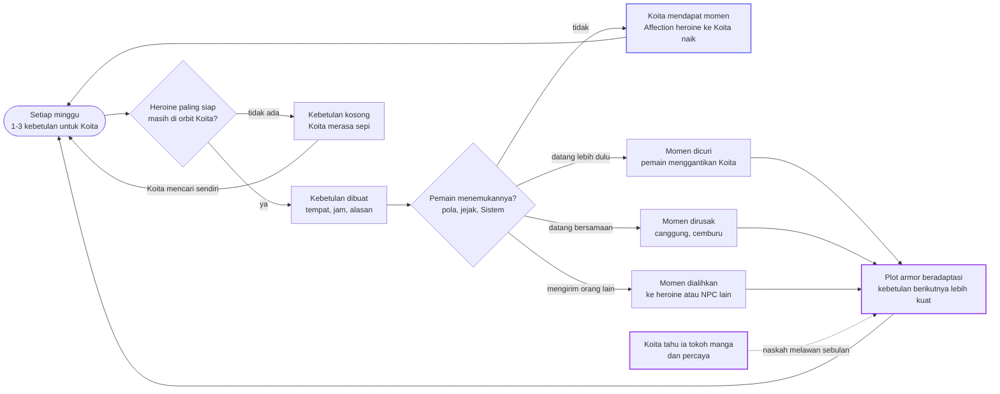
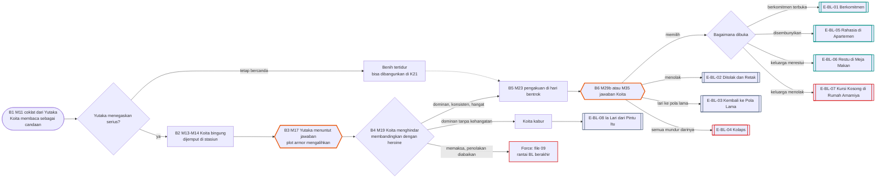
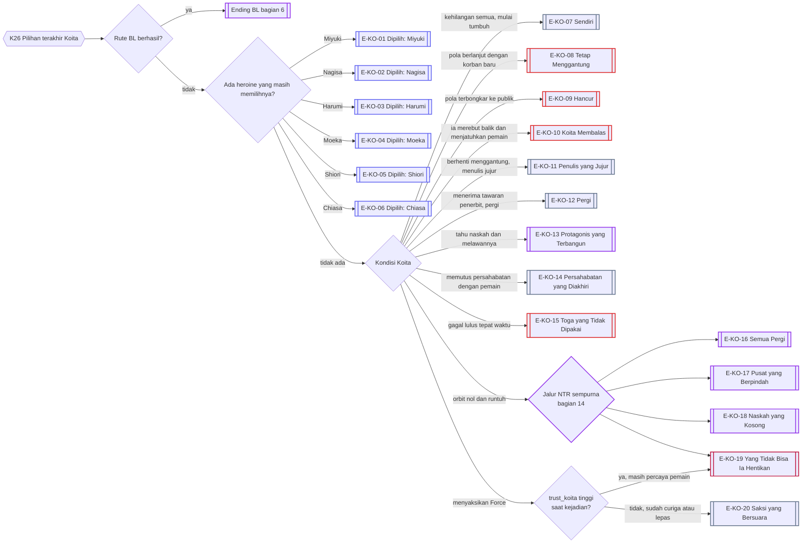
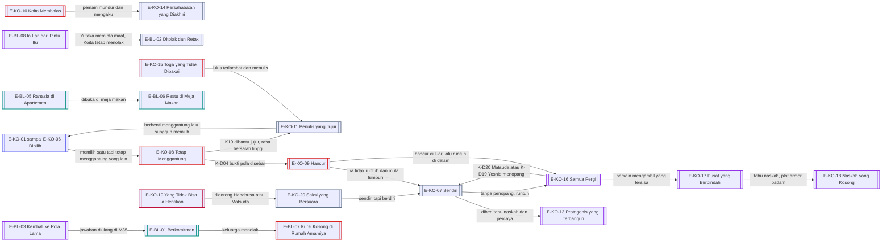
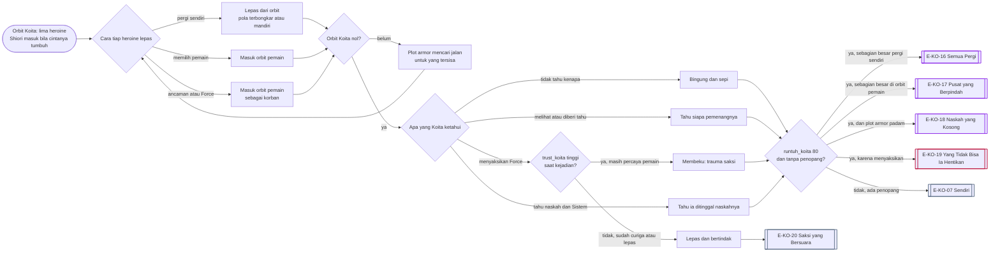

# Alur Cabang 07 — Amamiya Koita dan Rute BL

Status: 🟡 usulan. Dasar ✅ Master Canon §3: Koita sadar sejumlah gadis menyukainya dan sengaja menggantung perasaan mereka; tidak tahu dirinya tokoh manga; plot armor menciptakan kebetulan tetapi **tidak bisa memaksakan cinta**. ✅ GDD 6J: NPC mengambil keputusan penting sendiri. Rute BL ⭐: Yutaka (pemain) bisa mengejar Koita, Yutaka yang dominan, penolakan Koita dihormati.
Event: [Event_Koita.md](../../Karakter/Amamiya_Koita/Event_Koita.md).

## 1. Bentuk pohon
Koita bukan hadiah di ujung rute. Ia **pemain lawan**. Pohonnya bercabang pada tiga hal: seberapa cepat ia sadar (`koita_sadar`), bagaimana ia membalas (simpati, menyudutkan, konfrontasi), dan apa yang pemain lakukan dengan rahasianya (pola menggantung, cinta SMA pada Miyuki, ayahnya). Di atasnya ada plot armor yang terus memberinya kesempatan, dan Rute BL yang memaksa Koita berhenti menggantung. 21 ending Koita dan 8 ending BL, termasuk **jalur NTR sempurna** (bagian 14): Koita hancur, tidak ada satu pun yang bersamanya, dan ia kena mental.

## 2. Sumbu cabang
| Sumbu | Nilai | Digerakkan oleh |
|---|---|---|
| `koita_sadar` | 0 nyaman, 1 ada yang aneh, 2 panik dan manuver balik, 3 konfrontasi terbuka | K09, K15, K18, K20 |
| `pola_koita_dikenal` | pemain tahu polanya | K01-A, K03-A |
| `pola_koita_publik` (baru) | heroine atau publik tahu polanya | K11, K14, bukti, Shiori |
| `manuver_koita` (baru) | simpati / menyudutkan / konfrontasi / sekutu | `koita_sadar` dan sikap pemain |
| `koita_tahu_naskah` (baru) | Koita diberi tahu ia tokoh manga: tidak percaya / percaya | pengakuan pemain (file 10) |
| `plot_armor_tekanan` (baru) | seberapa sering kebetulan Koita dicuri | bagian 4 |
| `bl_tahap` (Y) | B0–B6 | rantai BL |
| `gaya_dominan` (Y) | konsisten dan hangat / tanpa kehangatan / memaksa | pilihan pemain di rantai BL |
| `koita_status` | Menggantung / Dipilih / Sendiri / Hancur / lainnya | K26 |
| `orbit_koita` (baru) | jumlah heroine yang masih di orbit Koita | bagian 11 dan 14 |
| `runtuh_koita` (baru) | dari baik-baik saja sampai runtuh mental | bagian 11 dan 14 |

## 3. Pohon utama Koita

```mermaid
flowchart LR
  classDef gerbang stroke:#ea580c,stroke-width:3px
  classDef koita stroke:#6366f1,stroke-width:2px
  classDef buruk stroke:#dc2626,stroke-width:2px
  classDef romantis stroke:#0d9488,stroke-width:2px
  classDef khusus stroke:#9333ea,stroke-width:2px
  S(["M01a K01 senyum yang terlalu cepat"])
  subgraph T1["Tahun 1 · nyaman"]
    I1["K01-A pola dicatat<br/>intel pemain"]
    I3["K03 tanzaku: semoga semua tetap begini<br/>ketakutan Koita"]
    K4{"K04 kalau kamu jadi aku,<br/>memilih siapa?"}
    K4D["D menyebut nama sendiri<br/>benih BL atau Koita Success"]
    K10{{"K10 coklat yang tidak habis<br/>GERBANG BL dan KS M11"}}
    K11["K11 hadiah yang sama<br/>heroine sadar disamakan"]
  end
  S --> I1
  S --> I3
  S --> K4
  K4 --> K4D
  K4D --> K10
  I1 --> K11
  K10 --> K11
  subgraph T2["Tahun 2 · retak"]
    K14{"K14 rumor tentang Koita"}
    K14C["disebarkan pemain<br/>jalur kehancuran"]
    K15{{"K15 panik pertama<br/>koita_sadar naik M19"}}
    MB{"Manuver balik Koita"}
    K16["K16 telepon larut<br/>cerita tentang ayah"]
    K17{{"K17 Hari Pengakuan Bentrok M23"}}
    K18["K18 daftar nama yang ia pilih"]
  end
  K11 --> K14
  K14 --> K14C
  K14 --> K15
  K14C --> K15
  K15 --> MB
  MB --> K16
  K16 --> K17
  K17 --> K18
  subgraph T3["Tahun 3 · tagihan"]
    K19{"K19 skripsi: tokoh yang tidak memilih"}
    K20["K20 atap penginapan<br/>bicara jujur"]
    K23{"K23 tawaran penerbit"}
    K25["K25 Natal sendirian"]
    K26{{"K26 Pilihan terakhir Koita M35"}}
  end
  K18 --> K19 --> K20 --> K23 --> K25 --> K26
  K19 -->|disabotase| TG["Toga yang tidak dipakai<br/>Koita gagal lulus tepat waktu"]
  TG --> K26
  class K10,K15,K17,K26 gerbang
  class K4D,K16 romantis
  class K14C,TG buruk
  class MB khusus
```

## 4. Plot armor: kebetulan yang bisa dicuri

Batas ✅: plot armor tidak bisa memaksa cinta atau mengendalikan pikiran. Kebetulan yang paling kuat pun hanya peluang.

## 5. Manuver balik Koita
Saat `koita_sadar` mencapai 2 (K15), Koita bergerak sendiri (✅ 6J). Urutan dasarnya dari file karakter: menggalang simpati lewat citra baiknya, menyudutkan pemain secara sosial tanpa menyebar kebohongan (tetapi tidak mengoreksi rumor yang menguntungkannya), lalu konfrontasi pribadi.

| Respons pemain | Hasil |
|---|---|
| Membongkar pola Koita lebih dulu (bukti, kesaksian heroine) | simpati berbalik; `pola_koita_publik` naik; jalur E-KO-09 |
| Bersekutu dengannya (jujur sebagian di K15-A atau K20) | Koita menjadi sekutu canggung; jalur E-KO-11 atau Rute BL |
| Melawan balik di lingkungan sosial | perang reputasi; Mei mendapat bahan; dua pihak sama-sama rugi |
| Memanfaatkan kepanikannya (K15-D, K16-C) | Fear naik; Koita bisa runtuh atau berbalik keras (E-KO-10) |
| Memberitahunya soal Sistem dan naskah | lihat `koita_tahu_naskah` dan E-KO-13 |
| Diam | Koita merebut balik heroine yang masih ragu |

## 6. Rantai BL — Yutaka × Koita ⭐ (Male Route)

Catatan rantai BL:
- **Dominan** berarti Yutaka memutuskan ritme, menutup jalur menggantung, dan menuntut kejelasan. Koita punya ruang menolak, dan penolakannya berarti.
- **Reaksi sekitar:** Nagisa (yang curhat pada Yutaka) paling terkejut; Chiasa tersisih dua kali (E-CH-07 atau E-CH-08); Daisuke dan Yoshie perlu dijelaskan; Matsuda bisa menjadi pelindung Koita atau penyebar kabar.
- **Female Route:** pemain sebagai Chiasa mengejar Koita lewat Koita Success (file 06). Koita menolak di awal (saudara tiri, rasa takut) dan mulai menerima bila Chiasa konsisten dan tidak menggantungnya balik.

## 7. Diagram resolusi ending Koita

## 8. Malam dan tubuh
- Koita menulis sampai 01:00. Di Female Route, dapur rumah Amamiya jam 02:00 adalah tempat ia paling jujur.
- **K16 Telepon larut** butuh pemain terjaga atau mode Normal. Melewatkannya menutup akar cerita ayah Koita sampai K20.
- `koita_sadar` 2+: ia terjaga di Dini Hari, membeli minuman di konbini, berjalan ke taman masa kecil. Pertemuan acak di jam ini adalah benih BL paling kuat di Male Route (contoh C di dokumen sistem).
- Koita bisa datang ke apartemen Yutaka tengah malam setelah heroine menjauh. Membuka pintu dalam keadaan Sangat Lelah membuat pemain lebih mudah mengatakan hal yang tidak direncanakan.

## 9. Ending
| Kode | Nama | Jenis | Host | Syarat inti | Isi |
|---|---|---|---|---|---|
| E-KO-01 | Dipilih: Miyuki | Koita | Y/C | Miyuki masih memilih Koita; Koita memilihnya | jalur manga; cinta SMA Koita akhirnya diakui |
| E-KO-02 | Dipilih: Nagisa | Koita | Y/C | `harapan_koita` Nagisa tegak | teman masa kecil yang akhirnya dijawab |
| E-KO-03 | Dipilih: Harumi | Koita | Y/C | Harumi tahap ≤ 2; Koita memilihnya | variabel tetap |
| E-KO-04 | Dipilih: Moeka | Koita | Y/C | Moeka selamat; hatinya ke Koita | Koita belajar menepati janji |
| E-KO-05 | Dipilih: Shiori | Koita | Y/C | cinta Koita tumbuh di S08 | lawan yang ia kira tak tersentuh |
| E-KO-06 | Dipilih: Chiasa | Koita | Y/C | Koita Success (NPC atau host) | tabu saudara tiri; lihat file 06 |
| E-KO-07 | Sendiri | Neutral | Y/C | semua heroine menjauh; Koita tidak runtuh | kehilangan semuanya, mulai bertumbuh |
| E-KO-08 | Tetap Menggantung | Bad | Y/C | pola tidak pernah terbongkar | pola lama berlanjut dengan korban baru |
| E-KO-09 | Hancur | Bad | Y/C | `pola_koita_publik` tinggi; atau E-SH-09 | lingkungan menjauh setelah sifat aslinya terbukti |
| E-KO-10 | Koita Membalas | Bad | Y/C | manuver balik berhasil; pemain kalah perang reputasi | Koita merebut balik heroine dan menjatuhkan pemain di mata semua orang |
| E-KO-11 | Penulis yang Jujur | Neutral | Y/C | K19 dibantu jujur; K20 diisi kebenaran sebagian | berhenti menggantung; menulis novel tentang tokoh yang tidak pernah memilih |
| E-KO-12 | Pergi | Neutral | Y/C | K23-A didukung pergi | menerima tawaran penerbit di kota lain dan meninggalkan semuanya |
| E-KO-13 | Protagonis yang Terbangun | Khusus | Y/C | `koita_tahu_naskah` percaya | Koita sengaja melawan plot armor-nya; pilihannya kini benar-benar miliknya |
| E-KO-14 | Persahabatan yang Diakhiri | Neutral | Y/C | Koita tahu semua manipulasi pemain; tidak runtuh | ia memutus pemain dengan tenang dan tidak pernah kembali |
| E-KO-15 | Toga yang Tidak Dipakai | Bad | Y/C | K19 disabotase atau Koita runtuh di Tahun 3 | Koita gagal lulus tepat waktu; evaluasi tetap di tanggal wisuda angkatannya |
| E-KO-16 | Semua Pergi | Khusus | Y/C | `orbit_koita` 0; sebagian besar heroine pergi sendiri (pola terbongkar atau memilih mandiri); `runtuh_koita` ≥ 80; tanpa penopang | NTR sempurna: tidak ada satu pun yang tersisa. Koita berhenti menulis dan kuliah, mengurung diri, kena mental; ditulis lewat kondisi dan dampaknya |
| E-KO-17 | Pusat yang Berpindah | Khusus | Y/C | `orbit_koita` 0; minimal tiga heroine kini di orbit pemain, karena memilih pemain atau terikat lewat ancaman atau Force ⭐; Koita tahu; `runtuh_koita` ≥ 80 | NTR sempurna: lingkaran yang dulu berputar di sekitar Koita kini berputar di sekitar pemain, dan Koita menjadi figuran di ceritanya sendiri. Slide tiap heroine berbeda: yang memilih pemain tampak bahagia, yang dipaksa tampak hancur |
| E-KO-18 | Naskah yang Kosong | Khusus | Y/C | syarat E-KO-16 atau E-KO-17; Koita tahu soal naskah dan percaya; plot armor padam (K-D14) | Koita sadar ia protagonis yang ditinggalkan naskahnya sendiri; kebetulan tidak pernah datang lagi. Sistem membacakan: "Protagonis selesai." |
| E-KO-19 | Yang Tidak Bisa Ia Hentikan | Broken | Y/C | Koita menyaksikan Force; `trust_koita` masih tinggi saat itu (ia masih percaya dan dekat dengan pemain), sehingga ia membeku alih-alih bertindak; korban tidak kembali padanya | trauma karena gagal melindungi orang yang masih ia percaya; ia tidak sanggup mendekati siapa pun lagi. Bisa menempel sebagai lapisan di E-KO-16 atau E-KO-17 |
| E-KO-20 | Saksi yang Bersuara | Neutral | Y/C | Koita menyaksikan atau mengetahui Force saat `trust_koita` sudah rendah (sudah lama curiga atau lepas dari pemain), sehingga ia bisa bertindak alih-alih membeku | dari orang yang sudah tidak percaya menjadi orang yang menjatuhkan pemain; sendiri, tetapi berdiri. Berjalan bersama E-FO-11 |
| E-KO-21 | Dituduh atas Luka yang Menimpanya | Broken | C | jalur manipulasi pembalikan Chiasa ([06_Chiasa.md](06_Chiasa.md) §14) bertahan; `runtuh_koita` ≥ 80 | Koita korban yang justru dicap pelaku; tidak dipercaya dan tidak bisa membuktikan sebaliknya; runtuh dalam diam. K-D21 (ada yang tetap percaya) atau C-D14/C-D15 (Chiasa sendiri goyah) bisa membelokkan ini sebelum M35 |
| E-BL-01 | Berkomitmen | Romantis | Y | B6 memilih; dibuka terbuka | Koita berhenti menggantung dan memilih Yutaka |
| E-BL-02 | Ditolak dan Retak | Neutral | Y | B6 menolak | persahabatan sejak kecil retak |
| E-BL-03 | Kembali ke Pola Lama | Neutral | Y | B6 lari; Yutaka mundur | Koita kembali menggantung semua orang, termasuk Yutaka |
| E-BL-04 | Kolaps | Bad | Y | semua orang, termasuk Yutaka, mundur darinya | Koita kolaps setelah sendirian |
| E-BL-05 | Rahasia di Apartemen | Romantis | Y | B6 memilih; disembunyikan | hubungan berlanjut diam-diam; Chiasa tahu |
| E-BL-06 | Restu di Meja Makan | Romantis | Y | B6 memilih; Daisuke dan Yoshie menerima | makan malam keluarga dengan satu kursi tambahan yang kini resmi |
| E-BL-07 | Kursi Kosong di Rumah Amamiya | Bad | Y | B6 memilih; keluarga menolak | Koita meninggalkan rumah dan tinggal di apartemen Yutaka |
| E-BL-08 | Ia Lari dari Pintu Itu | Neutral | Y | B4 dominan tanpa kehangatan | Koita kabur dari Yutaka dan dari semuanya |

## 10. Interlock
- **Semua heroine:** Koita adalah pusat Fate Deviation. Setiap heroine yang menjauh darinya menaikkan deviasi (Aturan_Evaluasi §1).
- **Shiori:** satu-satunya yang bisa menjatuhkan Koita secara sistematis (E-SH-09).
- **Miyuki:** rahasia cinta SMA Koita (file 01).
- **Chiasa:** BL dan Koita Success saling mengunci di Male Route.
- **Wisuda:** evaluasi terjadi di tanggal wisuda angkatan Koita, bahkan bila Koita sendiri gagal lulus (E-KO-15). Ini menutup celah "menunda wisuda untuk menunda evaluasi".
- **Ending tersembunyi ⭐:** satu varian langka dari E-KO-13 — Koita menolak memilih siapa pun di K26 bukan karena menggantung atau hancur, tetapi karena ia sadar dan sengaja berhenti memerankan protagonis harem. Dipasangkan dengan tiga gerbang lain, ini membuka satu ending rahasia untuk pemain: [10_Sistem_dan_Evaluasi.md](10_Sistem_dan_Evaluasi.md) §11.

## 11. Poin dan ambang
Skala dan aturan umum: [Sistem_Cabang_dan_Poin.md](../Sistem_Cabang_dan_Poin.md) §2–§3.

| Poin | Awal | Naik karena | Turun karena | Ambang dan akibat |
|---|---|---|---|---|
| `koita_sadar` | 0 | heroine menjauh; kebetulan gagal (K-D10); rumor; K-D08 | semuanya kembali seperti biasa | 25: ketakutan (K09) · 50: manuver balik (bagian 5) · 75: konfrontasi terbuka, X-D07 |
| `pola_publik` | 0 | bukti K-D04 disebar; K14-C; Matsuda menulis; Shiori | Koita berubah sungguh-sungguh | 50: simpati berbalik · 80: E-KO-09 menguat |
| `rasa_bersalah_koita` | 10 | melihat heroine terluka (Harumi, Moeka); K16-A | ia mengalihkan diri | 60: E-KO-11 menguat · 80: risiko runtuh (E-KO-15) |
| `takut_ditinggal` | 50 | heroine pergi; Yutaka atau Chiasa menjauh | seseorang tetap tinggal | tinggi: manuver balik makin keras dan rantai BL makin rapuh |
| `ikatan_bl` (Y) | 0 | Yutaka konsisten dan hangat; K-D07 | dominan tanpa kehangatan; penolakan diabaikan (Force) | 50: B4 · 70: B5 · 85: B6 condong memilih |
| `ambisi_menulis` | 40 | K19-A atau C; drafnya dibaca serius; K23 | disabotase; diejek | 70: E-KO-11 dan E-KO-12 menguat |
| `pilihan_koita[x]` (Affection Koita pada tiap heroine) | 30–70 | momen plot armor; heroine membalas | heroine menjauh | tertinggi di K26 menentukan E-KO-01 sampai E-KO-06 |
| `plot_armor_tekanan` | 0 | kebetulan dicuri | kebetulan dibiarkan | 50: kebetulan berikutnya lebih kuat · 75: K-D10 |
| `orbit_koita` | 5 (Miyuki, Nagisa, Harumi, Moeka, Chiasa); Shiori masuk bila cintanya tumbuh di S08 | heroine kembali menyukai Koita | Affection heroine pada Koita turun di bawah Sedang, atau heroine masuk orbit pemain (lewat hati, ancaman, atau Force ⭐) | ≤ 2: K-D13 · ≤ 1: K-D14 · 0: syarat jalur NTR sempurna (bagian 14) |
| `runtuh_koita` | 0 | tiap heroine lepas +10; melihat heroine bersama pemain (K-D15) +5 sampai +15; pengakuan pemain (K-D16) +20 sampai +40; menyaksikan Force sambil masih percaya pemain (`trust_koita` tinggi) +40; dituduh lewat framing Chiasa ([06_Chiasa.md](06_Chiasa.md) §14) +30; kebetulan gagal berulang; pola terbongkar | Matsuda, Yoshie, Daisuke, Sato Kyoko, atau satu heroine yang tetap tinggal; K-D21 ada yang tidak ikut percaya; menulis lagi | 40: insomnia, menarik diri · 60: berhenti menulis dan kuliah, K-D18, K-D19 · 80: runtuh; syarat E-KO-16 sampai E-KO-19, atau E-KO-21 bila sumbernya framing |
| `trust_koita` (baru) | 60 | pemain jujur dan konsisten; menolong Koita; tidak pernah ketahuan memanipulasi | pola terbongkar (K-D04, K-D08); `koita_sadar` naik; dibohongi berulang | menentukan reaksi Koita bila menyaksikan Force langsung ([09_Force_dan_Kriminal.md](09_Force_dan_Kriminal.md) §6): tinggi → ia membeku, tidak bisa bertindak, `runtuh_koita` naik besar (E-KO-19) · rendah → ia lepas secara emosional dan bisa bertindak — melawan atau mencari bantuan (E-FO-11, E-KO-20) |

## 12. Event dinamis
| ID | Nama | Syarat | Isi dan cabang | Efek |
|---|---|---|---|---|
| K-D01 | Draf yang Tertinggal | Koita meninggalkan naskahnya | baca semua / baca sebagian / kembalikan tanpa membaca | pilihan "Kutip kalimat drafnya" terbuka; intel tentang kesadaran Koita |
| K-D02 | Jalan Pulang yang Diperpanjang | `takut_ditinggal` ≥ 60 | Koita sengaja pulang lewat jalan jauh. Temani / tanya kenapa / biarkan | Koita bicara soal rumah; benih BL (Y) atau Koita Success (C) |
| K-D03 | Uang untuk Hadiah | Male Route | Koita meminta uang untuk hadiah salah satu heroine (hadiah, bukan pinjaman ✅). Beri / tolak / tanya untuk siapa | intel `pilihan_koita[x]` |
| K-D04 | Dua Pesan yang Sama | pemain melihat ponsel dua heroine | Koita mengirim kalimat yang sama ke dua orang. Simpan tangkapan layar / hadapi Koita / abaikan | bukti pola; `pola_publik` naik bila disebar |
| K-D05 | Senyum yang Berhenti | `koita_sadar` ≥ 50 | pemain melihat Koita berhenti tersenyum saat mengira tak ada yang melihat. Sapa / pura-pura tidak lihat / catat | Trust atau intel |
| K-D06 | Debat di Klub Sastra | Matsuda sekutu (K07-A) | Matsuda menantang Koita di depan klub. Dukung Matsuda / bela Koita / tetap diam | `pola_publik` ± |
| K-D07 | Pelukan di Stasiun | Male Route; `ikatan_bl` ≥ 50 | Koita memeluk Yutaka setelah menjemputnya. Balas / tahan jarak / bercanda | rantai BL maju atau tertahan |
| K-D08 | Ponsel Pemain di Meja | pemain meninggalkan ponsel | Koita membaca pesan pemain dengan heroine. Saat pemain kembali: hadapi / jelaskan / pura-pura tidak tahu | `koita_sadar` +25; manuver balik dimulai lebih awal |
| K-D09 | Foto Ayah | setelah K16-A | Koita menunjukkan foto ayahnya. Dengarkan / bandingkan dengan dirimu / alihkan | akar sifat menggantung; `rasa_bersalah_koita` + |
| K-D10 | Kebetulan yang Gagal Tiga Kali | `plot_armor_tekanan` ≥ 75 | "Rasanya ada yang mengambil tempatku." Tertawakan / akui sebagian / ceritakan Sistem | `koita_sadar` +; jalur E-KO-13 |
| K-D11 | Pilihan Lebih Awal | `pilihan_koita[x]` ≥ 80; `koita_sadar` ≥ 75 | Koita memilih seseorang di M30, bukan M35. Dukung / halangi / diam | belok besar bagi heroine itu |
| K-D12 | Gladi Resik Pidato | menjelang M36 | Koita meminta pendapat soal pidato wisudanya. Jujur / memuji / menulis ulang untuknya | nada epilog Koita berubah |
| K-D13 | Nama yang Dicoret | `orbit_koita` ≤ 2 | Koita mencoret nama di daftar K18 satu per satu. Lihat diam-diam / ambil daftarnya / tulis namamu sendiri di sana | `runtuh_koita` +; pemain tahu siapa yang tersisa |
| K-D14 | Kebetulan yang Tidak Datang Lagi | `plot_armor_tekanan` ≥ 90; `orbit_koita` ≤ 1 | Koita menunggu di tempat kebetulan biasa terjadi, dan tidak ada yang datang. Datangi dia / biarkan / kirim heroine yang tersisa | plot armor padam; jalur E-KO-18 |
| K-D15 | Dari Seberang Jalan | heroine yang dulu di orbit Koita sedang bersama pemain di tempat umum | Koita melihat dari seberang jalan, dan pemain menyadarinya. Pamer / pura-pura tidak lihat / hampiri dan jelaskan | `runtuh_koita` +15 / +5 / ±; pamer menaikkan Fear dan rumor |
| K-D16 | Pengakuan yang Disengaja | pemain memutuskan memberi tahu Koita semuanya | ceritakan dengan tenang / dengan mengejek / tunjukkan buktinya | `runtuh_koita` +20 sampai +40; Koita runtuh atau berbalik melawan (E-KO-10, E-KO-20) |
| K-D17 | Yang Ia Temukan Setelahnya | Koita mengetahui Force setelah kejadian, bukan menyaksikan | Koita menemukan heroine dalam keadaan hancur. Pemain ada di sana: sangkal / diam / mengaku | rasa bersalah Koita; bukti; jalur E-KO-19 atau E-KO-20 |
| K-D18 | Draf Terakhir | `runtuh_koita` ≥ 60 | Koita menghapus semua tulisannya. Selamatkan filenya / biarkan / baca halaman terakhirnya | dibiarkan: `ambisi_menulis` nol; halaman terakhir berisi nama-nama heroine |
| K-D19 | Telepon Yoshie | `runtuh_koita` ≥ 60 | ibunya menelepon dari luar negeri dan bertanya pada pemain apa yang terjadi. Jujur / bohong / minta ia pulang | Yoshie pulang: penopang, belok ke E-KO-07; bohong: runtuh berlanjut |
| K-D20 | Matsuda Mengetuk | `runtuh_koita` ≥ 70; Matsuda sekutu Koita | Matsuda membawa Koita ke Sato Kyoko. Halangi / biarkan / ikut | pemulihan: belok dari E-KO-16 ke E-KO-07 |
| K-D21 | Satu yang Tidak Ikut Percaya | `framing_koita` terpasang ([06_Chiasa.md](06_Chiasa.md) §14) | Matsuda, atau satu orang lain yang mengenalnya lama, menolak ikut menuduhnya. Terima dukungan itu / tolak karena malu / minta mereka diam saja | menerima: `runtuh_koita` −15, dan orang itu bisa menjadi saksi yang meruntuhkan framing; menolak: makin sendirian; minta diam: tertunda, bukan dihapus |

## 13. Belok ke ending lain

## 14. Jalur NTR sempurna ⭐
Koita hancur, tidak ada satu pun yang bersamanya, dan ia kena mental. Jalur ini bisa dicapai lewat tiga cara yang boleh dicampur dalam satu playthrough: heroine **pergi sendiri**, heroine **memilih pemain**, atau heroine **direbut lewat ancaman dan Force** (⭐ Force tetap cara NTR). Keruntuhan Koita ditulis lewat kondisi dan dampaknya: tidak tidur, menarik diri, berhenti menulis, berhenti kuliah, dirawat. Tanpa metode menyakiti diri.

- **Orbit awal:** Miyuki, Nagisa, Harumi, Moeka, dan Chiasa. Shiori masuk orbit hanya bila cintanya pada Koita tumbuh di S08.
- **Plot armor melawan:** makin sedikit orbit Koita, makin kuat kebetulan untuk yang tersisa (bagian 4), sampai benar-benar padam (K-D14).
- **Penopang yang bisa membelokkan Koita dari runtuh:** Matsuda (K-D20), Yoshie (K-D19), Daisuke, Sato Kyoko, atau satu heroine yang memilih tinggal. Pemain yang ingin NTR sempurna harus menutup jalan mereka juga, atau membiarkan mereka gagal.
- **Force bermata dua:** korban bisa berlindung pada Koita, dan itu justru menarik heroine kembali ke orbitnya ([09_Force_dan_Kriminal.md](09_Force_dan_Kriminal.md) §6).
- **Force bersih ⭐:** NTR sempurna lewat Force yang tidak pernah ketahuan sama sekali adalah konfigurasi tersulit di seluruh game — butuh `force_bersih[x]` bertahan untuk **setiap** korban sampai M36. Lihat [09_Force_dan_Kriminal.md](09_Force_dan_Kriminal.md) §10 dan E-X-14.
- **Gerbang Shiori ⭐:** jalur ini nyaris mustahil kecuali pemain bermain tanpa satu kesalahan pun, karena menuntut Shiori juga lepas dari orbit Koita. Varian *Pusat yang Berpindah* (E-KO-17), yang butuh Shiori ikut pindah ke orbit pemain, paling berat: ambang E-SH-01 adalah yang tertinggi di game, dan satu kesalahan kecil membelokkan Shiori ke ending yang justru menjatuhkan pemain ([05_Shiori_Revenge.md](05_Shiori_Revenge.md) §13). Varian *Semua Pergi* (E-KO-16) lebih mungkin, karena untuk itu Shiori cukup tidak dibiarkan mencintai Koita (cegat S03), bukan ditaklukkan.
- **Evaluasi:** jalur ini menghasilkan deviasi sangat tinggi. Akibat hukum, sosial, dan tubuh tetap berjalan terpisah, jadi pemain bisa memenangkan kontrak dan tetap berakhir di sel (E-SI-09).
- **Lapisan kombinasi:** E-X-05 Kursi Kosong di Wisuda biasanya menempel di atas ending ini; E-X-14 menempel bila jalurnya lewat Force yang bersih.
