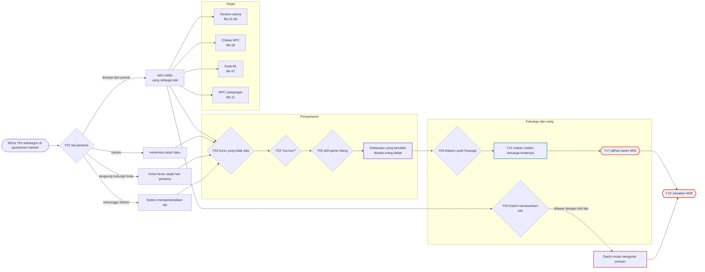
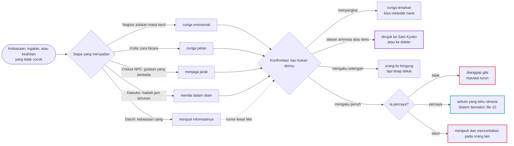
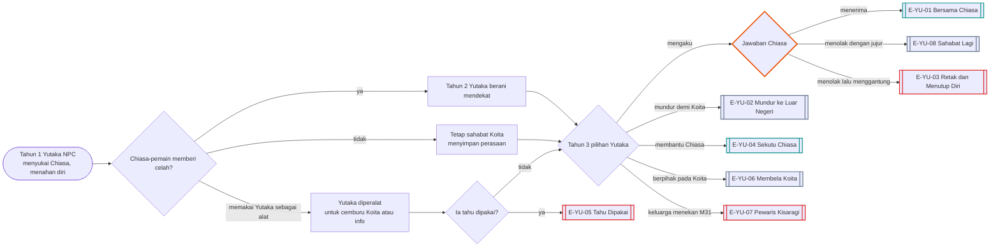
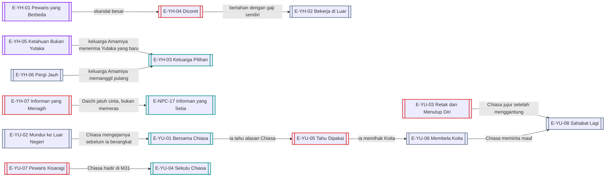

# Alur Cabang 08 — Kisaragi Yutaka (host di Male Route, NPC di Female Route)

Status: 🟡 usulan. Dasar ✅ Master Canon §2 dan §5: kesadaran asli Yutaka hilang permanen; pemain tidak mewarisi ingatan, perasaan, atau keahlian rumit; perubahan kebiasaan bisa disadari orang terdekat; keluarga Kisaragi kaya tetapi dingin; Yutaka lebih nyaman di keluarga Amamiya, tidak punya kunci cadangan, dan biasanya mengabari sebelum datang. Ekonomi ✅: saldo awal ¥500.000, uang saku ¥150.000/bulan, kuliah dan apartemen ditanggung keluarga.
Event: [Event_Yutaka.md](../../Karakter/Kisaragi_Yutaka/Event_Yutaka.md). Ending NPC lama: [Kisaragi_Yutaka.md §11](../../Karakter/Kisaragi_Yutaka/Kisaragi_Yutaka.md).

## 1. Bentuk pohon
Sebagai host, Yutaka bercabang pada **penyamaran** (siapa yang curiga dan apa yang terjadi bila ketahuan), **keluarga Kisaragi** (tekanan, warisan, atau dicoret), dan **uang** (kebebasan finansial yang bisa membeli informasi, menolong orang, atau menimbulkan gosip). Sebagai NPC, ia pria yang mencintai "Chiasa" dan bisa menjadi kekasih, sekutu, lawan, atau orang yang patah. 7 ending host dan 8 ending NPC.

## 2. Sumbu cabang
| Sumbu | Nilai | Berlaku |
|---|---|---|
| `curiga_identitas[npc]` (baru, umum) | per orang: Nagisa, Koita, Chiasa, Daisuke, Daichi | host (Y); padanan Chiasa di file 06 |
| `pengakuan_identitas` (baru) | tidak / setengah / penuh | host |
| `hubungan_keluarga_kisaragi` | dingin / tegang / berdamai / dicoret | host |
| `jalur_karier` | perusahaan keluarga / kerja di luar / luar negeri | host (Y17) |
| `ekonomi_saldo` | ✅ saldo tunggal | host |
| `kerja_kafe_bar` | lanjut / berhenti / dipecat | host |
| `daichi_status` (baru) | informan / mitra / penagih | host (Y06) |
| `yutaka_npc_hati` | menahan diri / mendekat / mengaku / mundur | NPC (C) |
| `yutaka_tahu_dipakai` (baru) | tahu bahwa Chiasa memilihnya demi bertahan hidup | NPC (C) |

## 3. Pohon host (Male Route)

## 4. Kecurigaan identitas (berlaku juga untuk Chiasa host)

Aturan 🟡: tidak ada meter "ketahuan" global. Setiap orang punya kecurigaannya sendiri, dan kecurigaan bisa menular lewat percakapan antar-NPC.

## 5. Pohon NPC (Female Route)

Ingat ⭐: Chiasa × Yutaka saja = deviasi nol = pemain mati di evaluasi (E-SI-06). E-YU-01 hanya aman bila ada deviasi lain.

## 6. Garis besar cabang host
- **Y01:** empat cara bangun menentukan nada awal. Memeriksa dompet membuat pemain tahu sejak hari pertama bahwa uang adalah alat.
- **Y02:** masuk rumah Amamiya seolah rumah sendiri adalah kesalahan (Yutaka asli tidak punya kunci cadangan ✅) dan menaikkan curiga Chiasa/Koita.
- **Y04:** kuis Ekonomi. Menyontek berisiko skorsing (✅) dan masuk `daftar_kebohongan` Shiori yang seangkatan.
- **Y05:** Yutaka asli jago game. Kalah terang-terangan dari Nagisa memicu "Yutaka tidak pernah kalah". Latihan berminggu-minggu (begadang) bisa menutupnya.
- **Y06:** Daichi menjual informasi. Membayarnya dengan informasi lain membuat Daichi mulai mengorek pemain dan kelak bisa menjadi penagih.
- **Y07:** Natal di apartemen sepi. Keluarga Kisaragi tidak menelepon.
- **Y09–Y17:** keluarga Kisaragi. Membantah ayah, menyebut Saionji, atau memilih karier di luar menentukan apakah keluarga berdamai, menekan, atau mencoret.
- **Uang:** memberi uang ke NPC dekat diperbolehkan (✅ #52). Moeka bisa tertolong, tetapi gengsinya terluka; Daichi bisa dibeli; Mei bisa dibayar diam (K14-D).

## 7. Malam dan tubuh
- Ritme tubuh Yutaka: tidur sekitar 02:00–10:00, stamina tinggi, toleransi alkohol sedang–tinggi. Kelas pagi di minggu awal terasa berat.
- Kafe bar Jumat malam (✅ part-time): orang mabuk bicara jujur, Tojo atau Hayase bisa muncul, Mei merekam. Berhenti kerja menghemat tenaga tetapi menutup jendela informasi ini.
- Apartemen D3 adalah tempat malam paling serbaguna: Nagisa main game sampai larut, Daichi menumpang, Koita datang tengah malam. Ambruk di sini berbahaya karena tidak ada yang tahu sampai seseorang datang.
- Yutaka NPC (Female Route) main game online sampai 02:00 dan lebih jujur di jam itu.

## 8. Ending
| Kode | Nama | Jenis | Host | Syarat inti | Isi |
|---|---|---|---|---|---|
| E-YH-01 | Pewaris yang Berbeda | Neutral | Y | Y17-A; keluarga berdamai | mengambil perusahaan keluarga dengan cara sendiri, tidak sedingin orang tuanya |
| E-YH-02 | Bekerja di Luar | Neutral | Y | Y17-B | lepas dari keluarga Kisaragi; hidup dengan gaji sendiri |
| E-YH-03 | Keluarga Pilihan | Romantis | Y | hubungan dengan keluarga Amamiya tinggi; tanpa kejahatan | Daisuke dan Yoshie memperlakukannya sebagai anak sendiri |
| E-YH-04 | Dicoret | Bad | Y | membangkang keluarga berulang atau skandal besar | uang saku berhenti; apartemen dilepas; mulai dari nol |
| E-YH-05 | Ketahuan Bukan Yutaka | Khusus | Y | minimal dua orang dekat yakin ia bukan Yutaka | diterima sebagai "Yutaka yang baru", atau dijauhi |
| E-YH-06 | Pergi Jauh | Neutral | Y | Y17-C magang luar negeri | meninggalkan kota; quest Sistem tetap berjalan dari jauh |
| E-YH-07 | Informan yang Menagih | Bad | Y | `daichi_status` penagih | Daichi memeras pemain dengan semua yang ia tahu |
| E-YU-01 | Bersama Chiasa | Romantis | C | Yutaka mengaku; Chiasa menerima | aman hanya bila ada deviasi lain (bila tidak, E-SI-06) |
| E-YU-02 | Mundur ke Luar Negeri | Neutral | C | Yutaka mundur demi Koita | magang ke luar negeri untuk melupakan |
| E-YU-03 | Retak dan Menutup Diri | Bad | C | Chiasa menolak lalu menggantung | apartemen menjadi satu-satunya tempatnya |
| E-YU-04 | Sekutu Chiasa | Khusus | C | Chiasa jujur padanya | Yutaka membantu Chiasa di rute heroine atau Koita Success |
| E-YU-05 | Tahu Dipakai | Bad | C | Chiasa memperalat Yutaka dan ia mengetahuinya | patah; memutus Chiasa dan Koita sekaligus |
| E-YU-06 | Membela Koita | Neutral | C | Yutaka melihat Chiasa menyakiti Koita | berpihak pada Koita; menjadi lawan sosial Chiasa |
| E-YU-07 | Pewaris Kisaragi | Bad | C | keluarga menekan di M31; Chiasa tidak hadir | menjadi sedingin orang tuanya |
| E-YU-08 | Sahabat Lagi | Neutral | C | Chiasa menolak dengan jujur dan konsisten | geng masa kecil tetap utuh |

## 9. Interlock
- **Nagisa:** curhat ke Yutaka soal Koita; Yutaka host yang mengejar Koita mengejutkan Nagisa paling keras.
- **Chiasa NPC:** Yutaka asli menyukainya; ini alasan atau penghalang bagi pemain.
- **Shiori:** seangkatan dan sefakultas; kebohongan akademik Yutaka paling mudah ia lihat.
- **Moeka:** satu panitia festival; uang Yutaka adalah pertolongan sekaligus sumber gosip.
- **Daichi dan Mei:** jalur informasi yang bisa dibeli, dan bisa menjual balik.

## 10. Poin dan ambang
Skala dan aturan umum: [Sistem_Cabang_dan_Poin.md](../Sistem_Cabang_dan_Poin.md) §2–§3.

| Poin | Awal | Naik karena | Turun karena | Ambang dan akibat |
|---|---|---|---|---|
| `curiga_identitas[x]` (Nagisa, Koita, Chiasa, Daisuke, Daichi) | 0 | kebiasaan berbeda; lupa kenangan; skill hilang (Y05) | meniru kebiasaan Yutaka asli; latihan | 50: x mulai bertanya · 75: konfrontasi (§4) |
| `keluarga_kisaragi` | 30 | patuh; nilai bagus; Y17-A | membangkang; skandal; menyebut Saionji tanpa rencana | < 20: E-YH-04 menguat · ≥ 60: E-YH-01 terbuka |
| `amamiya_rumah` | 70 | makan malam bersama; membantu; mengabari sebelum datang ✅ | masuk tanpa izin; kekacauan Koita Success atau BL | ≥ 80: E-YH-03 · < 40: keluarga Amamiya menjaga jarak |
| `daichi_tahu` | 10 | barter informasi; Daichi menginap (Y-D04) | membayar dengan makanan, bukan informasi | ≥ 70: Daichi menjadi penagih (E-YH-07) |
| `skill_game` | 20 | latihan malam | — | ≥ 60: Y05 aman; Nagisa tidak curiga |
| `yutaka_harap` (C, Yutaka NPC) | 40 | Chiasa memberi celah; C-D08 diterima | ditolak; Koita Success | ≥ 70: ia mengaku (Y-D11) · < 20: E-YU-02 atau E-YU-03 |
| `yutaka_tahu_dipakai` (C) | 0 | Chiasa memakainya untuk membuat Koita cemburu atau untuk informasi | kejujuran Chiasa | ≥ 60: E-YU-05 |

## 11. Event dinamis
| ID | Nama | Syarat | Isi dan cabang | Efek |
|---|---|---|---|---|
| Y-D01 | Notifikasi Saldo | tanggal uang saku | Sistem berkomentar soal uang. Belanja / simpan / beri pada seseorang | arah pemakaian uang |
| Y-D02 | Teman Game yang Heran | Male Route | teman online Yutaka asli: "kok mainmu beda?" Jujur sebagian / beri alasan / berhenti main | `curiga_identitas` menyebar lewat dunia online |
| Y-D03 | Ayah di Lobi | `keluarga_kisaragi` < 40 | ayah Kisaragi datang mendadak ke apartemen. Sambut / hindari / ajak bicara serius | `keluarga_kisaragi` ±; Y17 bergeser |
| Y-D04 | Daichi Menginap | kenal Daichi | Daichi menginap dan melihat catatan pemain tentang heroine. Jelaskan / sembunyikan / sogok | `daichi_tahu` + |
| Y-D05 | Jam dari Daisuke | M16 | "Masih ingat jam yang tahun lalu?" Jawab yakin / akui lupa / alihkan | `curiga_identitas[daisuke]` ± |
| Y-D06 | Lidah yang Lepas di Kafe Bar | Jumat malam saat kerja | Hayase atau Tojo mabuk membocorkan rencana. Dengarkan / rekam / antar pulang | intel untuk rute Miyuki atau Shiori |
| Y-D07 | Nagisa Main Sampai Pagi | Aff Nagisa Sedang | Nagisa main game di apartemen sampai subuh. Biarkan tidur di sofa / antar pulang / suruh pulang | rumor; kelekatan Nagisa |
| Y-D08 | Pesan dari Ibu | `keluarga_kisaragi` ≥ 40 | ibu Kisaragi mengirim pesan hangat yang jarang terjadi. Balas hangat / formal / abaikan | pintu kecil ke keluarga yang dingin |
| Y-D09 | Koita di Depan Pintu | Koita bertengkar atau ditinggal heroine | Koita datang jam 01:00. Biarkan menginap / dengarkan lalu antar pulang / tolak | benih BL atau persahabatan |
| Y-D10 | Menunggu di Stasiun | Female Route; `yutaka_harap` ≥ 50 | Yutaka NPC "kebetulan" menunggu Chiasa sepulang kelas malam. Jalan bersama / terima tumpangan / tolak | `yutaka_harap` + |
| Y-D11 | Pengakuan Jumat Malam | Female Route; `yutaka_harap` ≥ 70 | Yutaka mabuk dan mengaku di kafe bar. Jawab sekarang / tunda / anggap candaan | E-YU-01 atau E-YU-03 menguat |

## 12. Belok ke ending lain

