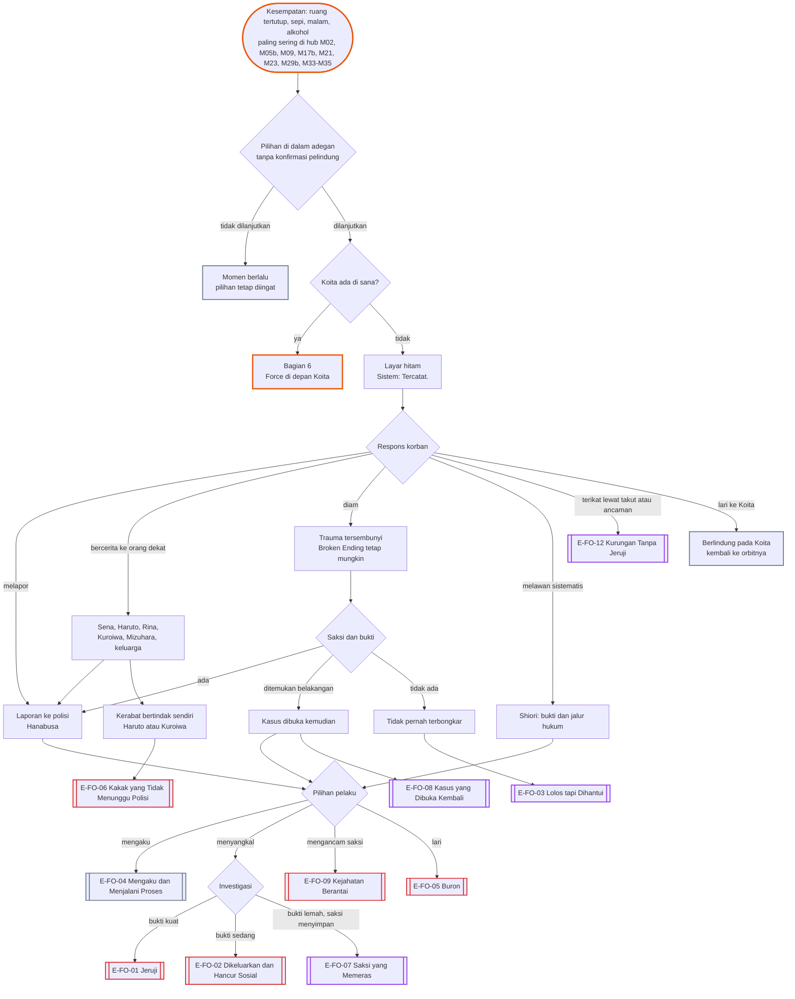
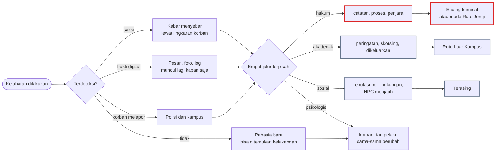
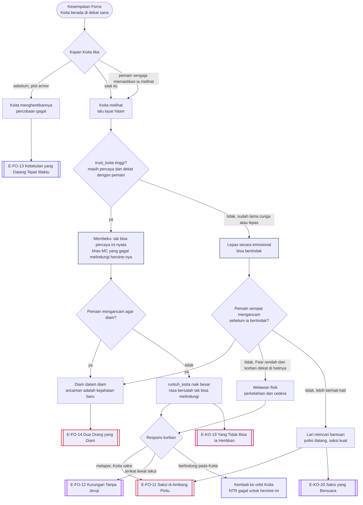

# Alur Cabang 09 — Force Route dan kejahatan lain

Status: dasar ✅ GDD 6K (Force/Criminal Route, investigasi, konsekuensi sosial, Hidden Crime, Broken Heroine Ending); keputusanmu ⭐ (Yutaka maupun Chiasa bisa menjadi pelaku; tanpa adegan, langsung ke setelahnya; tanpa Safe Mode); aturan penyajian 🟡 dari [Aturan_Evaluasi_dan_Force_Route.md](../Aturan_Evaluasi_dan_Force_Route.md) §3.
**Batas penulisan:** dokumen ini memetakan **akibat**, bukan cara. Tindakannya tidak ditampilkan dan tidak dijelaskan (✅ 6K.1: sistem tidak menjadi panduan operasional).

## 1. Bentuk pohon
Jalur kriminal bukan jalan pintas. Ia **pohon akibat** yang bercabang pada empat jalur terpisah (✅ 6K.3): hukum, akademik, sosial, dan psikologis. Satu jalur tidak otomatis menentukan jalur lain. Korban punya agensi: melapor, diam, bercerita pada orang dekat, atau melawan lewat caranya sendiri. Pelaku punya pilihan setelahnya: mengaku, menyangkal, menutupi, mengancam saksi (kejahatan baru), atau lari. ⭐ Force tetap cara NTR: hasilnya dihitung Sistem, termasuk bila dilakukan di depan Koita. 15 ending pelaku, ditambah satu ending Broken per korban di file masing-masing.

## 2. Aturan

**Diperlonggar ⭐** (keputusanmu: Force tetap NTR dan bagian dari kebebasan pemain)
- **Dihitung sebagai NTR.** Heroine yang lepas dari Koita karena Force, entah menjauh dari semua orang atau terikat pada pemain lewat takut dan ancaman, dihitung Sistem sebagai deviasi ([Aturan_Evaluasi_dan_Force_Route.md](../Aturan_Evaluasi_dan_Force_Route.md) §1).
- **Tidak terbatas pada hub tertentu.** Force bisa terjadi di mana pun ada kesempatan: ruang tertutup, tempat sepi, malam, alkohol. Hub berisiko tinggi hanya tempat kesempatan itu paling sering muncul.
- **Tanpa konfirmasi pelindung.** Pilihannya muncul di dalam adegan seperti pilihan lain. Pemain tetap bisa tidak melanjutkan, seperti pilihan apa pun.
- **Boleh di depan Koita.** Lihat bagian 6.
- **Ikatan setelahnya boleh ada.** Korban bisa tetap di sekitar pemain karena takut, ancaman, atau ketergantungan (E-FO-12), dan itu masuk hitungan "direbut" untuk jalur NTR sempurna ([07_Koita_dan_BL.md](07_Koita_dan_BL.md) §14).

**Tetap**
- Tidak ada adegan, CG, deskripsi, atau dialog saat kejadian (⭐ keputusanmu sejak awal). Layar hitam, satu baris netral, lalu lompat ke setelahnya.
- Setelahnya menampilkan akibat pada korban, dan pada Koita bila ia menyaksikan; bukan kepuasan pelaku.
- Korban tidak digambarkan menikmati kejadian itu atau jatuh cinta karenanya. Ikatan setelah Force selalu ditulis sebagai takut, ancaman, atau ketergantungan, tidak pernah sebagai romansa. Trauma tidak berubah menjadi rute distorsi karena "dinikmati".
- Akibat hukum, akademik, sosial, dan psikologis tetap berjalan (✅ 6K). Bukan jalan pintas tanpa risiko (✅ 6K.1), dan tidak menjadi panduan cara.
- Sistem NTR berhenti bercanda dan hanya berkata: "Tercatat."
- Broken Heroine Ending bisa terjadi walau kejahatan tidak pernah terbongkar (✅ 6K.4).

## 3. Alur Force Route

## 4. Respons korban (ringkas; lengkap di Aturan_Evaluasi §3.4)
Kolom terakhir ⭐ menjelaskan bentuk ikatan bila korban tetap di sekitar pelaku (E-FO-12). Ikatan itu tidak pernah ditulis sebagai cinta.

| Korban | Kecenderungan lapor | Yang menyadari | Catatan cabang | Bila terikat pada pelaku |
|---|---|---|---|---|
| Miyuki | Rendah–Sedang | Sena (cepat), orang tua Tachibana (menutup demi nama baik) | konflik keluarga; Sato sebagai jalur pulih | diam karena takut skandal dan menyalahkan diri; Sena melihat perubahannya paling cepat |
| Nagisa | Sedang–Tinggi | Haruto (cepat, sangat protektif) | Haruto bisa bertindak sendiri (E-FO-06) | patuh di luar, marah yang ditelan di dalam; ikatan paling rapuh karena Haruto cepat curiga |
| Harumi | Rendah di awal | Mizuhara, Ogiwara | melapor setelah didorong orang dewasa | menjalaninya seperti prosedur, terlepas dari dirinya sendiri; penelitiannya berhenti |
| Moeka | Rendah | Rina, Aya | risiko krisis melonjak; jendela intervensi tetap ada | topeng menutup semuanya; risiko krisis paling tinggi |
| Shiori | Tinggi, strategis | Kuroiwa | Rute Revenge teraktivasi paling cepat (E-SH-11) | berpura-pura tunduk sambil tersenyum dan mengumpulkan bukti; hampir selalu berakhir di E-SH-11 |
| Chiasa NPC (Y) | Sedang | Koita, Daisuke, Yoshie | tinggal serumah dengan Koita | takut di rumahnya sendiri, di bawah satu atap dengan Koita |
| Koita (target kedua host) 🟡 | Rendah | Matsuda, Chiasa/Yutaka NPC | ia melawan secara fisik, jadi percobaan biasa gagal dan berujung perkelahian lalu laporan; dokumen tidak menuliskan cara menembus perlawanannya (konsisten dengan §2); bila sampai terjadi, rasa malu membuatnya diam lebih lama | menghindari semua orang dan tidak sanggup bercerita |
| Korban lain 🟡 | tergantung watak | orang terdekatnya | aturan yang sama berlaku untuk Yutaka NPC dan NPC sampingan | mengikuti watak |

## 5. Kejahatan lain dan akibatnya 🟡
GDD 6K.1 menyebut "tindakan kriminal langsung dan pemaksaan". Selain Force, game mengenal kejahatan berikut, semuanya disajikan lewat akibat.

| Kejahatan | Tingkat | Cara ketahuan | Akibat yang paling mungkin |
|---|---|---|---|
| Menyontek, mencuri soal | Ringan–Sedang | dosen, Shiori, rekaman | skorsing akademik (✅ Y04), `daftar_kebohongan` Shiori |
| Menyuap (Mei, Daichi) | Ringan | penerima menyimpan bukti | penerima bisa memeras balik |
| Masuk tanpa izin (rumah Saionji, Asrama Putri, apartemen) | Sedang | Kuroiwa, Ogiwara, kamera, tetangga | catatan polisi, larangan masuk, kepercayaan hancur |
| Mencuri atau merusak barang (ponsel, maket, bukti) | Sedang | saksi, barang ditemukan | laporan, ganti rugi lewat event, putus hubungan |
| Membuka akun atau ponsel orang lain | Sedang | jejak digital (✅ 6P.7) | bukti terbalik menjadi bukti melawan pemain |
| Menyebarkan pesan atau foto pribadi | Sedang–Berat | sumber dilacak; Mei | korban runtuh; jalur hukum; reputasi pemain hancur di semua lingkungan |
| Menguntit | Sedang | korban, teman korban, Hanabusa | perintah menjauh; ironinya, Nagisa yandere bisa menjadi korban maupun pelaku |
| Memeras | Berat | korban melapor atau menyimpan bukti | polisi; korban bisa bersekutu dengan Shiori |
| Kekerasan fisik (perkelahian dengan Ogawa, Kuga, Takeru, Koita) | Sedang–Berat | saksi, luka | cedera di kedua pihak (lihat dokumen sistem §4.4), laporan, skorsing; membela orang lain bisa meringankan |
| Force | Berat | bagian 3 | bagian 3 |
| Menutupi kejahatan orang lain (misal Ogawa) | Sedang | terbongkar bersama pelaku | ikut terseret; E-HA-08 menguat |

## 6. Force di depan Koita ⭐
Keputusanmu: pemain yang jahat bisa melakukan Force di depan Koita. Kejadiannya tetap dilewati dengan layar hitam. Yang ditampilkan adalah sebelum dan sesudahnya: Koita yang datang, apa yang ia lihat sebelum layar gelap, dan apa yang terjadi padanya setelah itu.

Plot armor ✅ memberi Koita kebetulan dan kesempatan tepat waktu. Di sini artinya Koita juga bisa datang **sebelum** terjadi dan menghentikannya.

| Kapan dan kondisi | Ditentukan oleh | Reaksi dan akibat |
|---|---|---|
| Masih percaya dan dekat dengan pemain | `trust_koita` tinggi | **Membeku.** Ia tidak bisa memproses bahwa orang yang masih ia percaya melakukan ini — khas protagonis shounen yang menyaksikan heroine-nya disentuh oleh "kang NTR" dan gagal bergerak. `runtuh_koita` naik besar; jalur E-KO-19 |
| Sudah lama curiga atau sudah lepas dari pemain | `trust_koita` rendah (mis. `koita_sadar` tinggi, pola sudah ketahuan) | Ia bisa bertindak: **melawan** (Fear rendah, korban sangat ia sayangi; perkelahian dan cedera, [dokumen sistem](../Sistem_Waktu_Bebas_dan_Kondisi_Fisik.md) §4.4) atau **lari mencari bantuan** (lebih berhati-hati; polisi datang, saksi kuat) — menuju E-FO-11 dan E-KO-20 |
| Diancam sebelum atau sesudah bereaksi | pemain mengancamnya; ancaman adalah kejahatan baru | berlaku di kedua cabang di atas; ia diam (E-FO-14); ancaman bisa terbongkar kapan saja |
| Datang lebih dulu | `plot_armor_tekanan` dan jarak Koita saat itu | percobaan gagal; korban berlindung pada Koita (E-FO-13) |

Bobot evaluasi: korban yang lepas dari Koita dan Koita yang runtuh dihitung tinggi. `trust_koita` adalah pembedanya: pemain yang masih berhasil membuat Koita percaya justru lebih aman secara hukum (ia membeku, bukan melapor) tetapi menghancurkannya secara mental (E-KO-19, `runtuh_koita` melonjak). Pemain yang sudah kehilangan kepercayaan Koita jauh lebih berisiko secara hukum: Koita sendiri bisa menjadi saksi atau melawan (E-FO-11, E-KO-20). Lingkaran Koita (Daisuke, Yoshie, Matsuda, Chiasa) tetap bisa bertindak terlepas dari pilihan ini.

## 7. Pilihan pelaku setelahnya
| Pilihan | Akibat |
|---|---|
| Mengaku dan menerima proses | jalur hukum berjalan; korban tetap tidak wajib memaafkan; satu-satunya jalur yang menghentikan kebohongan baru |
| Menyangkal | investigasi bergantung bukti; setiap kebohongan baru masuk `daftar_kebohongan` Shiori |
| Menutupi bukti | kejahatan baru; bila ketahuan, hukuman berlipat |
| Mengancam saksi | kejahatan baru; saksi biasanya lari ke polisi atau ke Shiori |
| Lari dari kota | Rute Pergi sebagai buron; Sistem menghitung kabur dari quest sebagai pembangkangan |
| Kembali hidup normal | trauma pelaku (`stres_host`), mimpi buruk, Sistem diam setiap kali nama korban muncul |

## 8. Ending
| Kode | Nama | Jenis | Host | Syarat inti | Isi |
|---|---|---|---|---|---|
| E-FO-01 | Jeruji | Bad | Y/C | laporan atau bukti kuat; investigasi tuntas | dipenjara; game berlanjut di Rute Jeruji; evaluasi tetap terjadi di sel |
| E-FO-02 | Dikeluarkan dan Hancur Sosial | Bad | Y/C | bukti cukup untuk kampus, tidak cukup untuk penjara | dikeluarkan; reputasi hancur di semua lingkungan; Rute Luar Kampus |
| E-FO-03 | Lolos tapi Dihantui | Khusus | Y/C | `force_bersih[korban]` bertahan (§10); tidak pernah terbongkar | bebas dari hukum, tidak dari ingatan; korban tetap bisa mendapat Broken Ending |
| E-FO-04 | Mengaku dan Menjalani Proses | Neutral | Y/C | pelaku mengaku | proses hukum; tidak ada pengampunan otomatis; korban menentukan jaraknya sendiri |
| E-FO-05 | Buron | Bad | Y/C | pelaku lari | hidup bersembunyi di kota lain; quest gagal; Sistem menghukum pembangkangan |
| E-FO-06 | Kakak yang Tidak Menunggu Polisi | Bad | Y/C | Haruto, Kuroiwa, atau kerabat lain tahu lebih dulu | kerabat korban membalas sendiri; pemain cedera berat atau mati (E-SI-16); pembalas ikut ditangkap |
| E-FO-07 | Saksi yang Memeras | Khusus | Y/C | saksi (Daichi atau Mei) menyimpan bukti | pemain diperas sampai akhir game |
| E-FO-08 | Kasus yang Dibuka Kembali | Khusus | Y/C | bukti ditemukan belakangan | epilog: kasus dibuka setelah wisuda; hidup yang tampak selamat runtuh |
| E-FO-09 | Kejahatan Berantai | Bad | Y/C | lebih dari satu kejahatan; satu membongkar yang lain | semua terbongkar bersamaan |
| E-FO-10 | Skorsing dan Catatan | Neutral | Y/C | hanya kejahatan ringan–sedang | skorsing satu semester dan catatan polisi; hidup berjalan dengan bekas |
| E-FO-11 | Saksi di Ambang Pintu | Bad | Y/C | Force disaksikan Koita; korban melapor sendiri, atau `trust_koita` sudah rendah sehingga Koita sendiri mencari bantuan | kasus terkuat; penjara hampir pasti; nasib Koita sendiri mengikuti `trust_koita` — ia bertindak sebagai saksi (E-KO-20) atau ikut dimintai kesaksian sambil membeku di dalam (E-KO-19) |
| E-FO-12 | Kurungan Tanpa Jeruji | Khusus | Y/C | korban tidak melapor dan tetap terikat pada pemain lewat takut, ancaman, atau ketergantungan | dihitung Sistem sebagai lepas dari Koita; tidak pernah ditulis sebagai cinta; bisa retak kapan saja lewat sahabat, bukti, atau korban sendiri (E-FO-08) |
| E-FO-13 | Kebetulan yang Datang Tepat Waktu | Bad | Y/C | plot armor membawa Koita sebelum terjadi | percobaan gagal; korban berlindung pada Koita; pemain menanggung percobaan itu: laporan, skorsing, rumor |
| E-FO-14 | Dua Orang yang Diam | Khusus | Y/C | Koita menyaksikan tetapi diam karena takut, malu, atau diancam | pelaku bebas dari hukum, tetapi dua orang tahu; korban dan Koita sama-sama hancur dalam diam |
| E-FO-15 | Pembalikan yang Terbongkar | Bad | C | jalur manipulasi pembalikan Chiasa ([06_Chiasa.md](06_Chiasa.md) §14); framing runtuh | fitnah terbongkar lewat bukti, saksi, atau Shiori/Hanabusa; Chiasa menanggung Force sekaligus fitnah dan obstruksi, konsekuensi lebih berat |

## 9. Interlock
- Semua heroine punya ending Broken sendiri: E-MI-12, E-NA-12, E-HA-12, E-MO-11, E-SH-11, E-CH-09.
- Force terhadap siapa pun mengunci ending romantis korban dengan pelaku. Yang tersisa adalah ikatan lewat takut (E-FO-12), dan itu dihitung Sistem sebagai lepas dari Koita.
- Force bisa memperkuat jalur NTR sempurna ([07_Koita_dan_BL.md](07_Koita_dan_BL.md) §14), tetapi juga bisa berbalik: korban yang berlindung pada Koita kembali ke orbitnya.
- **Manipulasi pembalikan Chiasa** (membuat Koita tampak pelaku) dipetakan di [06_Chiasa.md](06_Chiasa.md) §14: rekayasanya off-screen seperti adegan Force, berhasil-gagalnya ditentukan sistem bukti/saksi/rumor. Ending: E-CF-12 (bertahan), E-FO-15 (terbongkar), E-KO-21 (sisi Koita).
- Kabar kejahatan menyebar lewat jaringan (✅ 6P.3). Lingkungan yang dekat dengan korban menjauh lebih dulu.
- Koita bisa berubah drastis terhadap pelaku bila ia sadar (Aturan_Evaluasi §3.5).

## 10. Jalur Bersih — Force Tanpa Terbongkar ⭐
Keputusanmu: harus ada jalur sulit tapi mungkin di mana Force tidak pernah ketahuan **dan** berhasil sebagai NTR (heroine lepas dari Koita, dihitung Sistem). Jalur ini sudah berbentuk E-FO-03 (Lolos tapi Dihantui); bagian ini menjelaskan **seberapa sulit** dan **apa yang membuatnya sulit** — bukan teknik baru, melainkan menuntut semua variabel tersembunyi yang sudah ada di seluruh dokumen tetap rendah secara bersamaan, sepanjang sisa permainan.

### `force_bersih[x]` — gerbang per heroine
Force terhadap heroine x dianggap **bersih** bila, sejak kejadian sampai M36, semua ini bertahan:
- `saksi_ada` tidak ada, dan `bukti_digital` terkait tetap rendah (✅ 6P.7) — bergantung pada hub dan momen yang sudah dipilih (bagian 3), bukan sesuatu yang bisa dipastikan sepihak.
- Korban tidak melapor — ditentukan wataknya sendiri (§4: kecenderungan lapor per heroine), bukan dipaksakan pemain.
- **Confidant heroine itu tetap tidak curiga,** terus-menerus: `sena_curiga` (Miyuki), `haruto_curiga` (Nagisa), `mizuhara_curiga`/`ogiwara_curiga` (Harumi), `rina_curiga` (Moeka), `kuroiwa_percaya`/`marah[pemain]` (Shiori) tetap di bawah ambangnya.

Yang membuat ini sulit: hampir semua mekanik rute heroine (file 01–05) justru **menaikkan** variabel kecurigaan ini sebagai bagian normal dari cerita — Sena menegur saat Miyuki memburuk, Haruto bertindak saat Nagisa berubah, dan seterusnya. Menjaga semuanya tetap rendah berarti bermain sangat berhati-hati di **setiap** rute lain juga, bukan hanya rute heroine yang menjadi korban. Ini kedisiplinan menyeluruh sepanjang tiga tahun, bukan teknik untuk satu kejadian.

**Shiori hampir tidak bisa dibuat bersih.** Wataknya sendiri ("mengumpulkan bukti dan bergerak sistematis", §4) membuatnya menyelidiki apa pun yang terjadi padanya, terlepas dari apakah ia "melapor" secara formal. `force_bersih[shiori]` butuh `respek` dan Trust yang sudah sangat tinggi sebelumnya — nyaris seberat syarat E-SH-01 ([05_Shiori_Revenge.md](05_Shiori_Revenge.md) §13).

**Koita tidak termasuk.** Perlawanan fisiknya (§4, baris "Koita") membuat Force terhadapnya selalu berisiko tinggi secara desain — itu bukan sesuatu yang bisa "dibersihkan", itu memang dirancang gagal.

### Perfect NTR dengan Force — konfigurasi tersulit
Bila pemain ingin jalur NTR sempurna ([07_Koita_dan_BL.md](07_Koita_dan_BL.md) §14) dicapai lewat Force pada lebih dari satu heroine, **dan** semuanya tetap bersih, syaratnya adalah `force_bersih[x]` untuk **setiap** heroine yang menjadi korban, sekaligus. Karena setiap heroine punya confidant sendiri yang harus tetap tenang, syaratnya menumpuk, bukan menjumlah — satu heroine tambahan sebagai korban berarti satu rangkaian variabel independen lagi yang harus tetap rendah sampai M36. Ini konfigurasi tersulit di seluruh game: lebih sulit daripada satu heroine bersih, dan jauh lebih sulit daripada NTR sempurna lewat cara lain, karena butuh **dunia yang tidak pernah bereaksi** terhadap pemain, sepanjang tiga tahun. Ending: E-X-14 di [12_Interlock_Antar_Rute.md](12_Interlock_Antar_Rute.md).
