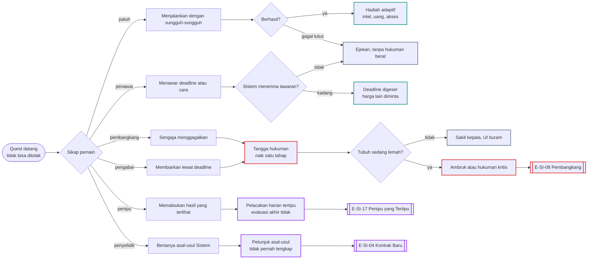
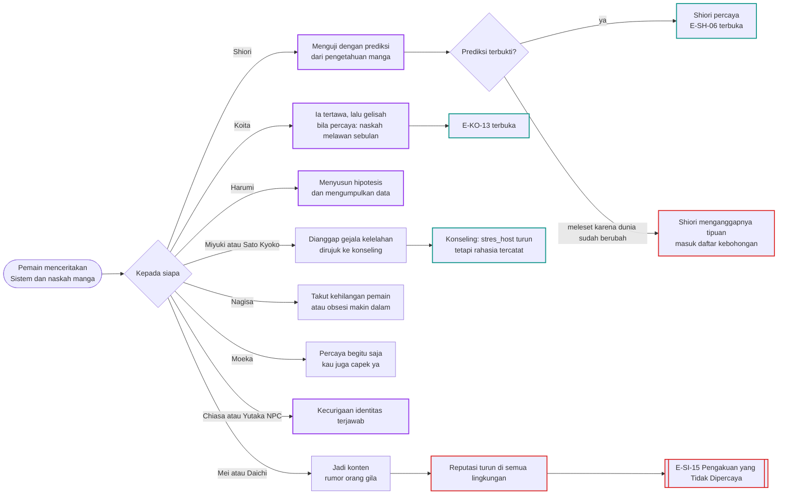
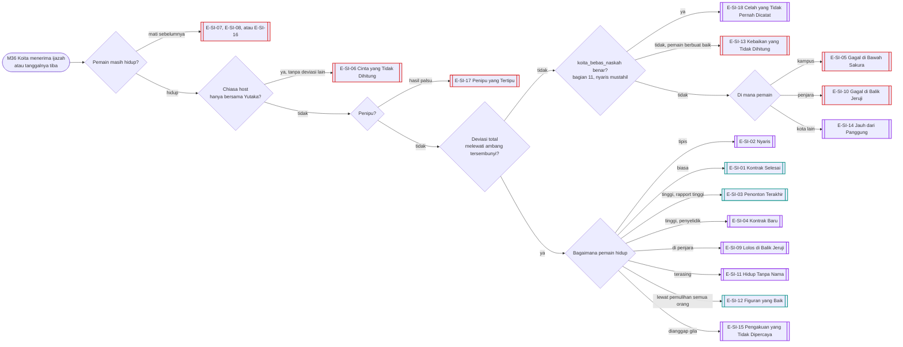
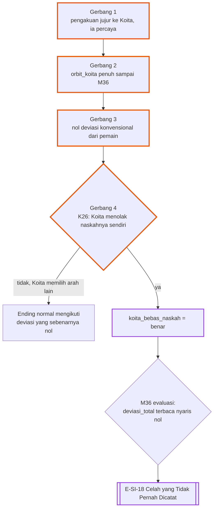

# Alur Cabang 10 — Sistem NTR, evaluasi, dan nasib pemain

Status: dasar ✅ GDD 6G/6G.1 dan Master Canon §6 (quest wajib dan tidak bisa ditolak; hukuman bertingkat sampai kematian; Sistem membedakan kegagalan tulus dari pembangkangan; target tersembunyi; evaluasi hanya sekali saat kelulusan Koita; ambang disembunyikan; pemain bisa mati sebelum lulus). Detail 🟡.
Persona: [Sistem_NTR.md](../../Karakter/NPC/Sistem_NTR/Sistem_NTR.md). Bobot deviasi: [Aturan_Evaluasi_dan_Force_Route.md](../Aturan_Evaluasi_dan_Force_Route.md) §1.

## 1. Bentuk pohon
Sistem adalah rute ketujuh yang selalu aktif. Pemain tidak bisa menolak quest (✅), tetapi bisa memilih **sikap**: patuh, membangkang, menawar, menyelidiki, mengabaikan, atau menipu. Sikap itu menentukan hukuman, hadiah, nada Sistem, dan kata-kata terakhirnya. Di atasnya ada cabang besar **membongkar Sistem kepada NPC**. Tidak ada target yang dipilih di awal ⭐: Sistem menilai hasil apa adanya, lalu membacakan apa yang ia hitung saat evaluasi. Semua bermuara ke evaluasi di hari wisuda. 18 ending nasib pemain (termasuk satu yang tersembunyi, bagian 11) dan 7 ending hati pemain.

## 2. Sumbu cabang
| Sumbu | Nilai | Digerakkan oleh |
|---|---|---|
| `sikap_sistem` (baru) | patuh / pembangkang / penawar / penyelidik / pengabai / penipu | pola respons pemain pada quest |
| `nyeri_sistem` | peringatan → rasa sakit → pelemahan fisik → hukuman kritis → kematian (✅) | pembangkangan sengaja |
| `rapport_sistem` (baru) | seberapa sering dan jujur pemain bicara dengan Sistem | obrolan |
| `rahasia_dibuka[npc]` (baru) | siapa yang diberi tahu soal Sistem dan naskah | bagian 4 |
| `hati_pemain` (baru) | dengan siapa pemain berakhir, atau tidak dengan siapa pun | semua rute; bagian 9 |
| `deviasi_total` | tersembunyi | semua rute |
| `peringatan_1`, `peringatan_final` | M24, M33 | `deviasi_total` |
| `sistem_bocor` | M17b | kebocoran sekali (🟡 di file Sistem) |
| `koita_bebas_naskah` (baru) | benar / salah | bagian 11; diperiksa hanya saat evaluasi |

## 3. Sikap pada Sistem

| Sikap | Rinciannya 🟡 |
|---|---|
| Patuh | Gagal tulus tidak dihukum berat (✅). Nada Sistem perlahan menjadi seperti rekan yang mengejek. |
| Pembangkang | Setiap pembangkangan sengaja menaikkan `nyeri_sistem`. Pada tubuh yang Kurang Tidur Kronis, hukuman kritis bisa membunuh. |
| Penawar | Sistem kadang menerima: deadline digeser, tetapi ia meminta harga lain (quest tambahan, informasi yang menyakitkan). |
| Penyelidik | Pertanyaan tentang asal-usul dijawab sepotong-sepotong. Tidak pernah lengkap di satu playthrough; New Game Plus (✅ 6N.3) membuka lebih banyak. |
| Pengabai | Membiarkan quest kedaluwarsa dihitung pembangkangan bila disengaja. Quest yang tidak relevan bisa berubah atau digantikan (✅). |
| Penipu | Pemain memalsukan hasil yang terlihat (putus pura-pura, pengakuan palsu). Sistem harian hanya melihat yang bisa diamati dari luar (🟡 batas pengetahuan Sistem), jadi ia tertipu dan memberi hadiah. Evaluasi akhir membaca takdir yang sebenarnya. |

## 4. Membongkar Sistem kepada NPC
Canon tidak melarang pemain bercerita. 🟡 Sistem tidak menghentikannya, hanya mengejek: "Silakan. Coba lihat siapa yang percaya."

Catatan: pengetahuan manga pemain makin tidak akurat saat dunia menyimpang (✅ 6R.1), jadi prediksi yang dipakai untuk meyakinkan orang bisa meleset justru karena pemain sudah mengubah banyak hal.

## 5. Tidak ada target yang dipilih ⭐
Keputusanmu: tidak ada target atau rute yang ditentukan di awal, baik oleh pemain maupun Sistem. Usulan Naskah Target dibatalkan. Semua tindakan bisa mengarah ke rute mana saja, atau tidak ke rute mana pun dan berakhir tanpa siapa-siapa.
- ✅ GDD 6G.1 menyebut target NTR tersembunyi dan baru diketahui saat evaluasi. Dengan keputusan ini, yang tersembunyi adalah **apa yang dihitung Sistem dan ambangnya**, bukan target yang ditetapkan sejak awal.
- Saat evaluasi, Sistem **membacakan** apa saja yang ia hitung: siapa yang lepas dari orbit Koita, apakah Koita berhenti menggantung, siapa yang memilih pemain, siapa yang memilih dirinya sendiri.
- Bobot dasar di Aturan_Evaluasi §1 tetap berlaku. Aturan ⭐ tetap: Chiasa × Yutaka saja = nol; Koita Success saja tidak cukup.
- Tidak ada jalur yang benar. Pemain yang tidak pernah masuk rute mana pun tetap bisa lolos bila heroine lepas dari Koita dengan cara lain (misalnya pulih dan mandiri), dan pemain yang mengejar semua orang tetap bisa gagal.
- Mekanik cabang, poin, dan belok: [Sistem_Cabang_dan_Poin.md](../Sistem_Cabang_dan_Poin.md).

## 6. Evaluasi di hari wisuda
- ✅ Evaluasi hanya sekali, saat kelulusan Koita.
- 🟡 Evaluasi terjadi di **tanggal wisuda angkatan Koita**, di mana pun pemain berada (sel, RS, kota lain), dan bahkan bila Koita sendiri gagal lulus (E-KO-15).
- 🟡 Pelacakan harian Sistem bisa tertipu; evaluasi tidak.

## 7. Mati sebelum wisuda
| Penyebab | Syarat | Kode |
|---|---|---|
| Tubuh | Ambruk berulang, kecelakaan saat Ambruk, penyakit yang diabaikan (dokumen sistem §4.7) | E-SI-07 |
| Hukuman Sistem | pembangkangan sengaja sampai hukuman kritis, terutama pada tubuh lemah | E-SI-08 |
| Orang lain | Haruto atau kerabat korban membalas (E-FO-06); Nagisa tahap 5 yang berbalik (E-NA-14); konfrontasi dengan Ogawa atau Kuga yang lepas kendali | E-SI-16 |

Setiap kematian sebelum wisuda tetap memicu epilog komposit versi duka: siapa yang datang ke pemakaman, siapa yang lega, dan apa yang terjadi pada rute yang belum selesai.

## 8. Ending
| Kode | Nama | Jenis | Host | Syarat inti | Isi |
|---|---|---|---|---|---|
| E-SI-01 | Kontrak Selesai | Romantis | Y/C | deviasi cukup | Sistem berpamitan dengan satu ejekan terakhir; pemain hidup |
| E-SI-02 | Nyaris | Khusus | Y/C | deviasi tipis di atas ambang | "Nyaris." Sistem tidak pernah bicara lagi |
| E-SI-03 | Penonton Terakhir | Romantis | Y/C | deviasi tinggi; `rapport_sistem` tinggi | Sistem membacakan semua yang ia hitung, lalu pamit seperti teman |
| E-SI-04 | Kontrak Baru | Khusus | Y/C | deviasi tinggi; sikap penyelidik | Sistem menawarkan kontrak baru (kait New Game Plus) |
| E-SI-05 | Gagal di Bawah Sakura | Bad | Y/C | deviasi kurang; pemain di kampus | pemain mati di hari wisuda, di bawah sakura |
| E-SI-06 | Cinta yang Tidak Dihitung | Bad | C | Chiasa × Yutaka saja ⭐ | "Ini bukan penyimpangan. Ini pelarian." |
| E-SI-07 | Tubuh Pinjaman Menyerah | Bad | Y/C | mati karena tubuh sebelum wisuda | tubuh host berhenti lebih dulu daripada kontraknya |
| E-SI-08 | Pembangkang | Bad | Y/C | hukuman kritis karena pembangkangan sengaja | Sistem menagih lebih awal |
| E-SI-09 | Lolos di Balik Jeruji | Khusus | Y/C | lolos; sedang dipenjara | "Selamat, kau hidup. Di sini." |
| E-SI-10 | Gagal di Balik Jeruji | Bad | Y/C | gagal; sedang dipenjara | mati di sel pada jam wisuda |
| E-SI-11 | Hidup Tanpa Nama | Khusus | Y/C | lolos; reputasi hancur di semua lingkungan | hidup, tetapi tak ada yang menunggu |
| E-SI-12 | Figuran yang Baik | Romantis | Y/C | pemain berhenti memanipulasi dan membantu heroine pulih; mereka lepas dari Koita dan berdiri sendiri | lolos lewat kebaikan; deviasi lahir dari orang-orang yang bebas |
| E-SI-13 | Kebaikan yang Tidak Dihitung | Bad | Y/C | pemain berbuat baik tetapi deviasi kurang | mati, tetapi dunia yang ditinggalkan lebih baik |
| E-SI-14 | Jauh dari Panggung | Khusus | Y/C | pemain di kota atau negara lain saat wisuda | lolos atau gagal tanpa menyaksikan wisuda |
| E-SI-15 | Pengakuan yang Tidak Dipercaya | Khusus | Y/C | rahasia Sistem dibuka luas; dianggap gila | evaluasi terjadi di ruang rawat; hasil mengikuti deviasi |
| E-SI-16 | Tagihan dari Orang Lain | Bad | Y/C | dibunuh atau dilukai fatal oleh NPC | kematian karena tindakan orang yang pernah disakiti |
| E-SI-17 | Penipu yang Tertipu | Bad | Y/C | hasil yang dinilai hanyalah sandiwara | Sistem harian tertipu sampai akhir; evaluasi tidak |
| E-SI-18 | Celah yang Tidak Pernah Dicatat | Khusus | Y/C | `koita_bebas_naskah` benar — nyaris mustahil, lihat bagian 11 | pemain lolos tanpa NTR dan tanpa mati, lewat satu celah dalam kontrak yang tidak pernah diantisipasi siapa pun, termasuk Sistem sendiri |

## 9. Hati pemain
Slide terpisah di epilog komposit: dengan siapa pemain berakhir. ⭐ Berakhir tanpa siapa-siapa adalah hasil yang sah. ✅ GDD 6I.1: pemain boleh menyelesaikan game tanpa romansa, dan itu bisa memengaruhi evaluasi.

| Kode | Nama | Jenis | Host | Syarat inti | Isi |
|---|---|---|---|---|---|
| E-HP-01 | Bersama Satu Orang | Romantis | Y/C | satu hubungan romantis bertahan sampai M36 | siapa pun orangnya: heroine, Koita, Chiasa atau Yutaka NPC, atau NPC sampingan |
| E-HP-02 | Bersama Beberapa Orang | Khusus | Y/C | lebih dari satu hubungan bertahan, terbuka atau rahasia | lihat E-X-02 dan E-X-01 |
| E-HP-03 | Tidak Dapat Siapa-Siapa | Neutral | Y/C | pernah mengejar, tetapi tidak ada yang bertahan | pemain berakhir sendiri; cerita tidak menghukumnya karena itu |
| E-HP-04 | Ditinggalkan Semua | Bad | Y/C | semua orang yang dikejar pergi karena kebohongan atau luka | sendiri, dan semua orang tahu kenapa |
| E-HP-05 | Tidak Pernah Mengejar Siapa Pun | Neutral | Y/C | tidak pernah memulai romansa | tiga tahun tanpa romansa; deviasi hanya datang dari cara lain |
| E-HP-06 | Cinta yang Datang Terlambat | Khusus | Y/C | seseorang mengaku di M35 atau M36 setelah pemain menyerah | jawaban pemain menjadi slide terakhir |
| E-HP-07 | Patah Hati yang Diterima | Neutral | Y/C | ditolak dengan jujur, dan pemain menerimanya | sendiri, tetapi damai |

## 10. Interlock
- Setiap rute menyumbang deviasi; tidak ada rute yang lebih "benar" daripada rute lain.
- Kematian Moeka membuat Sistem diam beberapa hari (✅ keputusan file Sistem) dan menghapus ejekan dari evaluasi.
- Kebocoran Sistem M17b memberi informasi usang; pemain yang memakainya untuk meyakinkan NPC (bagian 4) bisa terlihat berbohong.

## 11. Ending tersembunyi — Celah yang Tidak Pernah Dicatat ⭐
Keputusanmu: harus ada **satu** ending tersembunyi di mana pemain mengalahkan Sistem sepenuhnya — lulus evaluasi, tidak NTR sama sekali, dan tidak mati — dengan kemungkinan sangat sangat rendah. Bukan jalan pintas: pemain harus membaca semua celah sistem yang sudah ada di seluruh dokumen ini, bukan menekan tombol rahasia.

### Kenapa ini celah, bukan jalan normal
✅ Sistem menilai "penyimpangan takdir romantis Koita". 🟡 Celahnya: kontrak tidak pernah mendefinisikan apa yang terjadi bila Koita **berhenti memiliki takdir romantis untuk disimpangkan sama sekali** — bukan karena ia hancur (E-KO-09), bukan karena ia terus menggantung (E-KO-08), tetapi karena ia sendiri, dengan kehendak bebasnya sendiri (✅ GDD 6J), menolak seluruh premis "protagonis harem yang harus memilih". Sistem sendiri tidak menyentuh kehendak bebas NPC (✅, file Sistem bagian 3). Bila penolakan itu murni datang dari Koita sendiri, formula deviasi tidak punya apa pun untuk dihitung — bukan nol secara konvensional, tetapi **tidak terdefinisi**.

### Empat gerbang `koita_bebas_naskah`
Semua harus benar secara bersamaan sampai M36:
1. **Pengakuan langsung, bukan lewat celah plot armor.** Pemain memberi tahu Koita soal Sistem dan naskah lewat percakapan jujur (bagian 4), dan ia percaya. Jalur lewat K-D10 (mencuri kebetulan berulang sampai `plot_armor_tekanan` ≥ 75) **tidak memenuhi syarat ini** — mencuri kebetulan itu sendiri sudah bentuk gangguan pada takdirnya, jadi tidak murni lagi.
2. **`orbit_koita` penuh sepanjang permainan.** Tidak satu heroine pun pernah benar-benar lepas dari orbitnya — bukan karena pemain melindungi mereka secara aktif, tetapi karena pemain tidak pernah menggesernya ke arah mana pun.
3. **Nol kontribusi deviasi konvensional dari pemain.** Tidak ada Rute BL yang berhasil, tidak ada Koita Success, tidak ada heroine yang direbut, tidak ada Force. Bobot dasar (Aturan_Evaluasi §1) harus benar-benar nol dari pemain, bukan hanya rendah.
4. **Koita sendiri memilih cabang kelima yang tersembunyi di K26** ([07_Koita_dan_BL.md](07_Koita_dan_BL.md) §7): bukan Dipilih, bukan Sendiri, bukan Tetap Menggantung, bukan Hancur — ia memberi tahu semua heroine bahwa ia tidak akan memilih siapa pun, bukan karena takut atau rusak, tetapi karena ia menolak terus memerankan peran itu. Ini perluasan langka dari E-KO-13 ("Protagonis yang Terbangun"); E-KO-13 sendiri bisa dicapai dengan banyak cara, tetapi hanya varian ini — dengan ketiga gerbang lain juga terpenuhi — yang membuka E-SI-18. NPC bisa menolak (✅ 6C.3); tidak ada jaminan Koita akan sampai ke sini walau ketiga gerbang lain sudah benar.

### Kenapa nyaris mustahil
- Pemain harus bertahan dari Peringatan 1 (M24) dan Peringatan Final (M33) tanpa tahu pasti apakah celah ini akan berfungsi — dari sudut pandang pemain, jalur ini terlihat identik dengan jalur kalah biasa sampai detik terakhir.
- Pemain harus membangun Trust pada **Koita sendiri**, bukan pada heroine mana pun — arah yang hampir tidak pernah diperlukan rute lain.
- Pemain harus menahan diri dari hampir semua hub besar dan gerbang rute selama tiga tahun penuh, sambil tetap terlihat hidup secara sosial (dunia tetap menilai kepasifan total lewat `koita_sadar` dan reputasi).
- Keputusan terakhir tetap di tangan Koita, bukan pemain.

### Reaksi Sistem
Satu-satunya momen Sistem tidak punya sarkasme siap. Jeda yang lebih panjang dari biasanya, lalu membalik kalimatnya sendiri: "...Tidak tercatat." Apakah ini mengecewakannya atau diam-diam ia menunggu ini — tetap tidak dijawab (✅ twist potential yang sengaja dibiarkan terbuka, file Sistem bagian 7).

### Status
🟡 Bukan True Ending (✅ GDD 6H tetap berlaku: tidak ada satu ending yang benar). Ini satu ending langka di antara ratusan kombinasi, ditujukan untuk pemain yang membongkar seluruh sistem tersembunyi lewat pembacaan cermat atau pengulangan, bukan akhir yang "dimaksudkan" untuk ditemukan satu per satu.

