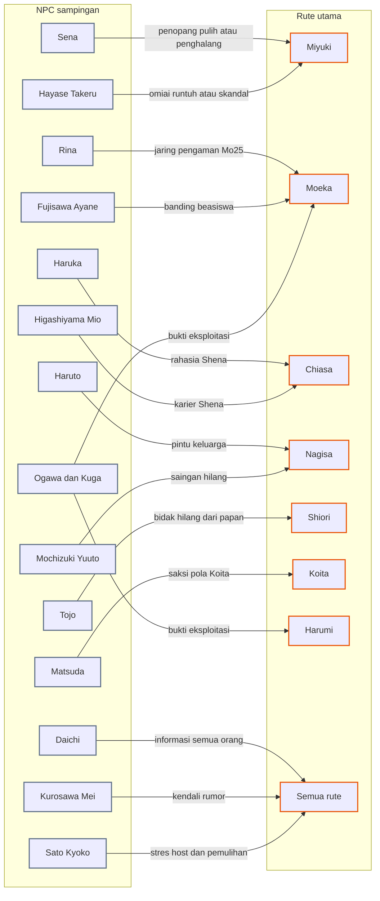
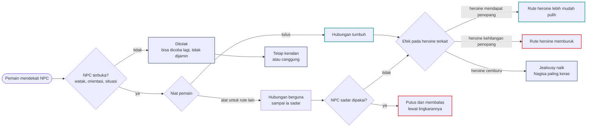

# Alur Cabang 11 — Rute sampingan NPC

Status: 🟡 usulan. Dasar ✅ Master Canon §2.4: pemain bisa membangun hubungan dengan heroine, Koita, Chiasa/Yutaka NPC, **atau tokoh lain**; tidak ada ketertarikan yang dijamin. ✅ GDD 6I.1: NPC tidak membentuk pasangan romantis baru **antar sesama NPC** di luar canon (aturan ini tidak membatasi pemain). Keputusanmu ⭐: kedua host bebas mengincar siapa saja; Chiasa lurus hanya ke Koita dan Yutaka, jadi rute sampingan Chiasa ke NPC laki-laki tidak ada.
Bobot evaluasi ✅ (Aturan_Evaluasi §1): hubungan pemain dengan karakter di luar takdir Koita bernilai **nol secara langsung**. Nilainya ada pada **efek tidak langsung**: siapa yang terisolasi, siapa yang mendapat penopang, dan informasi apa yang terbuka.

## 1. Bentuk pohon
Setiap NPC sampingan adalah cabang kecil yang menempel ke rute besar. Mengejar sahabat seorang heroine mengubah jaring pengaman heroine itu. Mengejar pengejar sepihak menyingkirkannya dari jalan heroine. Mengejar mesin rumor memberi kendali atas kabar, sampai ia patah hati. Ada juga jalur tanpa romansa: mentor, sekutu, dan penyusup. 27 ending.

## 2. Peta pengaruh

## 3. Alur umum rute sampingan

## 4. Daftar NPC sampingan
Kolom "Dikejar" : Y = bisa dikejar Yutaka, C = bisa dikejar Chiasa, — = bukan target romansa (jalur lain tersedia). Orientasi NPC di bawah adalah 🟡 usulan.

| NPC | Dikejar | Jalur | Efek tidak langsung | Ending |
|---|---|---|---|---|
| Akiyama Sena | Y/C | romansa, sekutu | sahabat Miyuki. Bila pemain tulus, Sena lebih sering ada untuk Miyuki dan pemain. Bila pemain menyakiti Miyuki sambil mendekati Sena, Sena memilih Miyuki | E-NPC-01, -02 |
| Hoshino Rina | Y/C | romansa, sekutu | sahabat Moeka. Rina yang dekat dan percaya pada pemain menelepon di Mo25. Menyakiti Rina memutus jaring Moeka | E-NPC-03, -04 |
| Ishikawa Haruka | Y/C | romansa, sahabat | sahabat Chiasa dan penggemar "Shena". Di Female Route, rahasia Shena dibagi atau terbongkar lewat Haruka | E-NPC-05, -06 |
| Fujisawa Ayane | Y/C | romansa, sekutu | Ketua BEM, mahasiswi Hukum. Kunci banding beasiswa Moeka dan prosedur kampus | E-NPC-07, -08 |
| Kurosawa Mei | Y/C | romansa, transaksi | admin akun gosip. Pacaran dengan mesin rumor memberi kendali atas kabar, sampai ia terluka | E-NPC-09, -10 |
| Higashiyama Mio | C (Y bila dikenalkan Chiasa) | romansa, profesional | editor Chiasa. Hubungan mengubah tekanan proyek dan rahasia Shena | E-NPC-11, -12 |
| Sakurajima Haruto | Y | romansa (BL), sekutu | kakak Nagisa. Membuka pintu keluarga Sakurajima; Nagisa bisa cemburu pada kakaknya sendiri atau lega | E-NPC-13, -14 |
| Matsuda Takumi | Y | romansa (BL), saksi | teman Koita yang curiga. Bisa menjadi sekutu melawan pola Koita atau penulis esai yang membongkar pemain | E-NPC-15, -16 |
| Nakamura Daichi | Y | romansa (BL), informan | informan yang mudah dibeli. Kesetiaannya menentukan apakah ia menjadi penagih (E-YH-07) | E-NPC-17 |
| Mochizuki Yuuto | Y | romansa (BL) | pengejar Nagisa. Bila ia jatuh cinta pada Yutaka, ia berhenti mengejar Nagisa dan `sasaran_cemburu` Nagisa bergeser | E-NPC-18 |
| Tojo Akihiro | Y | romansa (BL) | calon tunangan Shiori. Menyingkirkan bidak S21 dari papan | E-NPC-19 |
| Hayase Takeru | Y | romansa (BL) | pilihan orang tua Miyuki. Omiai runtuh dalam skandal; Miyuki bisa bebas atau ikut malu | E-NPC-20 |
| Ito Shinji | — | mentor, kerja | pemilik Kafe Komorebi. Kerja pagi dan makan teratur menstabilkan tubuh pemain | E-NPC-21 |
| Sato Kyoko | — | konseling | psikolog kampus. Menolak romansa demi batas profesional; konseling menurunkan `stres_host` | E-NPC-22, -23 |
| Kuroiwa Genzo | — | kepercayaan | setia pada Shiori. Kepercayaannya membuat ia memperingatkan pemain lebih dini | E-NPC-24 |
| Hanabusa Tsukasa | — | saksi, informan polisi | membantu memproses Ogawa atau Kuga; mencatat pemain bila pemain bermasalah | E-NPC-25 |
| Ogawa Masato, Kuga Renji | — | penyusup | berpura-pura akrab untuk mengumpulkan bukti; risiko ikut terseret | E-NPC-26, -27 |

Tidak dirancang sebagai target romansa 🟡: orang tua para heroine dan orang tua host, adik Kohinata (di bawah umur), Ogiwara Fumiko. Bisa kamu buka bila mau.

## 5. Malam dan tubuh
- Rina dan Moeka karaoke sampai pagi di D4. Pemain yang ikut melihat Moeka dari dekat, dan Rina menilai pemain.
- Mei paling aktif mengunggah antara 23:00 dan 02:00. Pesan dari pemain di jam itu bisa menghentikan atau mempercepat sebuah rumor.
- Kerja pagi di Kafe Komorebi (Ito) mulai 07:00 dan ikut pasar subuh 04:00. Ini cara paling ampuh memperbaiki ritme tubuh, dan juga tempat bertemu Miyuki yang membeli bahan pastry.
- Haruto pulang lembur sekitar 22:00. Bertemu di depan rumah Sakurajima adalah awal jalur Haruto.

## 6. Ending
| Kode | Nama | Jenis | Host | Syarat inti | Isi |
|---|---|---|---|---|---|
| E-NPC-01 | Dua Jas Putih | Romantis | Y/C | romansa tulus dengan Sena; Miyuki tidak disakiti | dua calon dokter yang saling menjaga jam tidur |
| E-NPC-02 | Sahabat yang Memilih Sisi | Bad | Y/C | pemain menyakiti Miyuki sambil mendekati Sena | Sena memilih Miyuki dan menutup pintu |
| E-NPC-03 | Thrift Hari Minggu | Romantis | Y/C | romansa tulus dengan Rina; Moeka selamat | Minggu pagi di toko bekas, bertiga dengan Moeka |
| E-NPC-04 | Rina Tidak Memaafkan | Bad | Y/C | Moeka meninggal atau disakiti pemain | Rina menjadi saksi paling keras terhadap pemain |
| E-NPC-05 | Studio Berdua | Romantis | Y/C | romansa dengan Haruka | dua meja gambar dalam satu studio |
| E-NPC-06 | Rahasia yang Dititipkan | Neutral | C | Haruka tahu rahasia Shena dan menjaganya | persahabatan yang lebih kuat dari rahasia |
| E-NPC-07 | Pasal yang Membela | Romantis | Y/C | romansa atau aliansi dengan Ayane | Ayane membela pemain di kampus dan Moeka di sidang banding |
| E-NPC-08 | Rapat Terakhir BEM | Bad | Y/C | Ayane mengetahui manipulasi pemain | ia mengecam pemain di depan umum |
| E-NPC-09 | Redaksi Berdua | Romantis | Y/C | romansa dengan Mei; pemain jujur padanya | akun gosip berhenti menulis tentang pemain |
| E-NPC-10 | Headline Terakhir | Bad | Y/C | Mei dipakai lalu dibuang | Mei menerbitkan semua yang ia tahu |
| E-NPC-11 | Naskah dan Penyuntingnya | Romantis | C | romansa dengan Mio | hubungan kerja menjadi lebih dari itu |
| E-NPC-12 | Kontrak Diputus | Bad | C | hubungan dengan Mio rusak | Mio memutus kontrak Shena |
| E-NPC-13 | Kakak yang Dipilih | Romantis | Y | romansa dengan Haruto | keluarga Sakurajima terkejut; Nagisa bereaksi sesuai tahapnya |
| E-NPC-14 | Restu Sakurajima | Neutral | Y/C | Haruto menjadi sekutu | keluarga Nagisa membuka pintu untuk pemain |
| E-NPC-15 | Esai untuk Satu Orang | Romantis | Y | romansa dengan Matsuda | Matsuda menulis esai baru, kali ini tentang tokoh yang memilih |
| E-NPC-16 | Saksi yang Menulis | Bad | Y/C | Matsuda membongkar manipulasi pemain | esai yang membongkar pemain dibaca seluruh fakultas |
| E-NPC-17 | Informan yang Setia | Romantis | Y | romansa dengan Daichi | informan yang berhenti menjual pemain |
| E-NPC-18 | Maket Kedua | Romantis | Y | romansa dengan Yuuto | Yuuto berhenti mengejar Nagisa |
| E-NPC-19 | Pewaris yang Membangkang | Romantis | Y | romansa dengan Tojo | rencana pertunangan Tojo–Saionji runtuh |
| E-NPC-20 | Skandal Omiai | Khusus | Y | romansa dengan Takeru | omiai Miyuki runtuh dalam skandal |
| E-NPC-21 | Kafe Pagi | Neutral | Y/C | kerja tetap di Kafe Komorebi | Ito menjadi mentor; tubuh pemain paling sehat di semua ending |
| E-NPC-22 | Batas Profesional | Neutral | Y/C | pemain mengejar Sato secara romantis | Sato menolak dan memindahkan konseling ke rekan lain |
| E-NPC-23 | Konseling Host | Neutral | Y/C | konseling rutin dengan Sato | `stres_host` turun; rahasia Sistem dicatat sebagai "keyakinan pasien" |
| E-NPC-24 | Kepercayaan Kuroiwa | Neutral | Y/C | Kuroiwa mempercayai pemain | peringatan dini setiap kali Shiori bergerak |
| E-NPC-25 | Saksi yang Dipercaya | Neutral | Y/C | pemain membantu Hanabusa | kesaksian pemain menjatuhkan Ogawa atau Kuga |
| E-NPC-26 | Penyusup | Khusus | Y/C | penyamaran berhasil; bukti cukup | Ogawa atau Kuga jatuh dari dalam |
| E-NPC-27 | Penyusup yang Tertelan | Bad | Y/C | penyamaran terlalu lama | pemain ikut terseret kejahatan mereka |
