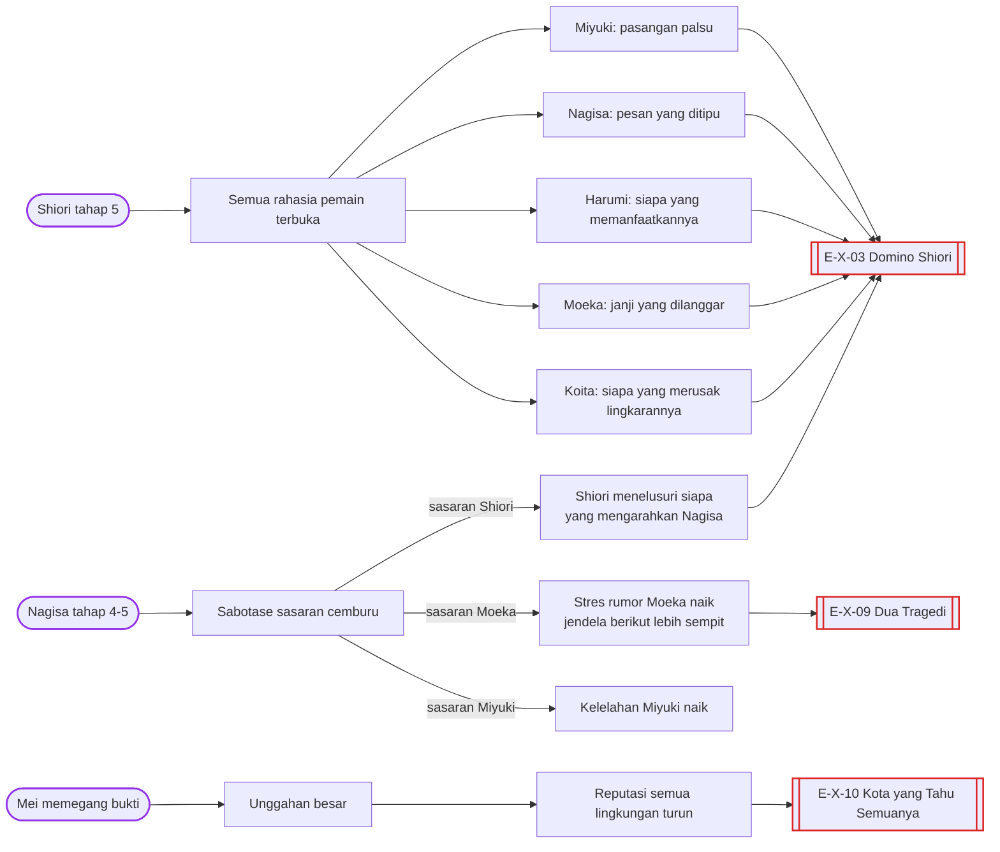
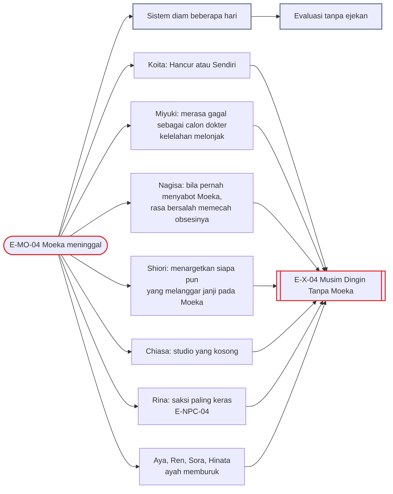
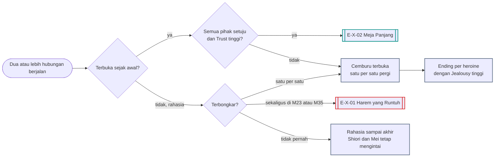

# Alur Cabang 12 — Interlock antar rute

Status: 🟡 usulan. Dasar ✅ GDD 6B.5 dan 6B.6: keenam rute khusus bisa aktif bersamaan dan desain harus memperhitungkan konflik jadwal, hubungan, dan reaksi NPC. ✅ 6I.3: rute bisa saling bertabrakan, bergantung karakter dan situasi.

## 1. Bentuk pohon
Di sinilah cabang berlipat. Satu rute jarang berjalan sendiri: sabotase Nagisa menambah stres Moeka, penemuan Shiori membuka rahasia semua rute, kematian Moeka mengubah epilog semua orang, dan plot armor Koita terus menarik heroine yang belum lepas. Dokumen ini memetakan tabrakan itu, reaksi berantainya, dan 14 ending kombinasi.

## 2. Matriks pengaruh (baris memengaruhi kolom)
| | Miyuki | Nagisa | Harumi | Moeka | Shiori | Chiasa | Koita |
|---|---|---|---|---|---|---|---|
| **Miyuki** | — | Nagisa cemburu pada kedewasaannya | Miyuki bisa melihat tanda fisik Harumi | penolong medis; tahu kondisi ayah Moeka | pasangan palsu adalah kebohongan yang bisa ditemukan | saingan "dewasa" bagi Chiasa | rahasia cinta SMA Koita |
| **Nagisa** | Miyuki bisa menjadi sasaran sabotase | — | jarang bersinggungan | sabotase menambah stres Moeka | Shiori membalas bila disabot | rival lama; Koita Success ketahuan lewat Nagisa | geng masa kecil; `harapan_koita` |
| **Harumi** | Sena dan Miyuki bisa menegur | — | — | Ogawa dan Kuga adalah cermin eksploitasi | Shiori bisa menargetkan Ogawa | kolaborasi seni–sains (C) | rasa bersalah Koita yang terlambat sadar |
| **Moeka** | butuh Miyuki yang tidak burnout | rangkulan Moeka pada Koita memicu cemburu Nagisa | Harumi mencatatnya sebagai "variabel kacau" | — | salah paham jarak Shiori; Shiori sangat melindungi bila peduli | satu fakultas dengan Chiasa | `andalan_moeka` bisa Koita; kematiannya menghancurkan Koita |
| **Shiori** | membongkar pasangan palsu | membongkar senjata Nagisa | membongkar Ogawa atau pemain | membongkar janji yang dilanggar | — | rahasia Shena | menjatuhkan Koita (E-SH-09) |
| **Chiasa** | — | rival; yuri dari rival | — | melihat tanda Moeka di studio | Shena sebagai jembatan | — | Koita Success; tersisih di Rute BL |
| **Koita** | plot armor menarik Miyuki kembali | plot armor menarik Nagisa kembali | Koita bisa menjadi "variabel tetap" | Koita bisa datang tepat waktu di Mo25 | cinta Shiori tumbuh di S08 | tabu saudara tiri | — |

## 3. Reaksi berantai

## 4. Gelombang duka setelah Moeka

## 5. Banyak pasangan sekaligus
Pemain boleh mengincar lebih dari satu orang (✅ Hubungan_Antar_Karakter §6). Aturan 🟡:
- **Setiap hubungan rahasia** punya risiko terbongkar lewat saksi, bukti digital, dan Mei (✅ 6C.3).
- **Hari Pengakuan Bentrok (M23)** dan **Puncak (M35)** adalah dua hari ketika semua rahasia paling mungkin bertabrakan.
- **Terbuka dan disepakati** mungkin, tetapi paling sulit: semua pihak tahu sejak awal, Trust tinggi pada masing-masing, tidak ada Nagisa tahap 3+, dan tidak ada kebohongan di `daftar_kebohongan` Shiori.
- Sistem menertawakan pemain yang mengejar semua orang, lalu menagih di evaluasi (✅ keputusan lama).

## 6. Konflik jadwal di malam yang sama
Dua krisis bisa jatuh di malam yang sama, dan pemain hanya bisa berada di satu tempat. Contoh 🟡:
- M33: Natal Sunyi Moeka (Mo26) dan Natal Sakurajima Nagisa (N22).
- M34: Malam Tanpa Balasan (Mo25) dan Koko di meja pemain (N23).
- M21: ultimatum Nagisa (N15) dan undangan Ogawa untuk Harumi (H14).
Pilihan "kirim orang lain" (Rina, Haruto, Koita) dan "mode ponsel" adalah alat utama untuk menghadapi dua krisis sekaligus. Begadang dua malam beruntun di bulan-bulan ini mendorong tubuh ke Sangat Lelah tepat saat petunjuk paling dibutuhkan.

## 7. Ending kombinasi
| Kode | Nama | Jenis | Host | Syarat inti | Isi |
|---|---|---|---|---|---|
| E-X-01 | Harem yang Runtuh | Bad | Y/C | beberapa hubungan rahasia terbongkar sekaligus di M23 atau M35 | semua pergi di hari yang sama |
| E-X-02 | Meja Panjang | Romantis | Y/C | hubungan terbuka yang disepakati semua pihak | makan malam panjang yang canggung, tapi jujur |
| E-X-03 | Domino Shiori | Bad | Y/C | Shiori tahap 5 dengan `daftar_kebohongan` panjang | semua rahasia terbuka dan setiap rute ikut runtuh |
| E-X-04 | Musim Dingin Tanpa Moeka | Bad | Y/C | E-MO-04 | semua epilog berubah menjadi versi duka |
| E-X-05 | Kursi Kosong di Wisuda | Khusus | Y/C | semua heroine lepas dari Koita | Koita sendirian di wisuda; deviasi sangat tinggi |
| E-X-06 | Semua Orang Bebas | Romantis | Y/C | semua heroine pulih dan mandiri; tidak ada yang bersama Koita atau pemain | lingkaran yang bubar dengan sehat (sering bersama E-SI-12) |
| E-X-07 | Melawan Naskah Bersama | Khusus | Y/C | E-KO-13 dan persahabatan atau Rute BL | Koita dan pemain sama-sama sadar naskah dan melawannya |
| E-X-08 | Pengakuan di Depan Semua | Khusus | Y/C | pemain membuka Sistem kepada seluruh lingkaran di M35 | setiap orang bereaksi sesuai sejarahnya dengan pemain |
| E-X-09 | Dua Tragedi | Bad | Y/C | dua rute distorsi berakhir Bad dan saling memicu | dua kehilangan dalam satu musim |
| E-X-10 | Kota yang Tahu Semuanya | Bad | Y/C | Mei menerbitkan semuanya | reputasi semua orang yang terlibat hancur |
| E-X-11 | Pesta di Rumah Amamiya | Romantis | Y/C | semua pulih; Koita memilih dengan tulus; pemain bersama seseorang; geng masa kecil utuh | akhir paling bahagia, tetapi bukan True Ending |
| E-X-12 | Dua Ratu | Bad | Y/C | Shiori Rute Revenge dan Nagisa Rute Yandere sama-sama menargetkan pemain | dua orang yang tadinya tidak akrab bersekutu melawan pemain |
| E-X-13 | Tubuh yang Dibayar | Khusus | Y/C | pemain menyelamatkan minimal tiga heroine dari rute distorsi sambil terus memaksa tubuh | semua selamat, tubuh pemain yang membayar (dekat E-SI-07) |
| E-X-14 | Dalang yang Tak Pernah Dicurigai | Khusus | Y/C | `force_bersih[x]` bertahan untuk setiap korban Force; NTR sempurna tercapai ([07_Koita_dan_BL.md](07_Koita_dan_BL.md) §14, [09_Force_dan_Kriminal.md](09_Force_dan_Kriminal.md) §10) | tidak ada yang pernah tahu apa yang sebenarnya terjadi; pemain lolos evaluasi dengan deviasi tertinggi yang mungkin, dan dunia tidak pernah mengejarnya. Sistem NTR tetap mencatat semuanya diam-diam |

## 8. Event dinamis lintas karakter
Event ini muncul saat poin **dua karakter atau lebih** memenuhi syarat bersamaan. Pemain tidak harus hadir; bila tidak hadir, event tetap terjadi dan pemain tahu belakangan (atau tidak pernah).

| ID | Nama | Syarat | Isi dan cabang | Efek |
|---|---|---|---|---|
| X-D01 | Pertengkaran di Konbini | `jeal[moeka]` Nagisa ≥ 60; `stres_total` Moeka ≥ 60; keduanya di konbini saat Dini Hari | lerai / bela Moeka / bela Nagisa / pergi | stres Moeka; tahap Nagisa; bila pemain tidak ada, Rina mendengar ceritanya besok |
| X-D02 | Calon Dokter Membaca Tanda | kelelahan Miyuki < 60; Moeka tahap ≥ 3 | Miyuki melihat tanda Moeka dan menelepon pemain. Datang bersama / minta Miyuki menangani / abaikan | jendela Moeka bisa diambil lewat Miyuki |
| X-D03 | Dua Peringkat Teratas | Shiori dan Harumi sama-sama percaya pada pemain | mereka bersekutu melawan Ogawa. Bergabung / biarkan / pecah belah | `bukti_ogawa` melonjak; E-HA-07 dan E-SH-10 menguat |
| X-D04 | Dua Coklat di Satu Loker | Valentine; dua heroine dengan Aff ≥ 55 | dua coklat di loker pemain; keduanya datang di waktu yang sama. Jujur pada keduanya / sembunyikan satu / kabur | Jealousy keduanya; rahasia baru |
| X-D05 | Rumah Amamiya Penuh | Natal; tiga heroine atau lebih diundang | semua datang ke rumah Amamiya. Atur tempat duduk / bagi perhatian / keluar sebentar | panggung kecil Hari Pengakuan; Koita mengamati |
| X-D06 | Wawancara Mei | Mei menulis tentang pemain | Mei mewawancarai heroine satu per satu. Hentikan Mei / biarkan / bayar Mei | jawaban tiap heroine mengikuti keadaannya; reputasi |
| X-D07 | Rapat Rahasia Koita | `koita_sadar` ≥ 75 | Koita mengumpulkan heroine untuk "membicarakan" pemain. Hadir tanpa diundang / kirim orang / biarkan | manuver balik terbesar; E-KO-10 menguat |
| X-D08 | Rina dan Sena Bertukar Cerita | `rina_curiga` dan `sena_curiga` ≥ 50 | dua sahabat membandingkan catatan tentang pemain. Temui mereka / hindari / jujur | kecurigaan gabungan; dua lingkaran sosial sekaligus |
| X-D09 | Dua Penjaga | `haruto_curiga` ≥ 50; Kuroiwa curiga | Haruto dan Kuroiwa bertemu dan berbagi informasi; pemain baru tahu belakangan | peringatan dari dua sisi; bila ada Force, E-FO-06 lebih mungkin |
| X-D10 | Malam Dua Krisis | Mo25 dan N23 jatuh di malam yang sama | pemain hanya bisa berada di satu tempat. Datang ke Moeka / ke Nagisa / kirim orang ke salah satunya | ujian terberat untuk "kirim orang lain" dan mode ponsel |
| X-D11 | Grup Belajar SMA Hidup Lagi | Koita membuka grup chat lama | Koita, Yutaka, Nagisa, Miyuki, Harumi kembali bercakap. Ikut / diam / keluar grup | rahasia lama terangkat; benih E-NA-09 dan E-X-11 |
| X-D12 | Salah Kirim | pemain Sangat Lelah; sedang chat dengan dua orang | pesan untuk satu orang terkirim ke orang lain. Tarik pesan (notifikasi sudah terbaca) / jelaskan / pura-pura disengaja | rahasia bocor; contoh kondisi tubuh yang melahirkan cabang baru |
