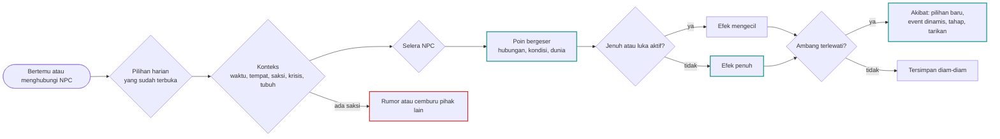

# Alur Cabang 14 — Pilihan harian

Status: 🟡 usulan. Dasar ✅ GDD 6F (aktivitas bebas, kencan bebas, hadiah dengan selera berbeda, reputasi per lingkungan), 6P (chat, telepon, media sosial, blokir dengan konsekuensi, bukti digital), 6C (lima dimensi tersembunyi).
Mekanik umumnya ada di [Sistem_Cabang_dan_Poin.md](../Sistem_Cabang_dan_Poin.md).

## 1. Bentuk pohon
Di luar event, setiap pertemuan di sandbox menawarkan **pilihan harian**: sapa, traktir, antar pulang, balas pesan, bohong kecil, dan seterusnya. Masing-masing hanya menggeser poin sedikit, tetapi ratusan pilihan kecil inilah yang menumpuk menjadi ambang, membuka event dinamis, dan membelokkan tarikan ending. Pilihan harian juga yang paling jelas **muncul sedikit demi sedikit**: daftar di bagian 5 hanya terbuka setelah pemain tahu, dekat, atau bisa.

## 2. Alur satu pilihan harian

## 3. Daftar pilihan harian
Notasi efek: **+** ≈ 1–3 poin, **++** ≈ 4–6, **−** dan **−−** sebaliknya. Efek akhir dikalikan konteks (bagian 4) dan selera (bagian 6).

### Bicara
| Pilihan | Terbuka saat | Biaya | Efek dasar | Risiko |
|---|---|---|---|---|
| Sapa, basa-basi | selalu | 5 menit | Aff + | cepat jenuh |
| Tanya kabar | sudah kenal | 10 menit | Trust +; bisa membuka curhat bila Trust Sedang | — |
| Dengarkan curhat | NPC sedang bercerita | 20–60 menit | Trust ++, Intim + | saat Lelah, salah merespons |
| Curhat (pemain bercerita) | Trust Sedang | 20–60 menit | Intim +, Trust + bila jujur | cerita yang tidak cocok dengan masa lalu host memicu curiga identitas |
| Puji | selalu | 2 menit | Aff + sesuai selera | pujian di depan umum memicu cemburu orang lain |
| Goda | Aff Rendah+ | 2 menit | Aff ±, Intim + | Jealousy pihak lain; Fear bila berlebihan |
| Bercanda | selalu | 5 menit | Aff + | saat NPC krisis: Trust − |
| Kritik jujur | Trust Sedang | 5 menit | Trust + (Shiori, Harumi), Aff − (Nagisa) | — |
| Sindir | selalu | 2 menit | Aff −, Fear + | — |
| Tanya soal [fakta] | fakta ada di jurnal | 10 menit | membuka cabang baru | "dari mana kau tahu?" bila sumbernya tidak wajar |
| Bohong kecil | selalu | 1 menit | menyelamatkan momen | masuk `daftar_kebohongan` Shiori bila ketahuan |
| Bohong besar | selalu | — | menghindari akibat besar | luka Trust bila ketahuan |
| Jujur, mengaku | selalu | — | Trust ± tergantung isi | — |
| Minta maaf | setelah melukai | 5 menit | luka berkurang sebagian, tidak dijamin | diulang tanpa perubahan: Trust − |
| Berjanji | selalu | 1 menit | Trust + kecil | bendera janji: ditepati ++, dilanggar −− (Moeka paling peka) |
| Menolak ajakan | ada ajakan | — | Aff − kecuali alasannya jujur | — |

### Lakukan
| Pilihan | Terbuka saat | Biaya | Efek dasar | Risiko |
|---|---|---|---|---|
| Ajak makan, traktir, patungan | sudah kenal | 1 jam, uang | Aff +, Intim + | traktir berlebihan melukai gengsi (✅ #20) |
| Antar pulang | Malam | 30 menit | Intim +, Trust + | dilihat orang: rumor; di D2 dilihat Nagisa |
| Bantu tugas | punya skill relevan | 1–3 jam | Trust ++ | mengerjakan untuknya = curang akademik |
| Belajar bersama | musim ujian | 2–4 jam | Intim +, nilai keduanya + | utang tidur |
| Beri hadiah | ✅ selera | uang | sesuai selera | mahal dan tidak sesuai: canggung (✅ #79) |
| Masakkan sesuatu | skill memasak | 1 jam | Aff +, Intim + | — |
| Jenguk | NPC sakit | 1 jam | Trust ++, Intim + | pemain bisa tertular |
| Temani diam | NPC sedih atau lelah | 30 menit | Trust +, Intim ++ | — |
| Gandeng, peluk | Intim Sedang, atau momen krisis | — | Intim ++ | tanpa kesediaan: Fear ++ |
| Cium, keintiman (teks tersirat ⭐) | Intim Tinggi dan persetujuan jelas | — | Intim +++ | dilihat orang: rumor besar. Tanpa persetujuan = Force (file 09) |
| Menginap | ada undangan (✅ 6O.6) | semalam | Intim ++ | rumor; keluarga |
| Ajak kencan | Aff Sedang | 2–4 jam, uang | sesuai rencana | bisa ditolak (✅ 6C.3) |
| Ajak ke acara kota | kalender | — | sesuai acara | — |
| Kerja bareng | tempat kerja sama | satu shift | Trust + | — |

### Digital (✅ 6P)
| Pilihan | Terbuka saat | Biaya | Efek dasar | Risiko |
|---|---|---|---|---|
| Chat pagi atau malam | punya kontak | 5–15 menit | Intim + | chat jam 02:00: Intim ++, tetapi utang tidur |
| Balas cepat | pesan masuk | — | Trust + | — |
| Balas lambat (> 6 jam) | pesan masuk | — | Aff − sesuai watak | Nagisa tahap 2+: Jealousy + |
| Abaikan | pesan masuk | — | Aff − | Moeka: stres +; Nagisa: eskalasi |
| Like, komentar | media sosial | — | Aff + kecil | komentar di unggahan heroine lain dilihat Nagisa |
| Unggah foto bersama | — | — | Intim + | **bukti digital** (✅ 6P.7); rumor |
| Telepon, video call | punya kontak | — | Intim + | — |
| Tandai kontak prioritas | ponsel | — | — | menentukan siapa yang bisa membangunkan pemain (dokumen sistem §3.1) |
| Blokir | — | — | — | konsekuensi sosial (✅ 6P.6); yandere tahap 3+ makin parah |
| Salah kirim | otomatis, peluang saat Sangat Lelah | — | — | X-D12 di file 12 |

### Sosial
| Pilihan | Terbuka saat | Biaya | Efek dasar | Risiko |
|---|---|---|---|---|
| Bela di depan umum | NPC disudutkan | — | Trust ++ | reputasi pemain bergeser |
| Permalukan di depan umum | — | — | Aff −−, Fear ++ | reputasi turun |
| Kenalkan ke teman | — | — | jaringan NPC bertambah | — |
| Tanya teman NPC tentang dia | kenal temannya | 10 menit | informasi | teman bisa bercerita balik (✅ 6J) |
| Sebar atau bantah rumor | ada rumor | — | sesuai isi | ✅ 6P.3 fakta dan manipulasi dibedakan |
| Bayar Mei | kenal Mei | uang | rumor ditahan | bukti suap |

### Diam dan pergi (Cabang Diam)
Tidak datang, terlambat, pergi di tengah, menjaga jarak, tidak membalas. Efeknya sesuai watak NPC: Moeka mencatatnya sebagai janji yang lagi-lagi tidak ditepati, Shiori mencatatnya sebagai data, Nagisa mencatatnya sebagai pengkhianatan kecil.

## 4. Pengali konteks
| Konteks | Pengaruh |
|---|---|
| Malam dan Dini Hari | Intim ×1,5; risiko rumor ×1,5 |
| Di depan umum | Jealousy orang yang melihat naik; rumor |
| NPC sedang krisis | Trust ×2, ke arah positif atau negatif |
| Setelah kebohongan terbongkar | efek positif ×0,5 selama luka aktif |
| Pemain Lelah / Sangat Lelah | peluang salah nada 10% / 25% |
| Pemain mabuk | hasil impulsif; sebagian tidak diingat besoknya |
| Hari spesial (ulang tahun, Natal, Valentine, White Day) | hadiah dan kehadiran ×2; absen ×2 ke arah negatif |
| Diulang dalam seminggu | efek menurun |

## 5. Pilihan yang terbuka belakangan
| Karakter | Pilihan | Terbuka saat |
|---|---|---|
| Miyuki | Panggil "Miyu" | Intim ≥ 60 |
| Miyuki | Paksa dia tidur | kelelahan ≥ 45 |
| Miyuki | Tanya soal Hayase | `omiai_takeru` ≥ 40 |
| Miyuki | Ceritakan rahasia SMA Koita | setelah Mi-D08 |
| Miyuki | Ajak ke Sato Kyoko | setelah Mi08 |
| Nagisa | Ajak ke ayunan taman | tahu tempat masa kecil (N05) |
| Nagisa | Serahkan ponsel tanpa diminta | tahap ≥ 3 |
| Nagisa | Bicara dengan Haruto | `haruto_curiga` ≥ 50 |
| Nagisa | Kembalikan Koko | Koko pernah dititipkan |
| Harumi | Bantu menamai perasaan | H09 tercatat |
| Harumi | Tanya soal jadwal kosongnya | setelah H-D09 |
| Harumi | Bawa bukti ke Mizuhara | `bukti_ogawa` ≥ 50 |
| Harumi | Ajak memasak lagi | H03-C pernah terjadi |
| Moeka | Tanya soal cuci darah ayah | setelah Mo-D04 |
| Moeka | Tanya langsung dan tenang apakah ia ingin menyakiti diri | tanda bahaya dikenali (Mo-D12) |
| Moeka | Hubungi Rina diam-diam | kenal Rina |
| Moeka | Temani ke pemotretan | setelah Mo-D05 |
| Shiori | Main shogi tanpa nama | tahu jam online Shiori |
| Shiori | Akui akun itu milikmu | `akun_anonim` aktif |
| Shiori | Tunjukkan bukti pola Koita | setelah K-D04 |
| Shiori | Buktikan Sistem dengan prediksi | `tahu_sistem` diberi tahu |
| Chiasa (host) | Tunjukkan sketsa latihan ke Haruka | `kemampuan_gambar` ≥ 30 |
| Chiasa (host) | Minta izin karena siklus | siklus bulanan aktif ⭐ |
| Chiasa (NPC) | Goda dengan gaya Yutaka asli | sudah mengamati kebiasaan Yutaka asli (Y03, Y11) |
| Koita | Kutip kalimat drafnya | setelah K-D01 |
| Koita | Tanya soal ayahnya | setelah K16-A |
| Koita | Tuntut kejelasan | Male Route, rantai BL B2+ |
| Koita | Singgung kebetulan yang gagal | setelah K-D10 |
| Yutaka (NPC) | Ajak main game sampai pagi | Aff Sedang |
| Yutaka (NPC) | Tanya kenapa ia menghilang | setelah ia menghilang karena cemburu |

## 6. Selera per karakter
| Karakter | Suka (efek naik) | Tidak suka (efek turun) | Catatan khusus |
|---|---|---|---|
| Miyuki | dibawakan makanan; dibiarkan bermanja; ditanya soal pediatri | dikasihani soal kerja kerasnya; diremehkan; pujian kosong | meminta tolong padanya menaikkan Aff, tetapi juga kelelahan |
| Nagisa | ditantang main; kalah tipis yang jujur; pujian maket di tempat sepi | dikasihani; mengalah lalu ketahuan; dipuji di depan umum | balas cepat makin penting di tahap 2+ |
| Harumi | diskusi akademik; teh buatannya diminum; kejujuran berbasis data | candaan soal perasaan; didesak cepat | kritik jujur menaikkan Trust |
| Moeka | pujian gaya; thrifting; ingat adik-adiknya; janji ditepati | janji dilanggar; dikasihani soal uang; ditanya "kenapa terlambat lagi" | pesta besar menebalkan topeng; perhatian kecil menipiskannya |
| Shiori | tanding jujur; debat; tidak disanjung | sengaja kalah; sanjungan; kebohongan | menang darinya secara adil menaikkan respek |
| Chiasa (NPC) | godaannya dibalas; karyanya dilihat; kopi tengah malam | dikasihani; dibandingkan dengan Nagisa | di Male Route, godaan ala Yutaka asli menurunkan curiga identitas |
| Koita | dicurhati (ia suka dibutuhkan); drafnya dibaca | dituntut jawaban (Fear +, kecuali rantai BL konsisten) | pujian membuatnya nyaman, dan nyaman membuatnya makin menggantung |
| Yutaka (NPC) | main game; kopi spesialti; barang praktis berkualitas | dibandingkan dengan Koita; kejutan yang terlalu emosional | menghilang beberapa hari bila cemburu |
| Sena | jujur soal Miyuki | memanfaatkan Miyuki | — |
| Rina | thrifting; jujur | menyakiti Moeka | — |
| Haruka | sketsa; jujur | dibohongi soal Shena | — |
| Kurosawa Mei | informasi eksklusif | diabaikan setelah dipakai | — |
