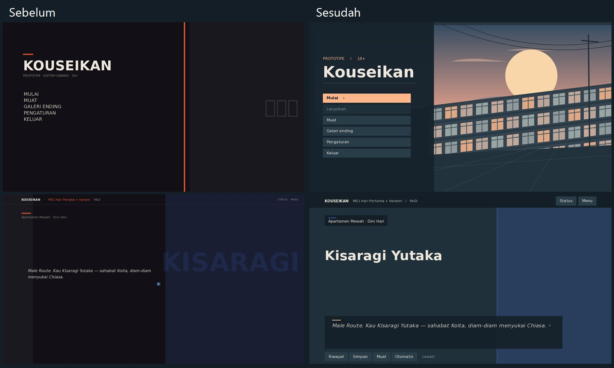

# Playtest UI Kouseikan

Prototipe Windows 64-bit, Ren’Py 8.3.2. Penguji dewasa dapat memainkan satu putaran singkat dari prolog sampai evaluasi. Sebagian event masih berupa ringkasan desain dan beberapa jalur memuat tema paksaan; adegan terkait dilewati menuju akibatnya.

## Untuk penguji

1. Ekstrak seluruh ZIP Windows ke satu folder dan buka `Kouseikan.exe`. Pilih **Mulai** lalu pilih tubuh Yutaka atau Chiasa. Gunakan klik, Enter atau Spasi untuk membaca. Gunakan tombol panah untuk memindahkan fokus dan Enter untuk memilih.
2. Mainkan hari pertama kampus dan Hanami. Buka **Riwayat** untuk menemukan dialog sebelumnya. Coba ubah kecepatan teks di **Menu → Pengaturan** lalu kembali ke dialog.
3. Di hub kampus, buka **Status**, baca kondisi host dan hubungan, lalu tekan Esc. Pilih jalur Miyuki atau Nagisa. Catat kapan kamu memahami lokasi, siapa yang berbicara, dan apa akibat pilihanmu.
4. Buka **Menu → Simpan**, pilih slot manual kosong, lalu gunakan **Muat** untuk kembali ke posisi itu. Coba **Lanjutkan** dari menu utama setelah memiliki save.
5. Pilih **Jelajah cabang**, ganti karakter, mainkan satu event, lalu kembali. **Evaluasi akhir** adalah pintasan pengujian menuju M36. Galeri di menu utama membuka katalog ending dan mengandung spoiler.
6. Saat melaporkan masalah, sertakan host, nama event atau layar, resolusi dan mode jendela, cara input, langkah terakhir, hasil yang diharapkan dan yang terlihat. Sertakan screenshot jika ada. Untuk umpan balik UX, sebutkan tombol atau istilah yang membuatmu ragu.

## Audit dan keputusan antarmuka

- Source awal memakai kanvas 1920 × 1080, tetapi beberapa layar memusatkan fungsi dalam area kira-kira 1280 × 720. Dialog narator tanpa panel dan penanda maju berposisi tetap membuat keterbacaan bergantung latar. Versi ini memakai panel baca bersama, label penutur dan penanda akhir baris bawaan karakter.
- Latar judul berupa ilustrasi vektor kampus orisinal. Adegan tanpa ilustrasi memakai warna karakter serta label lokasi dari event. Palet memakai tinta biru gelap, teks gading, dan aksen aprikot. Font DejaVu Sans dari runtime, judul layar 56, dialog 34, tombol 25, keterangan 22 pada kanvas logis. Margin utama 96 dan jarak antarkomponen 24.
- Tombol aksi memakai bidang fokus penuh. Aksen terisi menonjolkan Mulai. Warna terpisah menandai fokus, pilihan aktif dan aksi tidak tersedia. Transisi menu 140–180 ms. Teks pilihan dan aksi asli tetap berasal dari Ren’Py atau data event.
- Menu cepat sebelumnya kosong. Riwayat, pengaturan waktu baca otomatis, akses simpan/muat dan pilihan halaman slot tersedia dari UI baru. Slot lama tetap menggunakan nama halaman Ren’Py.
- Galeri awal memilih kelompok SI sambil menampilkan detail entri pertama dari kelompok MI. Pergantian kelompok sekarang memilih detail dalam kelompok aktif. Daftar dibentuk dari 220 entri dan 16 kelompok. Explorer kini juga menyediakan event Yutaka yang sudah ada di indeks tetapi sebelumnya tidak punya tombol rute.
- Panel Status awal menampilkan angka deviasi internal. Versi ini menyembunyikannya dan menyajikan kondisi serta hubungan secara kualitatif. Saldo tetap berupa mata uang. Catatan prototipe menyebut lima dimensi hubungan pada panel; source awal hanya menampilkan afeksi dan kepercayaan. Cakupan tampilan dua dimensi dipertahankan sambil menunggu keputusan pemilik sesuai GDD §6C.4.
- Acuan desain proyek adalah Master Canon §0A.7 serta GDD §6C.4 dan §6Q.2. Perbedaan rujukan Master Canon v11/v11.1 terdaftar di [indeks dokumen](README.md). Desain visual dan ilustrasi adalah implementasi untuk playtest. Tidak ada aset yang diambil dari portofolio desainer.

## QA dan batas pengujian

- Lint terhadap source produksi tanpa driver uji, Ren’Py 8.3.2.24090902, selesai tanpa diagnostik. SDK melaporkan 27 screen. Angka nol menu pada statistik lint merujuk statement `menu`; pilihan event di sini memakai `call screen`.
- Pengujian desktop Windows, renderer OpenGL. Tiga sesi memakai drawable 1280 × 720 (Yutaka), 1366 × 768 (Chiasa), dan 1920 × 1080 (Yutaka). Setiap sesi menjalankan menu, galeri dan ganti kelompok, pengaturan, prolog, riwayat, pilihan N01/Mi01, hub, status, simpan dan muat manual, explorer, kembali ke hub, serta kartu ending M36. Input mouse disimulasikan pada menu, aksi kembali keyboard pada galeri; sebagian besar tombol diuji melalui aksi pada komponen yang dirender.
- Pemeriksaan screenshot menemukan viewport kosong akibat scrollbar mengambil lebar konten dan slider tanpa track terlihat. Setelah perbaikan, daftar pilihan, hubungan, galeri, detail ending dan track pengaturan terlihat. Tes juga menemukan Esc dari galeri menu utama memerlukan aksi kembali eksplisit.
- Satu save manual dibuat dengan source main pada hub Yutaka sesudah N01/Mi01. Lanjutkan pada source baru memulihkan host dan dua pilihan tersebut. Dari save tersebut, kedua jalur hub Mi03/Mi05 dan N03/N06 dapat dimainkan kembali sampai ke hub. Pada desktop, viewport pilihan menerima gulir roda mouse sementara tombol menerima fokus arah dan Enter. Ini sampel kompatibilitas; save pada setiap titik skrip, versi SDK lain, perangkat sentuh, dan pembaca layar belum diuji.
- ZIP Windows dibangun dari source dan aset produksi. Integritas CRC diperiksa, lalu executable hasil ekstraksi memulai renderer. Pengujian alur lengkap dilakukan pada salinan source dengan driver uji terpisah. Paket distribusi tidak memuat driver, save pemain, atau log pengembangan.
- Pengujian mencakup alur prototipe dan sampel isi galeri. Belum semua 190 event, 128 data event dinamis, atau 220 ending dimainkan. Peta distrik, sprite karakter final, galeri CG/replay lengkap dan seluruh syarat ending tetap pekerjaan desain/konten terpisah. Uji kegunaan oleh pemain eksternal masih diperlukan.

## Catatan susulan — navigasi dunia (setelah playtest ini)

Instruksi langkah 3 dan 5 di atas ("Di hub kampus...", "Pilih jalur Miyuki atau Nagisa", "Galeri di menu utama") merujuk hub menu lama. Arsitektur navigasi diganti sesudah playtest ini: **distrik → lokasi** menggantikan daftar jalur datar, event ditemukan dengan berjalan ke lokasi yang tepat pada bulan yang tepat (bukan dipanggil dari menu), dan Galeri Ending dipindah dari menu utama ke panel **Alat Uji** sesuai risiko spoiler yang sudah dicatat di atas. Detail di [PROTOTIPE_RENPY.md](../PROTOTIPE_RENPY.md). Temuan UI/QA di dokumen ini (kanvas, token, viewport, keyboard focus) tidak berubah dan tetap jadi dasar tampilan.

