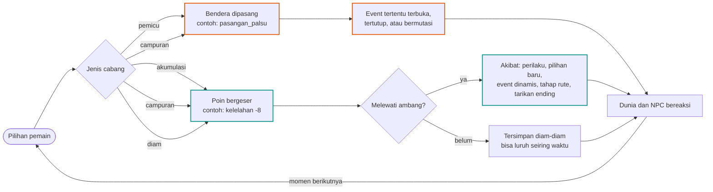
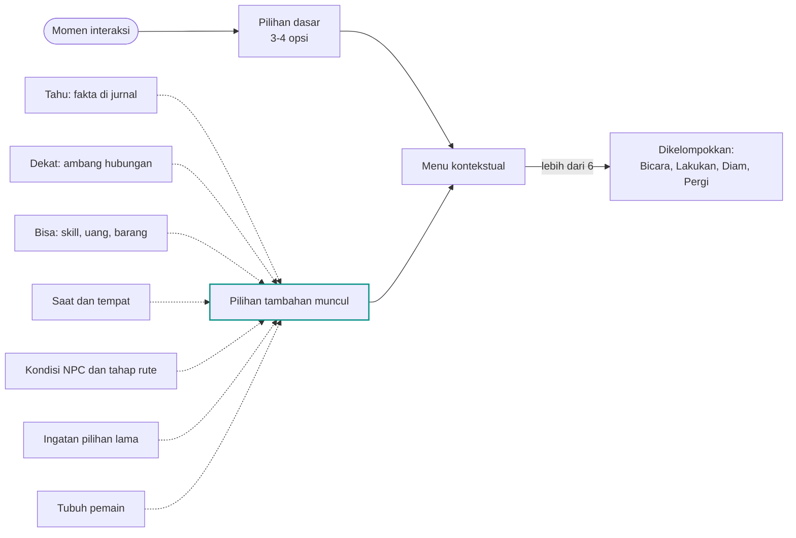
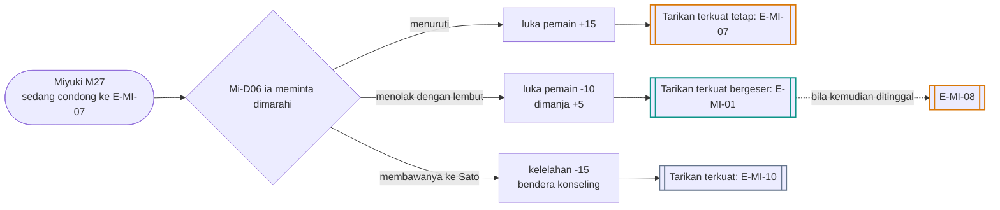
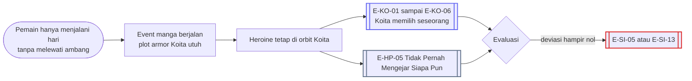

# Sistem Cabang dan Poin

Status: arah ⭐ dari keputusanmu (10 November 2026), dasar ✅ dari GDD, detail 🟡 usulanku.
Dokumen ini menjelaskan **bagaimana** cabang bekerja di seluruh game. Isi per karakter (poin, ambang, event dinamis, peta belok) ada di bagian akhir file `docs/Alur_Cabang/01`–`08`. Katalog pilihan sehari-hari ada di [Alur_Cabang/14_Pilihan_Harian.md](Alur_Cabang/14_Pilihan_Harian.md).

---

## 0. Keputusan dan dasar

**Keputusanmu ⭐**
- **Tidak ada target yang dipilih**, baik oleh pemain maupun oleh Sistem. Semua tindakan bisa mengarah ke rute mana saja, atau tidak ke rute mana pun dan berakhir tanpa siapa-siapa. (Usulan Naskah Target dibatalkan.)
- Cabang dan pilihan **muncul sedikit demi sedikit**.
- Cabang **tidak menuju satu ending**. Pilihan yang diambil bisa membelokkan arah ke ending lain. Pemain bebas bermain sesukanya; game tidak membatasi.
- Ada dua jenis cabang: yang **mengarah ke event tertentu**, dan yang **menambah atau mengurangi poin** yang akumulasinya menimbulkan akibat tertentu.
- Disetujui: AP diambil dari Energi, siklus bulanan Chiasa dipakai, cabang donor Moeka dipakai.

**Dasar canon ✅**
- Lima dimensi hubungan tersembunyi (Affection, Trust, Intimacy, Jealousy, Fear); perasaan bisa bertentangan; NPC mengingat perlakuan pemain (GDD 6C).
- Pilihan punya banyak opsi dengan konsekuensi tersembunyi; satu event bisa punya banyak hasil (6H).
- Rute dibuka oleh kombinasi hubungan, event, dan kondisi tersembunyi (6I.2); rute distorsi butuh ambang **dan** event penting (6B.5).
- Pilihan ditampilkan kontekstual (6L.2); ada event rahasia (6S.5); sebagian besar event kedekatan dinamis (6I.1).
- Target NTR tersembunyi dan baru diketahui saat evaluasi (6G.1). Dengan keputusanmu, ini dibaca sebagai: **apa yang dihitung Sistem baru dibacakan saat evaluasi**, bukan target yang dipilih di awal.

---

## 1. Dua jenis cabang

| Jenis | Cara kerja | Contoh | Yang dilihat pemain |
|---|---|---|---|
| **Cabang Pemicu** | memasang bendera yang membuka, menutup, atau mengubah event tertentu, kadang dengan jeda berminggu-minggu | N04-B: pemain mendorong Nagisa mengaku, Nagisa benar-benar mengaku pada Koita, dan dua minggu kemudian muncul event penolakan halus | hasilnya, bukan benderanya |
| **Cabang Akumulasi** | menambah atau mengurangi poin tersembunyi; akibat muncul saat akumulasinya melewati ambang | membawakan makanan untuk Miyuki tiap minggu menurunkan kelelahan dan menaikkan "dimanja", sampai Mi-D01 terbuka | perubahan perilaku NPC |
| **Cabang Campuran** | keduanya sekaligus; jenis paling sering | Mi09-B pasangan palsu: bendera `pasangan_palsu` terpasang, omiai turun, Trust orang tua Miyuki berubah | keduanya |
| **Cabang Diam** | tidak memilih: tidak datang, tidak membalas, menunda | tidak membalas Nagisa enam jam: kecemburuan naik; tidak membalas Moeka: stres naik | biasanya terlambat disadari |

---

## 2. Poin

### 2.1 Empat lapis poin
| Lapis | Isi | Contoh |
|---|---|---|
| Hubungan ✅ | lima dimensi, per arah, per pasangan | Affection Nagisa→pemain, Trust Shiori→pemain, Jealousy Nagisa→Moeka |
| Kondisi karakter | poin khusus tiap karakter | kelelahan Miyuki, stres Moeka, kejelasan emosi Harumi |
| Dunia | reputasi per lingkungan ✅, rumor, bukti, deviasi Sistem | reputasi di Fakultas Kedokteran, `bukti_ogawa` |
| Tubuh host | energi, utang tidur, sakit | lihat [Sistem_Waktu_Bebas_dan_Kondisi_Fisik.md](Sistem_Waktu_Bebas_dan_Kondisi_Fisik.md) |

### 2.2 Skala 🟡 (GDD 6C.5 masih terbuka)
- Internal 0–100, tidak pernah ditampilkan (✅ 6C.4). Label yang dipakai untuk menulis perilaku: **Rendah** < 25, **Sedang** 25–54, **Tinggi** 55–79, **Sangat Tinggi** ≥ 80.
- Besar perubahan: pilihan harian ±1–3; pilihan di event ±5–10; momen besar ±15–25; pengkhianatan yang terbongkar −30 Trust ditambah **luka**.
- **Luka:** batas atas Trust turun untuk sementara atau selamanya (✅ NPC mengingat). Minta maaf mengurangi luka sebagian, tanpa jaminan (✅ 6C.3).
- **Jenuh:** pilihan yang sama diulang dalam seminggu memberi hasil makin kecil (✅ #19: hadiah diingat).
- **Luruh:** Jealousy −2/minggu menuju nilai dasar; Fear −1/minggu bila tidak diperkuat; Affection dan Intimacy −1/minggu bila tidak bertemu dua minggu atau lebih. Trust tidak luruh; Trust hanya rusak.
- **Bertentangan:** Affection dan Fear bisa sama-sama tinggi (✅ 6C.2).

### 2.3 Variabel "siapa" selalu berupa poin per orang
Variabel lama yang berbentuk satu pilihan kini dihitung sebagai **poin per orang**. Yang tertinggi menentukan arah, sehingga arah bisa belok sedikit demi sedikit.

| Variabel lama | Sekarang |
|---|---|
| `arah_luka` Miyuki | luka tertinggi di antara `luka[pemain]`, `luka[koita]`, `luka[diri]` |
| `sasaran_cemburu` Nagisa | Jealousy Nagisa tertinggi terhadap seseorang |
| `validasi_dari` Harumi | `validasi[x]` tertinggi |
| `andalan_moeka` | `andalan[x]` tertinggi |
| `sasaran_balas` Shiori | `marah[x]` tertinggi |
| arah hati heroine | Affection tertinggi di antara pemain, Koita, dan "tidak ada" (kemandirian) |

### 2.4 Histeresis
Tahap naik dan turun memakai ambang berbeda (contoh: naik di 70, turun di 55), supaya NPC tidak berubah bolak-balik setiap hari.

---

## 3. Ambang dan akibat
Setiap poin punya beberapa ambang. Melewati ambang, naik atau turun, memicu satu atau lebih akibat:

| Akibat | Contoh |
|---|---|
| Perilaku | nada bicara, ekspresi, kebiasaan, jadwal ([Jadwal_Harian_NPC.md](Jadwal_Harian_NPC.md) §4) |
| Pilihan baru | "Paksa dia tidur" muncul saat kelelahan Miyuki ≥ 45 |
| Event dinamis | Mi-D02 Tertidur di Bahu saat kelelahan Miyuki ≥ 60 |
| Tahap rute | luka tertinggi Miyuki ≥ 70 → tahap 4 |
| Lingkaran sosial | kecurigaan Sena ≥ 60 → Sena menegur pemain |
| Tarikan ending | kelelahan Miyuki ≥ 90 → E-MI-06 menguat tajam |

Ambang **turun** juga punya akibat. Contoh: Trust di bawah 25 membuat heroine berhenti bercerita; pemain kehilangan sumber informasi.

---

## 4. Pilihan yang muncul sedikit demi sedikit
Di awal Tahun 1 sebuah momen biasanya menawarkan 3–4 pilihan. Di Tahun 3 momen yang sama bisa menawarkan 6–9, karena pemain sudah tahu lebih banyak, lebih dekat dengan lebih banyak orang, dan punya lebih banyak alat.

| Sumber | Contoh pilihan yang muncul |
|---|---|
| **Tahu** | "Tanya soal cuci darah ayahmu" setelah Mo-D04 |
| **Dekat** | "Panggil dia dengan nama kecilnya" saat Intimacy ≥ 60 |
| **Bisa** | "Masakkan bubur" setelah skill memasak naik; "Bayar sebagian tagihan" saat saldo cukup |
| **Saat dan tempat** | "Duduk di ayunan sebelah" hanya di taman lingkungan pada malam hari |
| **Kondisi NPC** | "Serahkan ponselmu tanpa diminta" saat Nagisa tahap 3+ |
| **Ingatan** | "Ingat payung bulan Juni?" bila S03 pernah dicegat |
| **Reputasi** | "Bicara di rapat BEM" bila reputasi di lingkungan panitia Tinggi |
| **Sistem** | "Pakai info dari Sistem" setelah quest memberi intel |
| **Tubuh** | "Bersandar di bahunya" saat pemain Sangat Lelah; kondisi tubuh **menambah** pilihan, tidak pernah menghapus |
| **Langka** | pilihan rahasia dengan syarat ganda (✅ 6S.5) |

Aturan 🟡:
- Pilihan baru **tidak diberi label "baru"**. Jurnal mencatat "Kau sekarang tahu …", jadi pemain yang teliti bisa menghubungkannya sendiri.
- Pilihan hanya hilang bila dunia membuatnya mustahil: orangnya pergi, barangnya hilang, waktunya lewat. Bukan karena game tidak suka pilihan itu.
- Sebagian pilihan punya batas waktu ("Kejar dia" hanya 30 menit).
- Mengetahui sesuatu dari sumber yang tidak wajar (Sistem, pengetahuan manga) membuka pilihan, tetapi NPC bisa bertanya "dari mana kau tahu?" (✅ 6R.4 #7).

---

## 5. Belok ke ending lain: tarikan ending

### 5.1 Cara kerja
- Setiap ending punya **syarat keras** (bendera wajib) dan **tarikan** (rumus berbobot dari poin).
- Tarikan dihitung diam-diam sepanjang permainan. NPC memberi isyarat lewat perilaku ke arah mana mereka sedang condong.
- Setiap pilihan yang menggeser poin ikut menggeser tarikan. Itulah **belok**.
- **Persimpangan:** gerbang dan hub memberi dorongan besar pada tarikan.
- **Resolusi:** di akhir rute (M35, atau saat event terminal), ending yang syarat kerasnya terpenuhi dan tarikannya tertinggi menang. Bila seri, pilihan besar terakhir yang menentukan.
- **Titik tanpa balik hanya menyempitkan.** Ia menutup sebagian ending, tidak mengunci satu. Aturan 🟡: untuk karakter yang masih hidup, selalu tersisa minimal dua ending yang bisa dicapai.
- **Lintas rute:** tarikan satu karakter bisa didorong rute lain. Contoh: kematian Moeka menguatkan E-MI-06 karena Miyuki merasa gagal sebagai calon dokter.

### 5.2 Contoh tarikan
| Ending | Syarat keras | Tarikan (ilustrasi) |
|---|---|---|
| E-MI-01 Jas Putih yang Ringan | tanpa Force; tahap ≤ 3 atau pulih | Aff + Trust + dimanja − luka tertinggi − Fear |
| E-MI-07 Kenyamanan yang Salah | tahap 5; luka tertinggi adalah `luka[pemain]` | luka[pemain] + Aff − dimanja |
| E-MI-06 Lampu Bangsal Padam | kelelahan pernah ≥ 90 | kelelahan − dukungan (Sena, Sato, pemain) − karier |

Angka bobotnya diseimbangkan saat playtest. Yang penting bentuknya: ending ditarik oleh **akumulasi**, dan setiap pilihan bisa menarik ke arah lain.

### 5.3 Satu pilihan, tiga arah

### 5.4 Tidak masuk rute mana pun
Bila pemain tidak pernah melewati ambang apa pun, dunia tetap berjalan dengan naskah manga dan keputusan NPC sendiri (✅ 6I.4: heroine bisa memilih Koita tanpa campur tangan pemain).

Jalan ini sah. Ia hanya punya harga yang jelas di hari wisuda.

---

## 6. Contoh rangkaian satu playthrough (Miyuki, Male Route)
Urutan ini menunjukkan kedua jenis cabang dan satu belok.
1. **M04 Mi03-A** membawakan makanan jam 01:00. Akumulasi: Trust +6, dimanja +4, kelelahan −5.
2. **M05b Mi05-A** mendengarkan. Akumulasi: Intimacy +8.
3. **M07 Mi07-B** menghalangi omiai tanpa memberi alternatif. Campuran: `omiai_takeru` +10, bendera `pemain_menghalangi`.
4. **M09 Mi09-B** pasangan palsu. Pemicu: bendera `pasangan_palsu`; Mi18 berubah bentuk; omiai −15.
5. **Sehari-hari:** chat malam dua kali seminggu. Akumulasi kecil: Intimacy +1 tiap kali, makin kecil bila terus diulang.
6. **M15 Mi14-C** mengkritik Miyuki. Akumulasi: `luka[pemain]` +8.
7. **M19 Mi16-B** bersikap tegas. Luka tertinggi menjadi `luka[pemain]`; Miyuki tahap 4.
8. **Tubuh:** pemain begadang tiga malam untuk maket Nagisa, jadi Sangat Lelah saat Mi17. Narasi tidak lagi menyebut tangan Miyuki yang gemetar.
9. **Mi-D06** terbuka karena `luka[pemain]` ≥ 40. Pemain menolak dengan lembut. **Belok:** tarikan E-MI-07 melemah, E-MI-01 dan E-MI-13 menguat.
10. **M21 Mi18** sandiwara diuji di depan dua keluarga; pemain mempertahankannya, lalu mengaku jujur. M35: tarikan terkuat **E-MI-13 Sandiwara yang Jadi Nyata**.

---

## 7. Catatan implementasi (ditunda sesuai aturan GDD §9.5)
- Bendera disimpan sebagai himpunan nama; poin sebagai kamus per karakter dan per pasangan.
- Setiap perubahan poin memanggil pemeriksa ambang; `resolve_ending()` menghitung tarikan per karakter.
- Semua angka di dokumen ini adalah titik awal untuk diseimbangkan saat playtest.
