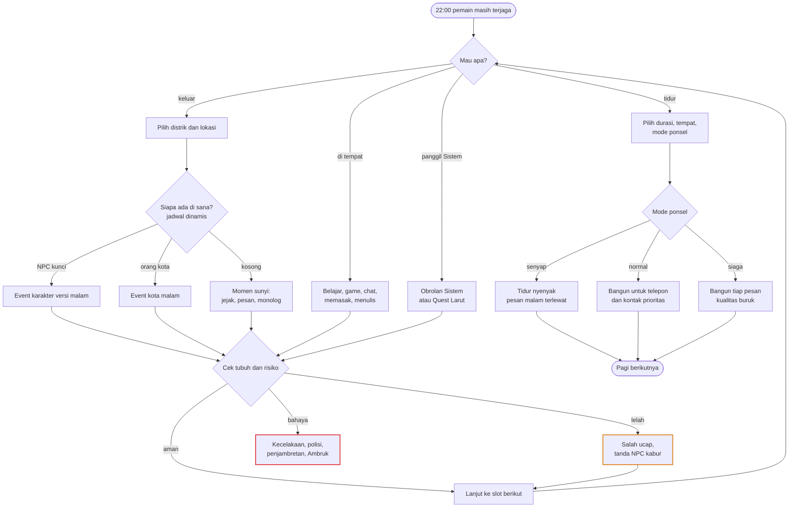
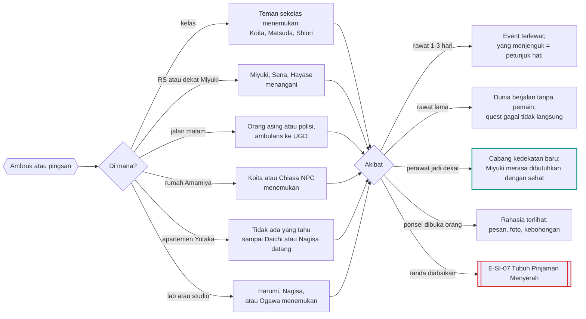
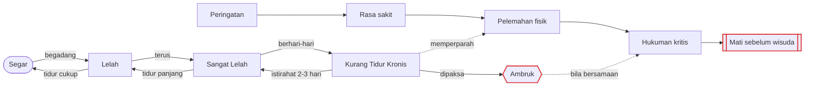

# Sistem Waktu Bebas, Malam, dan Kondisi Fisik

Status: arah ⭐ dari keputusanmu (10 November 2026), dasar ✅ dari GDD dan Master Canon, detail 🟡 usulanku.
Dokumen ini adalah fondasi semua cabang "malam", "tidak tidur", dan "tubuh" di `docs/Alur_Cabang/`.

---

## 0. Keputusan dan dasar

**Keputusanmu ⭐**
- Jadwal tidak tetap. Tabel di [Jadwal_Harian_NPC.md](Jadwal_Harian_NPC.md) hanya **rutinitas dasar**.
- Pemain tidak wajib tidur.
- Keluar tengah malam pun bisa memicu kejadian.
- Begadang dan memaksa tubuh punya **konsekuensi fisik** pada host.
- Tujuannya: pemain tidak merasa dibatasi, karena cabang dan hasilnya sangat banyak.

**Dasar canon ✅**
- Waktu 24 jam yang terus berjalan; dialog memakan waktu; pemain memilih kapan tidur, tidak hanya malam (GDD 6E.1).
- Waktu berhenti saat pemain sedang memilih, lalu bergerak sesuai durasi tindakan (Master Canon §4).
- Tubuh host mempertahankan kondisi fisik, refleks, dan kebiasaan otot sederhana (Master Canon §2.1).
- Lapar, energi, dan kebersihan memengaruhi aktivitas. Tidur, istirahat, dan santai memulihkan energi dengan efektivitas berbeda. Biaya kesehatan berbeda per fasilitas (GDD Batch 20 #23, #30–#32, #39).
- Jadwal NPC bisa berubah mendadak karena kondisi, hubungan, cuaca, dan event (GDD 6D #10).
- Hukuman Sistem untuk pembangkangan sengaja: peringatan → rasa sakit → pelemahan fisik → hukuman kritis → kematian. Pemain bisa mati sebelum wisuda karena kondisi atau hukuman lain (Master Canon §6).

---

## 1. Prinsip kebebasan 🟡 (berlaku di semua dokumen cabang)

1. **Pilihan tidak dikunci UI.** Yang membatasi adalah dunia: orang menolak, pintu terkunci, uang habis, tubuh tumbang. Semua itu konsekuensi, bukan tombol abu-abu.
2. **Kondisi fisik tidak menyembunyikan pilihan.** Pilihan tetap muncul. Yang bergeser adalah hasilnya: salah ucap, nada salah, lupa janji, salah membaca orang.
3. **Dunia berjalan tanpa pemain.** Setiap event punya hasil "pemain tidak ada" (✅ 6E.4: event terlewat tetap berlangsung).
4. **Tidak ada malam yang kosong.** Keluar jam berapa pun minimal memicu satu adegan kecil dengan pilihan (lihat §6).
5. **Gagal adalah cabang.** Ditolak, ketahuan, sakit, dan dipenjara membuka jalur baru, bukan layar Game Over (kecuali kematian).
6. **Konsekuensi tertunda.** Pilihan Tahun 1 bisa muncul lagi di Tahun 3 (✅ 6H: NPC mengingat).
7. **Informasi tidak lengkap.** Angka hubungan tersembunyi (✅ 6C.4). Kelelahan bahkan mengaburkan petunjuk yang biasanya terlihat.
8. **Setiap NPC punya agenda.** Pengejar sepihak, Koita, dan Shiori bergerak sendiri. Bila pemain diam, mereka yang menang.
9. **Keluar dari naskah selalu mungkin.** Bolos setahun, berhenti kuliah, pergi ke luar kota, mengaku pada semua orang, membongkar Sistem. Semuanya punya cabang.
10. **Tidak ada rute benar.** Tidak ada True Ending (✅ 6H).

---

## 2. Waktu

### 2.1 Enam slot 🟡
Slot adalah label untuk jadwal dan event. Jam tetap berjalan per menit.

| Slot | Jam | Catatan |
|---|---|---|
| Pagi | 06–10 | bangun, sarapan, berangkat |
| Siang | 10–14 | kuliah/kerja, makan siang |
| Sore | 14–18 | klub, lab, studio, part-time |
| Malam | 18–22 | makan malam, sosial, kencan |
| Larut | 22–02 | belajar, game, chat, pesta, lembur |
| **Dini Hari** (baru) | 02–06 | insomnia, krisis, konbini, kereta pertama 05:00, pasar subuh |

### 2.2 AP diambil dari tenaga tubuh ⭐ (disetujui)
GDD 6E.6 meminta waktu dan AP tidak terasa seperti pembatas ganda. Usulku: **AP bukan kuota harian terpisah, tetapi tenaga yang ditarik dari Energi.**
- Setiap aksi memakai waktu dan Energi. Tidak ada "AP habis, silakan tidur".
- Saat Energi nol, pemain tetap bisa beraksi dalam mode **Memaksa**: kesehatan turun, peluang salah naik, dan risiko Ambruk menumpuk.
- Ini membuat "tidak tidur" menjadi pilihan nyata yang ada harganya.

| Aksi | Waktu | Tenaga |
|---|---|---|
| Kuliah satu sesi | 90 menit | sedang |
| Shift kerja | 3–5 jam | besar |
| Kencan | 2–4 jam | sedang |
| Chat panjang | 15–60 menit | kecil |
| Begadang mengerjakan maket/tugas | 3–6 jam | besar |
| Jalan kaki keliling distrik | 30–60 menit | kecil |
| Bertengkar/konfrontasi | 20–60 menit | besar (mental) |

### 2.3 Timeskip
Timeskip (✅ 6N.1) berhenti otomatis bila: telepon atau pesan prioritas masuk, NPC datang ke tempat pemain, quest darurat Sistem muncul, krisis karakter terjadi, atau tubuh memberi sinyal bahaya. Pilihan "lewati sampai pagi" tetap ada, dengan risiko melewatkan kejadian malam.

---

## 3. Tidur adalah pilihan

### 3.1 Cara tidur 🟡
- **Durasi bebas:** tidur siang 20 menit, satu siklus 90 menit, tidur penuh 6–8 jam, tidur panjang 10 jam ke atas.
- **Tempat:** kamar sendiri (terbaik), rumah orang (butuh izin, membuka cabang kedekatan atau rumor), perpustakaan (diusir saat tutup), kereta (bisa kebablasan sampai stasiun terakhir), kafe atau net cafe (bayar), ruang klub atau studio (satpam), UGD (setelah Ambruk).
- **Mode ponsel** (tombol cepat di layar tidur):
  - **Senyap:** tidur paling nyenyak, semua pesan malam terlewat.
  - **Normal:** hanya telepon dan **kontak prioritas** yang membangunkan; kualitas tidur sedikit turun.
  - **Siaga:** semua pesan membangunkan; kualitas tidur buruk.
  - Pemain bisa menandai kontak prioritas. Ini cara mengantisipasi krisis seperti Mo25 tanpa harus begadang.
- **Sistem NTR tidak terikat mode ponsel.** Ia ada di kepala pemain dan bisa membangunkan untuk quest darurat: "Bangun, Host. Ada yang menarik."

### 3.2 Kualitas tidur
| Faktor | Efek |
|---|---|
| Tempat dan kebisingan | kamar sendiri terbaik; kereta dan kafe terburuk |
| Stres dan rasa bersalah | mimpi buruk; tidur terputus |
| Kafein setelah Sore | sulit tidur, kualitas turun |
| Alkohol | cepat tertidur, kualitas buruk, hangover |
| Rasa sakit dari hukuman Sistem | bangun berkali-kali |
| Cuaca | malam musim panas yang gerah dan malam musim dingin yang beku menurunkan kualitas tanpa AC/pemanas |
| Tidur bersama seseorang | teks dewasa tersirat tanpa ilustrasi; bisa menenangkan atau menegangkan, tergantung hubungan |

### 3.3 Ritme tubuh host 🟡 (dari kebiasaan otot yang diwarisi ✅)
- **Yutaka:** tubuhnya terbiasa tidur sekitar 02:00–10:00 (game online, kuliah siang). Stamina tinggi, tubuh atletis, toleransi alkohol sedang–tinggi (kerja di kafe bar). Bangun pagi di minggu-minggu awal terasa berat.
- **Chiasa:** tubuhnya terbiasa tidur sekitar 01:00–08:00 (menggambar malam). Stamina fisik lebih rendah, tetapi tahan begadang yang tenang. ⭐ **Siklus bulanan dipakai:** 3–5 hari per bulan energi turun dan ada nyeri; obat apotek meredakan sebagian; pilihan "minta izin" muncul; NPC bereaksi (Haruka membawa minuman hangat, Yoshie menelepon, Koita canggung tetapi membantu). Ditulis sebagai bagian dari hidup, bukan bahan lelucon. Event: C-D04 di [06_Chiasa.md](Alur_Cabang/06_Chiasa.md).
- Mengubah ritme butuh 1–2 minggu konsisten. Sebelum itu, bangun di luar ritme berarti mulai hari dengan Energi lebih rendah.

### 3.4 Bangun otomatis
Pemain terbangun karena alarm, telepon atau pesan sesuai mode, ketukan pintu (NPC datang), lapar berat, mimpi buruk, rasa sakit, atau Sistem. Terjaga terlalu lama memicu **microsleep**: pemain tertidur di tempat (kelas, kereta, saat percakapan). Lokasinya menentukan cabang berikutnya.

---

## 4. Kondisi fisik host

### 4.1 Variabel 🟡
Ditampilkan di menu status (✅ 6L.3 menampilkan "kondisi pemain") sebagai **kata dan gejala**, bukan angka: "Lelah", "Mata merah", "Demam ringan", "Tangan gemetar".

| Variabel | Arti | Naik karena | Turun karena |
|---|---|---|---|
| `energi` | tenaga jangka pendek | tidur, makan, istirahat, santai | semua aksi |
| `utang_tidur` | akumulasi kurang tidur | begadang, tidur buruk | tidur panjang beberapa hari |
| `lapar` (✅ #30) | kebutuhan makan | waktu, aktivitas fisik | makan, memasak |
| `kebersihan` (✅ #32) | badan dan pakaian | mandi, ganti baju | aktivitas, cuaca panas, tidak pulang |
| `kesehatan` | daya tahan | tidur cukup, makan teratur | utang tidur, cuaca, tertular |
| `sakit` | status penyakit | tertular, daya tahan rendah | istirahat, obat, klinik |
| `cedera` | luka fisik | perkelahian, kecelakaan, olahraga | perawatan, waktu |
| `stres_host` | beban mental pemain | quest, kebohongan, rasa bersalah, hukuman | bicara jujur, istirahat, konseling |
| `kafein` / `alkohol` | zat dalam tubuh | kopi, minuman energi, minum | waktu |
| `nyeri_sistem` | tahap hukuman Sistem | pembangkangan sengaja | kepatuhan, waktu |
| `penampilan` (turunan) | kantung mata, pucat, berat turun | gabungan variabel di atas | pulih |

### 4.2 Tangga kurang tidur
| Tingkat | Kira-kira | Hasil pilihan | Persepsi | Tubuh | Yang disadari NPC |
|---|---|---|---|---|---|
| **Segar** | tidur cukup | normal | semua tanda NPC terlihat | normal | — |
| **Lelah** | 1 malam kurang | sesekali salah nada | tanda halus kadang terlewat | konsentrasi turun | teman dekat bertanya "kurang tidur?" |
| **Sangat Lelah** | 2 malam atau 24 jam terjaga | salah ucap, lupa janji kecil | ekspresi NPC sering tidak dideskripsikan | refleks lambat, mudah sakit | Miyuki/Sena mendiagnosis, Nagisa mengomel, Koita curiga |
| **Kurang Tidur Kronis** | utang tidur berhari-hari | keputusan impulsif lebih sering muncul sebagai hasil | narasi tanda bahaya NPC kabur total | microsleep, daya tahan anjlok, kecelakaan | keluarga (video call Daisuke/Yoshie), dosen, atasan kerja |
| **Ambruk** | dipaksa terus | adegan diambil alih tubuh | — | pingsan; lihat §7.2 | siapa pun yang menemukan |

**Aturan penting:** kelelahan memotong **lapisan informasi**, inti game ini. Contoh: saat Segar, narasi menulis "Moeka tertawa, tapi jarinya meremas ujung lengan baju". Saat Sangat Lelah, narasi hanya menulis "Moeka tertawa." Pemain yang tidak tidur kehilangan petunjuk yang menyelamatkan nyawa.

### 4.3 Lapar, kebersihan, dan zat
- **Lapar:** melewatkan makan menurunkan konsentrasi (✅ #30); dua hari tanpa makan cukup memicu pingsan. Pemain bisa memasak (✅ #41), yang sekaligus membuka cabang hadiah bento.
- **Kebersihan:** tidak pulang dua hari membuat NPC bereaksi (✅ #32). Nagisa blak-blakan, Shiori mencatat diam-diam, Miyuki menawarkan handuk.
- **Kafein dan minuman energi:** menambah tenaga 2–4 jam, lalu "jatuh". Toleransi naik bila sering. Membuat Dini Hari terasa mungkin, tetapi tidur sesudahnya buruk.
- **Alkohol:** pelumas sosial di hub berisiko tinggi (M02, M05b, M17b, M29b). Risiko keputusan buruk, rumor dan foto (Kurosawa Mei), hangover, dan kecelakaan pulang malam.

### 4.4 Sakit dan cedera
- **Sakit:** flu, demam, maag, sakit perut, sengatan panas di musim panas, influenza di musim dingin. Pemicu: daya tahan rendah karena utang tidur, cuaca, tertular NPC (Moeka yang batuk tapi tetap kerja, pasien di RS tempat Miyuki praktik).
- **Akibat:** 1–7 hari di tempat tidur, event terlewat, quest gagal tidak langsung.
- **Cabang menjenguk:** siapa yang datang saat pemain sakit adalah **petunjuk hati tersembunyi**. Yang datang tanpa diminta biasanya punya Affection atau rasa bersalah tinggi. Nagisa membawa bubur gosong, Miyuki membawa termometer, Koita membawa manga, Shiori mengirim buah lewat Kuroiwa, Moeka datang lalu tertidur di kursi.
- **Cedera:** dari perkelahian, kecelakaan malam, tangga saat Sangat Lelah, olahraga. Biaya perawatan: klinik murah, RS sedang, UGD mahal (✅ #39).

### 4.5 Akademik, kerja, ekonomi
- Absen dan tertidur di kelas menurunkan nilai; nilai buruk membuka cabang skorsing akademik (✅ Y04).
- Terlambat atau bolos kerja memengaruhi gaji dan risiko dipecat (✅ #29).
- Taksi saat kereta terakhir lewat itu mahal (✅ #38). Uang yang habis membatasi pilihan dunia (✅ #33), bukan tombol.

### 4.6 Hukuman Sistem pada tubuh ✅ (detail 🟡)
| Tahap ✅ | Wujud fisik 🟡 | Bila tubuh sudah Kurang Tidur Kronis |
|---|---|---|
| Peringatan | notifikasi merah, dengung di telinga | sama |
| Rasa sakit | sakit kepala menusuk 1–6 jam | pemain pingsan di tempat |
| Pelemahan fisik | penglihatan buram, tangan gemetar, aksi lebih lama | Ambruk dalam 1–2 hari |
| Hukuman kritis | tubuh lumpuh sementara, dirawat | **risiko kematian** |
| Kematian | — | — |

Sistem membedakan kegagalan tulus dari pembangkangan (✅). Kelelahan karena berusaha keras tidak dihukum, tetapi tubuh yang lemah membuat hukuman apa pun jauh lebih berbahaya.

### 4.7 Mati karena tubuh 🟡
Hardcore, tetapi tidak pernah tiba-tiba. Selalu ada minimal dua tanda sebelumnya: gejala tubuh, NPC yang khawatir, dan komentar Sistem yang berhenti bercanda.
- Ambruk lalu kecelakaan di jalan malam.
- Hukuman kritis saat tubuh sudah Ambruk.
- Penyakit yang diabaikan berminggu-minggu (radang paru dari flu yang dipaksa kerja).

Kode ending: lihat `E-SI-*` di [10_Sistem_dan_Evaluasi.md](Alur_Cabang/10_Sistem_dan_Evaluasi.md).

---

## 5. Jadwal NPC dinamis ⭐ (detail 🟡)

### 5.1 Sembilan lapis pembentuk jadwal harian
Setiap pagi game menyusun posisi NPC dari lapisan ini, berurutan:
1. **Rutinitas dasar:** tabel hari kerja, akhir pekan, libur.
2. **Kalender:** minggu ujian, festival, libur nasional, tenggat studio, rotasi klinik.
3. **Cuaca:** hujan memindahkan aktivitas ke dalam; badai menutup kampus (✅ 6D).
4. **Kondisi NPC:** sakit, lelah, suasana hati, dan **tahap rute** (Moeka tahap 3 bolos kuliah).
5. **Hubungan dan agenda:** mencari atau menghindari pemain dan Koita, sesuai Affection, Fear, dan Jealousy. Tujuan pribadi (Hayase ke RS di akhir pekan demi Miyuki).
6. **Reaksi terhadap kejadian:** setelah bertengkar, NPC menghindari tempat biasa; setelah rumor, ia menjauhi kantin; setelah pengakuan cinta, ia mengganti jalan pulang.
7. **Janji:** janji dengan pemain atau NPC lain; bisa dilanggar sesuai watak (✅ 6D.2).
8. **Interaksi antar NPC:** Koita mengajak Nagisa, jadi keduanya mengubah rencana. Plot armor menaruh Koita di tempat heroine berada.
9. **Variasi acak berbobot:** penyimpangan kecil harian sesuai watak (tabel 5.2).

### 5.2 Watak jadwal
| Karakter | Keteraturan | Penyimpangan harian | Catatan |
|---|---|---|---|
| Shiori | sangat teratur | ~5% | penyimpangannya selalu berarti sesuatu |
| Harumi | teratur | ~8% | tahap 4+ membuatnya pulang pagi |
| Miyuki | teratur, lembur | ~10% | tahap 2+ hampir selalu pulang tengah malam |
| Koita | santai teratur | ~12% | `koita_sadar` 2+ membuatnya muncul di dekat pemain |
| Nagisa | sedang | ~15% | tahap 3+ mengikuti pemain |
| Yutaka (NPC) | longgar | ~20% | menghilang beberapa hari saat cemburu |
| Chiasa (NPC) | longgar, nokturnal | ~20% | proyek ilustrasi mengacaukan jam |
| Moeka | kacau | ~30% | janji paling sering terlupa (✅) |

### 5.3 Pemicu perubahan mendadak
Sakit; urusan keluarga (ayah Moeka cuci darah, orang tua Amamiya pulang mendadak ✅); tenggat; rumor; pertengkaran; pesan pemain; undangan; cuaca; event kota; quest Sistem yang menggeser seseorang secara tidak langsung.

### 5.4 Jejak: cara pemain melacak NPC (✅ jadwal tidak ditampilkan)
Unggahan media sosial dan story; pesan grup; ucapan teman ("tadi lihat Harumi di lab"); rumor Kurosawa Mei; lampu kamar yang menyala; sepeda yang terparkir; struk dan barang; informasi terbatas Sistem. Jurnal mencatat **pola** setelah pemain mengamati berulang ("Harumi biasanya di lab sampai 00:30 di hari kerja"), tetapi pola bisa pecah kapan saja.

### 5.5 Siapa yang terjaga di malam hari
| NPC | Larut 22–02 | Dini Hari 02–06 |
|---|---|---|
| Koita | menulis di kamar sampai 01:00 | jarang; terjaga bila panik (`koita_sadar` 2+) |
| Chiasa (NPC) | menggambar sampai 01:00 | proyek tenggat |
| Yutaka (NPC) | game online sampai 02:00 | jarang |
| Miyuki | belajar sampai 01:00; Tahun 3 jaga malam RS | jaga malam; insomnia tahap 4+ |
| Nagisa | game; studio saat tenggat | tahap 3+: pesan beruntun, berdiri di luar tempat pemain |
| Harumi | lab sampai 00:30 | tahap 4+: belum pulang |
| Moeka | menjahit, scroll media sosial | tahap 2+: insomnia, konbini jam 03:00, Mo25 |
| Shiori | belajar, shogi online | jarang; tahap 4+ menyusun bukti |
| Ogawa | lab larut | — |
| Hanabusa | patroli | patroli |
| Ito | — | pasar subuh 04:00 |

---

## 6. Malam dan dini hari: selalu bisa ada sesuatu ⭐

### 6.1 Cara event malam ditentukan 🟡
1. Pemain tiba di lokasi pada jam tertentu.
2. Game mengecek NPC yang ada di sana menurut jadwal dinamis.
3. Event karakter versi malam yang cocok (tabel 6.3).
4. Event kota malam (tabel 6.2).
5. Quest Larut Sistem (6.4).
6. Risiko: kelelahan, cuaca, alkohol, lokasi (6.5).
7. Bila semuanya kosong: **momen sunyi**. Monolog, menemukan jejak seseorang, pesan yang tiba-tiba masuk, atau Sistem yang mengajak bicara. Tetap ada pilihan kecil yang menggeser sesuatu.

### 6.2 Malam per distrik 🟡
| Distrik / lokasi | Siapa mungkin ada | Kejadian mungkin | Risiko |
|---|---|---|---|
| **D1 Studio Arsitektur** (24 jam saat tenggat) | Nagisa, Mochizuki | membantu maket semalaman; Nagisa tertidur di meja; foto berdua tersebar | rumor, utang tidur |
| **D1 Lab Sains** | Harumi, Ogawa | menemukan Harumi sendirian dengan Ogawa setelah Mizuhara pulang 19:00; log pintu lab sebagai bukti | konfrontasi, Ogawa membalas |
| **D1 Ruang belajar 24 jam** (musim ujian) | Miyuki, Harumi, Koita | belajar bersama; tertidur bersebelahan | rumor ringan |
| **D1 Asrama Putri** (jam malam 23:00) | Harumi, Ogiwara | menyelinap masuk/keluar; Harumi pulang pagi | Ogiwara mencatat, larangan masuk |
| **D1 Ruang BEM** (malam sebelum acara) | Moeka, Fujisawa | lembur dekorasi; Moeka tertidur kelelahan | Fujisawa menilai pemain |
| **D1 Atap dan taman kampus** | siapa pun, satpam | janji temu rahasia; satpam mengusir | dicatat satpam |
| **D2 Konbini 24 jam** | Moeka (03:00), Koita, Nagisa, Ren | pertemuan acak paling sering di game | rendah |
| **D2 Taman lingkungan** (ayunan geng masa kecil) | Nagisa, Koita, Chiasa | kenangan; curhat; pengakuan | rendah |
| **D2 Rumah Amamiya** | Koita, Chiasa | dapur 02:00; Koita menulis; orang tua pulang tengah malam | ketahuan keluarga |
| **D2 Depan rumah Sakurajima** | Haruto (pulang lembur) | Haruto menanyai pemain | Haruto curiga |
| **D2 Kos Moeka** | Moeka | lampu menyala jam 03:00; suara mesin jahit; lokasi Mo25 | krisis |
| **D3 Apartemen Yutaka** | host atau Yutaka NPC, tamu | Nagisa main game sampai larut; Daichi menumpang; Koita datang tengah malam setelah bertengkar | rumor, cabang BL |
| **D3 Rumah Saionji** | Shiori, Kuroiwa | shogi online anonim (cabang akun anonim); Kuroiwa menghadang tamu malam | masuk tanpa izin = kriminal ringan |
| **D3 Apartemen Miyuki** | Miyuki | pulang hampir tengah malam; butuh undangan | rumor |
| **D4 Karaoke/arcade 24 jam** | Moeka, Rina, Nagisa | karaoke sampai pagi; rematch arcade | uang, utang tidur |
| **D4 Bar, izakaya, kafe bar** | Yutaka (Jumat), Hayase, Tojo, Mei | orang mabuk bicara jujur; Mei merekam | alkohol, foto |
| **D4 Studio foto Kuga** | Moeka, Kuga | pemotretan malam yang ambigu | jalur Kuga |
| **D4 Jalan pusat kota** | orang asing | penjambretan, salaryman mabuk, pengamen | cedera, kehilangan barang (✅ #61 hanya lewat event) |
| **D5 Stasiun** (terakhir 00:30, pertama 05:00) | siapa pun | ketinggalan kereta; menunggu pagi bersama seseorang; taksi mahal | uang |
| **D5 Net cafe** | Moeka (kabur dari kos, tahap 3) | menemukan orang yang menghilang | — |
| **D5 Pos polisi** | Hanabusa | ditanyai karena lusuh atau mabuk; catatan polisi bisa muncul lagi | catatan |
| **D5 Pasar subuh** (04:00) | Ito | membantu belanja kafe; tawaran kerja pagi | — |
| **D6 RS Tachibana** | Miyuki (jaga malam T3), Hayase, Sena, keluarga Kohinata (cuci darah Shuji 🟡) | UGD; Miyuki tahu kondisi ayah Moeka lebih dulu (rahasia medis) | pertemuan keluarga |
| **D7 Kuil** | — / semua (Hatsumode 00:00) | doa tengah malam; omikuji malam tahun baru | rendah |
| **D7 Tepi sungai, pantai** | Koita, Moeka, siapa pun | merenung; matahari terbit setelah begadang | dingin, kelelahan |

### 6.3 Versi malam event karakter 🟡
| Karakter | Versi malam yang bisa terjadi |
|---|---|
| Koita | K16 telepon larut; Koita menulis dan membiarkan pemain membaca draf; Koita datang ke apartemen Yutaka setelah heroine menjauh |
| Chiasa (NPC) | menggambar di ruang tamu jam 02:00; Chiasa menangis diam-diam setelah Koita menggantungnya |
| Yutaka (NPC) | panggilan game jam 01:00; jujur saat lelah |
| Miyuki | membawakan makanan jam 01:00 (Mi03); jaga malam; menangis di tangga darurat RS (tahap 4) |
| Nagisa | pesan beruntun; berdiri di luar (tahap 3+); Koko ditinggal di depan pintu (N23) |
| Harumi | teh tengah malam di dapur asrama; pulang pagi (tahap 4+); pesan berisi "data" |
| Moeka | konbini 03:00; panggilan yang dibatalkan sebelum tersambung; Mo25 |
| Shiori | lawan shogi online anonim; jalan malam dengan Kuroiwa di belakang |

### 6.4 Quest Larut Sistem 🟡
Contoh: "Koita sedang menelepon Nagisa. 40 menit." / "Ada yang menunggumu di konbini. Aku tidak bilang siapa." / "Kau sudah 31 jam terjaga. Aku penasaran berapa lama lagi." Quest larut punya hadiah besar dan risiko tubuh besar.

### 6.5 Bahaya malam 🟡
| Bahaya | Pemicu | Akibat |
|---|---|---|
| Kecelakaan | Sangat Lelah + bersepeda/menyeberang malam | cedera, UGD, kematian bila Ambruk |
| Penjambretan | jalan sepi D4/D5 setelah 01:00 | kehilangan barang/uang lewat event; melawan = cedera |
| Ditanyai polisi | lusuh, mabuk, berkeliaran di dekat rumah orang | catatan polisi; muncul lagi bila ada kasus |
| Mabuk | alkohol di hub sosial | keputusan buruk, foto Mei, hangover |
| Ketinggalan kereta | lewat 00:30 | taksi mahal atau menunggu sampai 05:00 |
| Dingin/gerah ekstrem | musim | sakit |

---

## 7. Diagram

### 7.1 Satu malam

### 7.2 Ambruk

### 7.3 Tangga tubuh dan hukuman Sistem

---

## 8. Tiga contoh rangkaian 🟡

**A. Malam sebelum Mo25 (M34).** Pemain tahu Moeka sedang buruk. Pilihannya: begadang (tubuh Sangat Lelah besok saat ujian), tidur dengan mode Normal dan Moeka sebagai kontak prioritas (aman bila Moeka menelepon, tetapi Moeka cenderung mengirim pesan, bukan menelepon), mode Siaga (tidur buruk, tapi pasti bangun), atau meminta Rina menginap di kos Moeka. Setiap pilihan mengubah hasil Mo25, dan tidak satu pun gratis.

**B. Tiga malam untuk maket Nagisa (N03 A).** Nagisa masuk tahap 1 (terima kasih), tetapi pemain Sangat Lelah saat kuis Y04, gagal, dan tertidur di kelas. Shiori melihatnya dan mencatat. Daichi menawarkan contekan. Satu kebaikan melahirkan tiga cabang baru.

**C. Konbini 03:00, Tahun 2.** Pemain keluar membeli minuman dan bertemu Koita yang tidak bisa tidur karena merasa heroine menjauh. Koita bicara lebih jujur saat lelah. Pemain bisa mendengarkan (Trust Koita naik), memancing informasi, atau memanfaatkan kerapuhannya. Di Male Route ini juga benih Rute BL.

---

## 9. Variabel baru untuk registry flag 🟡
`energi`, `utang_tidur`, `lapar`, `kebersihan`, `kesehatan`, `sakit_status`, `cedera`, `stres_host`, `kafein`, `alkohol`, `nyeri_sistem`, `mode_ponsel`, `kontak_prioritas[]`, `ritme_host`, `catatan_polisi`, `pola_diketahui[npc]`, `penjenguk[]`.

## 10. Yang masih terbuka ❓
- ~~❓ AP diambil dari Energi (§2.2)~~ ⭐ disetujui.
- ~~❓ Siklus bulanan Chiasa (§3.3)~~ ⭐ dipakai.
- ❓ Seberapa sering kematian karena tubuh boleh terjadi pada pemain yang ceroboh: jarang (perlu kecerobohan berminggu-minggu) atau cukup sering?
